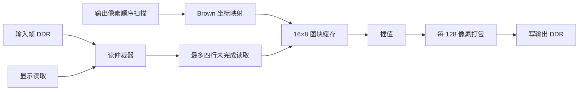

# 720p60 畸变矫正吞吐率分析

_更新于 2026-10-24。帧率来自实板 Fabric Debugger；周期计数来自最近完成帧的快照。_

## 1. 当前结论

- 工程清理后，`fpga/project/` 下 Stage 6/7 只保留两个工程：Stage 6 的 `stage6_radial_ddr` 和 Stage 7 的 `stage7_write_overlap_16x8`。前者保留为径向畸变矫正参考，后者作为当前吞吐优化主线；已删除的诊断副本和中间候选只在本文留下历史测量记录。清理核对见第 14 节。
- 周期分解版曾测得 59.83 fps；最新 **60 秒入口诊断实测约 60.05 fps**：原始输入、完整发布、处理完成和显示取新帧各增加 3,603 帧，拒收、中止和 READY 覆盖均未在窗口内增长，入口排空最长 9 周期、槽位等待最长 0 周期。该数据来自现已清理的入口诊断副本，其处理数据通路与保留的[写入重叠功能工程](../../fpga/project/stage7_write_overlap_16x8/README.md)一致。先前单次测到的 37 帧发布差值未复现，按帧率波动记录；详见第 13 节。
- 为给后续旋转映射和插值方式留处理余量，已从周期分解版派生独立的 [输出写入重叠候选](../../fpga/project/stage7_write_overlap_16x8/README.md)。双 128 像素突发缓冲允许收集下一突发时写出上一突发；定向、完整 720p 和故障仿真已通过，PDS 完整布线和已约束路径时序也已通过。实板最近完成帧降至 **1,849,511 周期（14.796 ms）**，比旧版减少 235,090 周期；在该版的一次 60 秒测量窗口中，原始输入 +3,604、完整发布 +3,567、处理完成 +3,566。该窗口曾显示约 37 帧发布差值，但后续入口诊断版没有复现，现按帧率波动记录；详见第 11、13 节。
- 为进一步观察入口计数，曾从写入重叠功能工程构建入口诊断副本，加入拒收、中止、采集写排空最长周期和采集槽等待最长周期。该副本完整布线并通过约束检查，DDR 125 MHz 慢角 slack +0.123 ns；60 秒实测各级帧数均增加 3,603。诊断副本及其位流/FIC 已随工程清理删除，哈希和上板读数保留在第 12、13 节。
- 上述周期分解版最近完成帧为 **2,084,601 个 125 MHz 周期（16.677 ms）**，比 60 fps 的约 2,083,333 周期预算多约 **1,268 周期（0.010 ms）**。其中 921,600 周期提交像素坐标、856,771 周期坐标阻塞、306,193 周期输出写阶段、37 周期其他帧首尾开销；输出写阶段包含 183,793 周期 DDR 写背压。单帧快照不能单独解释 60 秒累计丢掉的 10 帧，也不能据此计算平均帧间空档。
- 此前 Stage 7 16×8 帧间节奏诊断版在约 61 秒增加 3,602 帧处理完成及显示取新帧，按日志约 59.05 fps；最近完成帧为 2,091,600 周期、最长为 2,094,173 周期，最长已完成帧间空档为 15,520 周期。该版位流 SHA-256 为 `F3DE51007A79F2CF77D02E79F1A79FD3D15C95F3597D91E7AACEDEE12E9ABED6`；完整计数见第 8 节。两版计数窗口、位流和输入条件并非严格受控 A/B，不能把吞吐差值归因于诊断计数器；该诊断工程现已清理。
- 此前 Stage 7 16×8 四行并发读取版的 60 秒实测为 47.95 fps，最近完成帧为 2,602,738 周期；相关历史测量保留在[读流水实验记录](../results/stage7-read-pipeline.md)，工程目录现已清理。
- 此前建立过 Stage 7 周期分解诊断副本，只增加输出写阶段周期计数并重配 FIC 观测点。PDS 已完整布线并满足已约束路径时序，实板计数见第 9 节；诊断工程目录现已清理。
- 此前建立过 Stage 7 帧间 LRU 复位候选，通过五帧 RTL 比对、完整布线和时序。实板测得缓存未命中稳定为 **8,229 次/帧**、最近完成帧 **2,091,487 周期**，验证了替换状态复位可减少回填；其 60 秒窗口仅增加 **2,737 帧（45.62 fps）**，后续诊断版的高帧率测量说明该单次低值不能作为持续吞吐结论。工程目录现已清理，详细历史记录见第 6 节。
- 用户此前补充：LRU 复位版画面会“丝滑一段，突然卡一下”。节奏诊断工程现已有实板计数，详见第 8 节；本次数据证实约 61 秒内有 10 张 READY 输入帧被覆盖，尚无逐次丢帧时间戳，不能把每次可见卡顿与某次覆盖一一对应。
- 此前试过 Stage 7 32×8 缓存候选，定向仿真、综合和布局通过，但布线在第 59 轮仍有 6,332 条连接未布通，之后停止；没有完成布线、最终时序或可烧录位流，也没有 32×8 实板帧率。候选工程已清理。

这里的“显示帧率”指显示端取得**新处理帧**的速率，不等同于 HDMI 的 60 Hz 扫描刷新率。

## 2. 实测进展

| 工程与阶段 | 输入发布 | 处理完成／显示取新帧 | 输入丢帧 | 说明 |
| --- | ---: | ---: | ---: | --- |
| Stage 5 单位映射 | 59.80 fps | 29.11 fps | 30.69 帧/秒 | 早期基线；见 [Stage 5 记录](../results/stage5-fps-diagnostic.md) |
| Stage 6 Brown 试值 | 59.39 fps | 21.28 fps | 38.10 帧/秒 | 早期基线；见 [Stage 6 记录](../results/stage6-radial-fps-diagnostic.md) |
| Stage 7 16×8 缓存，串行行读取 | 60.25 fps | 31.28 fps | 28.97 帧/秒 | 见 [缓存实验记录](../results/stage7-cache-throughput-profile.md) |
| Stage 7 16×8，四行并发读取修复版 | 59.85 fps | 47.95 fps | 11.90 帧/秒 | 历史基线；见下节 |
| Stage 7 16×8，帧间 LRU 复位候选 | 45.62 fps | 45.62 fps | 0 帧/秒 | 仅表示 READY 帧未被覆盖；原始输入帧率及采集入口跳帧尚未测量 |
| Stage 7 16×8，节奏诊断版 | 约 59.21 fps | **约 59.05 fps** | 约 0.16 帧/秒 | 13:55:56 至 13:56:57 的秒级日志约 61 秒；完整计数见第 8 节 |
| Stage 7 16×8，周期分解版 | 60.00 fps | **处理完成约 59.83 fps**；显示未测 | 约 0.17 帧/秒 | 14:40:25 至 14:41:25 的日志相隔 60 秒；完整计数见第 9 节 |
| Stage 7 16×8，写入重叠版 | 约 59.45 fps，原始输入约 60.07 fps | 处理约 59.43 fps；显示约 59.45 fps | READY 覆盖 0，入口未发布约 0.62 帧/秒 | 15:21:33 至 15:22:33 的历史窗口；入口差值后续未复现，见第 11、13 节 |
| Stage 7 16×8，入口诊断副本（已清理） | 约 60.05 fps | **处理／显示各约 60.05 fps** | 本窗口 0 | 16:03:33 至 16:04:33，各级计数均 +3,603；拒收和中止无增长；数据通路与保留工程一致，见第 13 节 |

这些测量来自不同日期、位流和输入场景，可用于观察开发进展，不能把相邻两行的差值直接归因于单个 RTL 改动。Stage 5/6 的快照间隔为 61 秒，当前 Stage 7 为 60 秒。持续帧率包含帧间调度；单帧活跃周期不能直接代替持续帧率。

## 3. 此前四行并发版：Stage 7 16×8 实板证据

修复版在 19:44:04 和 19:45:04 采样，间隔 60 秒。帧数为累计计数，应取差值；性能计数是各次采样时最近完成帧的快照，不能取差值。

| 指标 | 起点 | 终点 | 结果 |
| --- | ---: | ---: | --- |
| 输入发布 | `0x1b82` | `0x2989` | 增加 3,591，59.85 fps |
| 处理完成／显示取新帧 | `0x1609` | `0x2146` | 均增加 2,877，47.95 fps |
| 输入丢帧 | `0x0577` | `0x0841` | 增加 714，11.90 帧/秒 |
| 错误标志 | `0x0000` | `0x0000` | 两次均未报错 |
| 最近完成帧周期 | `0x27b920` | `0x27b6f2` | 终点 2,602,738 周期 |
| 缓存回填次数／周期 | `0x3809`／`0x132767` | `0x3809`／`0x132a08` | 终点 14,345 次、1,255,944 周期 |
| 仲裁等待／`ARREADY` 等待 | `0xc3`／`0x2ce` | `0xbf`／`0x2ca` | 终点 191／714 周期 |
| DDR 读首拍／拍间等待 | `0xa5a5e`／0 | `0xa5ce8`／0 | 终点 679,144／0 周期 |

计数相互吻合：3,591 张输入帧 = 2,877 张完成帧 + 714 张丢弃帧。与中间的 [Stage 8 读等待诊断](../results/stage8-read-wait-profile.md)约 4,009,751 周期/帧、2,662,452 回填周期/帧相比，四行并发修复版两项各减少约 140.7 万周期。读首拍等待位于缓存回填窗口内，不能与回填周期直接相加；仲裁和 `ARREADY` 等待在该帧中很小。

一帧 1280×720 图像最多有 7,200 个互不相同的 32×4 源图块，实板的 14,345 次回填说明有重复载入。当前已确认这是缓存跨帧保留 LRU 顺序造成的；修复并复测后，再评估组冲突、替换策略和实际地址轨迹的剩余影响。单帧离线模型不能单独预测持续运行的帧率。

## 4. 暂停的 Stage 7 32×8 对照

新候选复制已修复的 16×8 工程，数据通路的功能性 RTL 变更是顶层 `CACHE_SET_COUNT: 16 → 32`，`CACHE_WAYS` 仍为 8；缓存容量从 64 KiB 增至 128 KiB。单图块回填和四笔未完成行读取与显示读取并行的定向仿真均通过。这只能说明对应测试情形正确，尚未证明整帧或实板工作正常。

| 构建指标 | 已验证 16×8 | 新候选 32×8 |
| --- | ---: | ---: |
| 综合 LUT | 22,018 | 34,888 |
| 综合 DRM | 26 | 42 |
| 详细布局结束最差裕量 | 最终布线时序满足 | −0.389 ns，尚非最终时序 |
| 布线／位流 | 完成；有可用位流 | 第 59 轮剩 6,332 条连接，构建已停止；无位流 |

32×8 的 LUT 比 16×8 多 12,870 个，约增加 58%；其中缓存模块从 13,692 增至 26,426 LUT，贡献了 12,734 个新增 LUT。数据 RAM 使用的 DRM 从 16 增至 32，增加的逻辑主要集中在缓存周围。缓存要并行查询四个邻域的标签，并按组、路更新有效位与 LRU 状态；综合阶段的一条关键路径从 `s2_missing_set[4]` 到 `valid_mem[0][0]`，组号信号扇出为 321。因此**缓存选择与元数据更新网络形成局部拥塞**是有依据的推断，尚无最终布线拥塞图证明。资源总量未超器件上限，但布线收敛缓慢且布局阶段时序尚未达标。此前另一版 32×8 工程也在第 78 轮仍有 4,602 条连接未布通并被中止；两次都是**未完成构建**，不能称已有最终布线失败或最终时序结论。

此前的 32×8 候选目录已按工程清理决定删除；该候选没有完成布线或生成位流。已推送到 GitHub `throughput-optimization` 分支的提交 `59cbd04` 包含当时最佳的 47.95 fps 版 16×8 工程、配套位流和本文件此前的测量记录；之后的诊断版测量结果保留在本文中。

## 5. 现有证据指向的停顿位置

| 位置 | 已确认的结构或计数 | 当前判断 |
| --- | --- | --- |
| [图块缓存](../../fpga/project/stage7_write_overlap_16x8/source/rtl/memory/pixel_tile_cache.sv) | 未命中时暂停后续查询，回填后重新查标签；历史实板曾测到 14,345 次回填、1,255,944 周期/帧 | 大的历史停顿窗口之一；回填周期与其他停顿可能重叠 |
| [行读取适配器](../../fpga/project/stage7_write_overlap_16x8/source/rtl/memory/tile_row_ddr_adapter.sv)与[仲裁器](../../fpga/project/stage7_write_overlap_16x8/source/rtl/memory/ddr_read_burst_arbiter.v) | 四行可并发；历史最近帧首拍等待 679,144 周期，仲裁 191、`ARREADY` 714、拍间 0 | 主要历史等待在已发出读请求后的响应首拍，而不是地址仲裁 |
| [当前帧处理引擎](../../fpga/project/stage7_write_overlap_16x8/source/rtl/memory/frame_identity_transform_engine.sv) | 双缓冲允许收集下一组像素时写出上一突发；每帧 7,200 个输出写突发 | 最新最近帧为 1,848,020 周期；坐标阻塞是当前诊断版最大单项计数，但仍需细分来源 |
| 帧所有权调度器 | 等待输入帧和输出槽位可用，再启动帧处理；具体历史诊断 RTL 已清理 | 最新 60 秒窗口四级帧计数同步增加，未显示持续帧间调度限制 |

## 6. 16×8 缓存回填问题与实板复测

**第一步：确认模型、当前工程 RTL 和实板计数差异；此项已完成。**相同的 1280×720 坐标轨迹在 Python 模型与 Stage 7 16×8 `pixel_tile_cache.sv` 中逐次比较，首帧的 8,229 条 miss 事件完全一致。随后连续重放 5 帧，只在帧间清除缓存有效位、保留 LRU 状态；RTL 与 Python 的 **63,316 条有序 miss 事件全部一致**，每帧结果为 **8,229、12,432、13,926、14,384、14,345**。第五帧精确复现了用户最新截图中的 14,345 次 miss。

原因已定位到帧间缓存初始化：`pixel_tile_cache.sv` 的逐组 invalidate 清除 `valid_mem`，但没有把 `lru_rank_mem` 恢复到初始顺序。首帧从复位态开始，得到 8,229 次 miss；后续帧沿用上一帧的替换顺序，逐渐升到稳定约 14.3k。用户已确认这批最新截图使用最新 `.sbit`，因此“烧录了旧位流”不再作为解释。模型和当前工程 RTL 逐事件吻合，且多帧 RTL 仿真精确重现实板计数，当前最有力的根因是**帧间未复位 LRU 状态**。

**第二步：帧间 LRU 复位候选，RTL 验证、位流构建和计数器实测已完成。**此前候选相对 47.95 fps 工程仅在 `pixel_tile_cache.sv` 中修改：逐组 invalidate 时清有效位并把每路 LRU rank 恢复到路号。修正前，要求帧间复位的五帧比较在第 2 帧第 79 次 miss 出现替换路不一致；修正后，RTL 五帧均为 **8,229 次 miss、191,982 个回填周期**，与模型的 **41,145 条有序 miss 事件全部一致**。PDS 已完整布线，最终时序报告为 `All Constraints Met`；DDR 时钟域慢角建立裕量 **+0.035 ns**，综合 LUT 为 **22,198**（原版 22,018）。候选 `.sbit` SHA-256 为 `4A6D40E2356F1D2EEFC67138D45955A298EAED8F04287D2A519A8AACCE18E1C4`，配套 `.fic` SHA-256 为 `AEEFDE091C2FAA48EE9E1AA5B4C9134740A586C893E7466AF1386B6A9F9EA031`。候选工程已清理，仿真、构建和实板数据留存在本节。

**第三步：2026-10-24 实板复测。**Fabric Debugger 在 10:39:29 和 10:40:29 各触发一次；累计计数取差值，性能计数读取终点最近完成帧快照：

| 指标 | 起点 | 终点 | 结果 |
| --- | ---: | ---: | --- |
| 输入发布 | `0x0c5c` | `0x170d` | 增加 2,737，45.62 fps |
| 处理完成／显示取新帧 | 均为 `0x0c5b` | 均为 `0x170c` | 各增加 2,737，45.62 fps |
| `capture_dropped_count`／错误标志 | 均为 0 | 均为 0 | READY 帧未被覆盖，未报告管线错误 |
| 最近完成帧周期 | `0x1fe580` | `0x1fe9df` | 终点 2,091,487 周期，约 16.732 ms（125 MHz） |
| 缓存未命中／回填周期 | `0x2025`／`0x0b18ac` | `0x2025`／`0x0b1d0b` | 终点 8,229 次／728,331 周期 |
| 读首拍等待 | `0x608b5` | `0x60d1b` | 终点 396,571 周期；拍间等待为 0 |

与原 16×8 修复版的最近完成帧比较，未命中减少 **6,116 次（42.6%）**，回填减少 **527,613 周期**，处理活跃期缩短 **511,251 周期（19.6%）**。但是 60 秒实际显示帧数反而少 140 帧。两次测量的输入发布速率分别是 59.85 和 45.62 fps，且输入条件是否相同尚未确认，因此不能把持续帧率下降直接归因于 LRU 修改。候选处理活跃期仅比 60 fps 的约 2,083,333 周期预算多 **8,154 周期（0.065 ms）**；按 60 秒完成 2,737 帧折算，平均完成间隔约 2,740,227 周期，其中约 648,740 周期/帧未包含在最近一次处理活跃期快照内。这是跨帧统计推算，不能直接当作已测得的调度空闲时间。

`input_published_count` 只在完整采集帧写入 DDR 并发布后增加；`capture_dropped_count` 实际来自 `capture_dropped_ready_count`，只统计发布新帧时被覆盖的 READY 帧。`capture_pixel_gate` 若在首个有效像素未获得许可，会跳过整帧；未完成采集帧也可能被 `capture_frame_admission` 中止。上述两类情况均不进入这张截图的“丢帧 0”。`perf_frame_cycles` 只计处理引擎非 IDLE 的周期，不含等待输入帧或输出槽位的时间。因此目前不能仅凭这组计数区分：原始输入已降到约 45.6 fps、入口跳帧／采集中止，或帧间调度等待。

下一轮先用第 7 节的新诊断工程定位为何发布速率只有 45.62 fps，以及卡顿时是处理活跃期还是帧间空档突增，再处理剩余约 8,154 周期的单帧活跃期缺口。之后可用**相同地址轨迹、相同 64 KiB 容量**比较组哈希、替换顺序和有界预取；以回填次数、回填周期和资源／时序筛选，并独立上板测持续帧率。

32×8 留作后续候选。若重新尝试，先比较现有精确 LRU 与代码已有的树形伪 LRU 选项，以及分级、寄存的组选择／元数据写使能，检查 LUT、布局裕量和未命中数后再决定是否完整布线；伪 LRU 可能减轻逻辑，也可能增加回填。旧的单帧离线模型中 32×8 比 16×8 少 2,097 次回填；按实板约 88 周期/回填粗估约省 18 万周期，小于尚缺的约 52 万周期。这个估算没有纳入帧间 LRU 状态，因此不能当作 32×8 持续运行收益预测。

实板图像内容尚未在这组 Fabric Debugger 截图中确认。后续采集新诊断计数时仍以约 60 秒窗口记录累计帧数差值；`perf_cache_miss_count` 等性能计数是最近完成帧的快照，应直接读数，不应跨截图相减。

## 7. 卡顿定位：Stage 7 16×8 帧间节奏诊断工程

用户补充的“丝滑一段，突然卡一下”说明要同时量化**平均吞吐**和**最长单帧／帧间停顿**。当时保留 LRU 复位、16×8 缓存、坐标映射及 DDR 数据通路，只增加观测计数；节奏诊断工程现已清理，实板记录仍见本节。

256 位 Fabric Debugger 通道重新分配如下；当时使用的 JTAG 说明文件随诊断工程清理，计数定义和读数顺序保留在本节及本文件第 8 节：

| 观测点 | 作用 |
| --- | --- |
| 原始输入 VSYNC、完整输入发布、处理完成、显示取新帧 | 60 秒累计差值区分输入、采集、处理和显示四级帧率 |
| 首个有效像素拒绝、采集中止、READY 帧覆盖 | 区分入口未接纳、写入不完整和已发布帧被覆盖；上一版的“丢帧 0”只覆盖最后一类 |
| 最近单帧处理周期、复位以来最长单帧处理周期 | 判断是否存在偶发长处理帧，而非只看截图时最近一帧 |
| 复位以来最长已完成帧间空档，以及该空档内等待输入／等待输出槽位的周期 | 判断突然停顿是否发生在处理之间，并定位主要等待原因 |
| 最近单帧缓存未命中、错误标志 | 核对 LRU 修复仍在工作且管线未报错 |

`raw_input_vsync_count` 由原有 DDR 时钟域输入帧边界计数，不依赖采集是否准入。像素时钟域在首个有效像素被拒绝时翻转事件位，经两级同步后在 DDR 域计数。最长帧间空档从一次处理完成后开始，到下一次处理启动被接受结束；输入／输出等待周期与最长空档同次锁存。最长值自复位累计，不保证一定发生在两次截图之间，因此最好在重新上电后观察并记录发生卡顿的时刻。

新工程已完成综合、Fabric Debugger 内核插入、布线和位流生成；最终报告为 `All Constraints Met`，125 MHz DDR 域慢角建立裕量 **+0.011 ns**，综合 LUT **22,209**。该裕量较上一版的 +0.035 ns 更窄，仍为正值。位流和配套 FIC 必须成对使用：

| 产物 | SHA-256 |
| --- | --- |
| `stage7_cadence_diag_16x8/generate_bitstream/HDMI_IN_DDR3_HDMI_OUT_top.sbit` | `F3DE51007A79F2CF77D02E79F1A79FD3D15C95F3597D91E7AACEDEE12E9ABED6` |
| `stage7_cadence_diag_16x8/generate_bitstream/HDMI_IN_DDR3_HDMI_OUT_top.fic` | `E183A5C3A41B4B26BDD89EC829288AF080B34405B9B2934AB7F55DFF5022B41E` |

上板读数已经取得，详见第 8 节。原始 VSYNC 与完整发布的增量均为 3,612，处理与显示的增量均为 3,602，READY 覆盖增加 10；还需定位单帧处理周期中的剩余耗时。

## 8. 2026-10-24 节奏诊断版实板结果：约 59 fps

用户已烧录第 7 节列出的节奏诊断 `.sbit`，并提供同一 FIC 的四张 Listing 截图。Console 时间为 **13:55:56** 和 **13:56:57**，相差约 61 秒。累计计数取差；帧周期、缓存未命中和最长空档是快照，不能取差作为总耗时。

| 指标 | 首次 | 再次 | 解读 |
| --- | ---: | ---: | --- |
| 原始输入 VSYNC | `0x1c53` | `0x2a6f` | 增加 3,612 |
| 完整输入发布 | `0x1c52` | `0x2a6e` | 增加 3,612；与原始输入同步 |
| 处理完成 | `0x1c3d` | `0x2a4f` | 增加 3,602；约 59.05 fps |
| 显示取新帧 | `0x1c3c` | `0x2a4e` | 增加 3,602；显示交接未进一步减少新帧 |
| 首像素拒收／采集中止 | `0`／`1` | `0`／`1` | 均未增加 |
| READY 输入帧被覆盖 | `0x0013` | `0x001d` | 增加 10；与输入、处理帧数差相符 |
| 管线错误标志 | `0` | `0` | 两次均未报错 |
| 最近完成帧周期 | `0x1fe7cc` | `0x1fea50` | 终点 2,091,600 周期，即 16.733 ms |
| 自复位最长完成帧周期 | `0x1ff3bd` | `0x1ff45d` | 终点 2,094,173 周期，即 16.753 ms |
| 最近完成帧缓存未命中 | `0x2025` | `0x2025` | 均为 8,229 次；与 LRU 复位预期相符 |
| 自复位最长已完成帧间空档 | `0x003ca0` | `0x003ca0` | 15,520 周期，即 0.124 ms；本测量窗口未刷新最大值 |
| 最长空档中的等待输入／等待输出槽位 | `0x003c9f`／`0` | `0x003c9f`／`0` | 对应最大空档几乎全部在等输入；不是每帧平均等待 |

按约 61 秒计算，原始输入约 59.21 帧/秒，处理和显示约 **59.05 张新帧/秒**；截图时间只显示整数秒，因此这些速率是近似值。更稳健的同窗口比例是处理完成 **3,602／3,612 = 99.72%** 的完整输入帧，10 张 READY 帧被覆盖。HDMI 60 Hz 扫描仍会在没有新处理帧时重复上一张。

125 MHz 下的 60 fps 预算是约 2,083,333 周期/帧。终点最近完成帧超出约 **8,267 周期（0.066 ms）**，最长完成帧超出约 **10,840 周期（0.087 ms）**。已有两个近邻快照和最长值均略超预算，加上 10 次 READY 覆盖，说明处理链路当前几乎达到、但仍未稳定达到每个输入帧都完成处理的速率。最长空档只约 0.124 ms，且不在此次窗口内刷新；未见输出槽位长期阻塞。最大值不能与最近帧周期相加后当作实测平均帧周期。

之前 LRU 复位候选只发布 2,737 帧/60 秒的异常在本轮没有复现：本轮原始 VSYNC 和完整发布均增加 3,612，拒收和中止也未增加。因此不能根据前一次“发布约 45.62 fps”的读数判断是输入源、准入逻辑还是测量条件造成。缓存未命中仍为 8,229 次/帧，但这组 FIC 没有导出同帧的回填周期、DDR 读首拍等待或输出写入等待，**尚不能认定哪一个环节造成剩余约 8,267 周期的缺口**。

当时的串行处理引擎每收到 128 个结果像素就进入 `WRITE_AW`、`WRITE_DATA`，在写阶段暂停接收新输出像素并停止提交新坐标。每帧有 7,200 个突发；即使 DDR 每拍都就绪，AW 加 16 个数据拍也至少占 **122,400 周期/帧**。这说明写阶段有确定的串行成本，但不能据此说它就是剩余 8,267 周期缺口的唯一来源。上一 LRU 复位候选测到 728,331 回填周期和 396,571 读首拍等待周期；两者会重叠，且不是同一位流的读数。对应历史 RTL 已清理。

为量化同一帧的成本，当时另建周期分解诊断副本。它保留 16×8 缓存、LRU 复位和视频数据通路，只增加 `perf_write_phase_cycles` 并重配 FIC 观测点。PDS 2022.2-SP6.4 完整布线且满足约束，DDR 125 MHz 慢角建立余量 **+0.027 ns**；位流 SHA-256 为 `4B098AE8AB559F5FAD0CD073DD33835BC32852BF30D5262298C75A449E93BE3E`，FIC SHA-256 为 `E5C844B2981B4175044A17F0950782C1ABDA26603CE302FF60BA685166DC6EBD`。实板分解计数见第 9 节；诊断工程目录现已清理。

这对新的 `.sbit`／`.fic` 已烧录并测量。帧数计数取差，性能计数取结束时最近完成帧的快照；回填和读首拍等待可能重叠，不直接相加。结果及下一步见第 9 节。

## 9. 2026-10-24 周期分解版实板结果：处理完成约 59.83 fps

Fabric Debugger 两次触发日志为 **14:40:25** 和 **14:41:25**，按日志相隔 60 秒。前后两张截图各有横向滚动的两页，属于同一次采样；累计帧数应取两次差值，`perf_*` 是各次最近完成帧的快照，应直接读取，不能对两次性能计数做差。

| 指标 | 首次 | 再次 | 解读 |
| --- | ---: | ---: | --- |
| 原始输入 VSYNC | `0x1d01` | `0x2b11` | 增加 3,600，约 60.00 fps |
| 完整输入发布 | `0x1d00` | `0x2b10` | 增加 3,600，约 60.00 fps |
| 处理完成 | `0x1ceb` | `0x2af1` | 增加 3,590，约 59.83 fps |
| READY 输入帧被覆盖 | `0x0014` | `0x001e` | 增加 10，约 0.17 帧/秒；与 3,600−3,590 一致 |
| 错误标志 | `0x00` | `0x00` | 两次均未报管线错误 |
| 最近完成帧总周期 | `0x1fcc68` | `0x1fcef9` | 2,083,944 → **2,084,601 周期** |
| 坐标提交阻塞周期 | `0x0d1118` | `0x0d12c3` | 856,344 → **856,771 周期** |
| 缓存未命中次数／回填周期 | `0x2025`／`0x0b0968` | `0x2025`／`0x0b0823` | 均为 8,229 次；终点 722,979 回填周期 |
| DDR 读首拍等待 | `0x05f978` | `0x05f827` | 终点 391,207 周期 |
| 输出写阶段总周期 | `0x04ab2b` | `0x04ac11` | 305,963 → **306,193 周期** |
| 输出写背压周期 | `0x02cd0b` | `0x02cdf1` | 183,563 → **183,793 周期** |
| DDR 读 ARREADY 等待 | `0x0001c3` | `0x0001b4` | 终点仅 436 周期 |

当前最好实测是 **3,590/60 ≈ 59.83 张处理完成帧/秒**，而原始输入和完整发布都是 **3,600/60 = 60.00 帧/秒**。处理率占完整输入的 99.72%；少处理的 10 帧对应 READY 覆盖增加 10。该 FIC 没有 `display_take_count`，因此本轮只证实处理完成速率，不能直接给出显示取新帧的速率；显示 HDMI 的扫描刷新率也不是这里的统计对象。日志仅有整数秒，59.83 fps 是按 60 秒日志间隔得出的近似值。

终点最近完成帧的处理引擎周期可以无重叠地核算为：**921,600 个像素坐标提交 + 856,771 个坐标阻塞 + 306,193 个输出写阶段周期 + 37 个帧启动／收尾等周期 = 2,084,601 周期**。首次快照也满足同一关系：921,600 + 856,344 + 305,963 + 37 = 2,083,944。这里的 37 周期是由现有计数差额得到，未单独设置探针。源码中 `perf_coord_stall_cycles` 只在 `COLLECT` 状态且坐标有效、下游未就绪时增加；`perf_write_phase_cycles` 在 `WRITE_AW` 和 `WRITE_DATA` 状态增加。因此大块活跃耗时已有可解释归属。终点总周期按 125 MHz 为 **16.6768 ms**，较 60 fps 理想预算约 **2,083,333.3 周期**多约 **1,268 周期，即 10.14 µs**。

输出写阶段还可分解为：**306,193 = 122,400 + 183,793 周期**；首次也有 **305,963 = 122,400 + 183,563**。每帧 7,200 个 128 像素突发，单次 AW 握手加 16 个数据拍的结构性成本正好是 7,200×17 = 122,400 周期，其余为 DDR 写背压。终点写阶段约 **2.450 ms**，背压约 **1.470 ms**。当前引擎在这段写阶段停止提交新坐标和接收新像素，因而写等待直接占据不可重叠的引擎活跃时间。坐标阻塞约 **6.854 ms**，为另一大块耗时；8,229 次缓存未命中的回填窗口为 **722,979 周期（5.784 ms）**，读首拍等待 **391,207 周期（3.130 ms）**，而 ARREADY 等待仅 436 周期。回填、读首拍和坐标阻塞的计数窗口可能重叠，不能把它们与总周期再次相加。

当时的周期分解结果显示最近两帧略超 60 fps 单帧预算，但不能仅凭终点多出的约 1,268 周期解释窗口内全部 10 次 READY 覆盖。60 秒累计完成数还受其他帧的周期波动及帧间调度影响，而该版 FIC 没有最长帧与帧间空档通道。后续入口诊断版已补充四级帧计数并测得约 60.05 fps；目前主要优化目标转为降低单帧周期、给后续算法留余量。实板图像内容仍需单独确认。

## 10. 为后续算法留余量：输出写入重叠候选

当前周期分解版的最近一帧正好满足 **921,600 像素坐标提交 + 122,400 输出突发最低握手周期 + 37 其他周期 + 856,771 坐标阻塞 + 183,793 写背压 = 2,084,601 周期**。前面三项合计 1,044,037 周期；后两项停顿合计 1,040,564 周期。为了给旋转映射及更复杂插值留初始工程余量，暂以现有处理链路 **≤1,562,500 周期/帧**作为 25% 帧时间余量目标；此目标是设计选择，最终仍须用真实算法的坐标轨迹和硬件读数调整。按当前快照，至少需减少 522,101 个停顿周期。单帧活跃周期之外还需考虑帧间空档和最坏帧。

优先选用写入重叠作为单一功能改动：原引擎每收齐 128 个输出像素后，暂停流水等待一个 DDR AW 和 16 个 W 拍；实测该写阶段每帧累计 306,193 周期，其中 183,793 周期是写背压。保留的[stage7_write_overlap_16x8](../../fpga/project/stage7_write_overlap_16x8/README.md)把收集和写出拆成两个状态机和两个 128 像素突发缓冲。写入端按原顺序发地址和数据，缓冲直到最后一拍 W 握手才可重用；完成整帧后仍等待物理排空才发布。双缓冲即使完全隐藏原有写阶段，按该快照估算也只降到 1,778,408 周期，距离 25% 余量目标仍有 215,908 周期，因此后续还要削减坐标阻塞。这是理想重叠的算术上界，不是候选实测收益；并发写入可能增加 DDR 读侧等待。

新工程 `source/` 相比周期分解版只有 `frame_identity_transform_engine.sv` 不同。定向仿真先在旧结构上复现“首个写突发被延迟时无法收集下一突发”的失败，再在新结构上通过：写突发被阻塞 1,000 周期时下一缓冲仍收集像素；两个 512 像素帧的全部 DDR 地址、数据与排空后发布检查通过。完整 1280×720 单位映射仿真核对 **7,200 个 AW 地址和 115,200 个 W 数据拍**，通过；故意给错 `WLAST` 的故障仿真确认未发布帧且不允许重新启动。完整帧仿真的 1,442,345 周期使用理想化 DDR 和单位映射，不能外推为当前 Brown 映射实板帧周期。生产位流仍使用相同的固定 Brown 试值、双线性插值和 16×8 缓存。

PDS 2022.2-SP6.4 完成完整布线和位流，最终报告 `All Constraints Met`，DDR 125 MHz 域慢角建立裕量 **+0.032 ns**，相对当前周期分解版的 +0.027 ns 仍属于很窄的时序余量。位流与 FIC 必须成对使用：

| 产物 | SHA-256 |
| --- | --- |
| `stage7_write_overlap_16x8/generate_bitstream/HDMI_IN_DDR3_HDMI_OUT_top.sbit` | `D3E1127E621D959B1085D74C9CD713632BBBFFB0896024BE186F9CD98D686499` |
| `stage7_write_overlap_16x8/generate_bitstream/HDMI_IN_DDR3_HDMI_OUT_top.fic` | `D1FDB7592A3BCF4979C8B4B0A9596ACB6E865D5F23BA1F6EF994263379A90DF7` |

保留的写入重叠功能工程提供原始输入、完整发布、处理完成、显示取新帧、READY 覆盖、错误标志、最近帧周期、最长帧周期、坐标阻塞、缓存未命中／回填、写阶段／写背压等通道。**新架构中写阶段与坐标处理并发，性能计数可能重叠，不能再把写阶段、坐标阻塞与像素提交直接相加。**上板应先检查图像与错误标志，再在相同相机与场景下间隔约 60 秒取两次 Listing：累计帧计数取差，周期计数读终点快照和最长值。若处理和显示各增加约 3,600 帧、READY 覆盖不增长，再看最近／最长帧周期距 1,562,500 周期目标多远；达到 60 fps 本身并不等于有后续算法余量。

## 11. 2026-10-24 写入重叠版实板结果：单帧加快，输入发布成为当前缺口

用户烧录第 10 节的写入重叠版位流并导入配套 FIC。两次 Fabric Debugger 触发日志为 **15:21:33** 和 **15:22:33**，按日志相隔 60 秒；每次的两张截图是 Listing 横向滚动的不同列。累计帧数取差，`perf_*` 与最长帧周期是快照值，不能跨截图相减当作累计耗时。日志仅显示整数秒，以下 fps 为近似值。

| 指标 | 首次 | 再次 | 解读 |
| --- | ---: | ---: | --- |
| 原始输入 VSYNC | `0x0cca` | `0x1ade` | +3,604，约 60.07 fps |
| 完整输入发布 | `0x0cb8` | `0x1aa7` | +3,567，约 59.45 fps；比原始输入少 37 |
| 处理完成 | `0x0cb8` | `0x1aa6` | +3,566，约 59.43 fps；比发布少 1 |
| 显示取新帧 | `0x0cb7` | `0x1aa6` | +3,567，约 59.45 fps；与处理完成的 1 帧差来自两端采样时队列相位变化，不能解释为显示产生额外帧 |
| READY 输入帧被覆盖／错误标志 | `0`／`0` | `0`／`0` | 均未增长；READY 覆盖计数不包含入口拒收或采集中止 |
| 最近完成帧总周期 | `0x1c3153` | `0x1c38a7` | 1,847,635 → **1,849,511 周期** |
| 自复位最长完成帧周期 | `0x1c4628` | `0x1c4854` | 1,852,968 → **1,853,524 周期**；最大值不一定发生在这 60 秒内 |
| 坐标提交阻塞周期 | `0x0e210d` | `0x0e285f` | 925,965 → **927,839 周期** |
| 缓存未命中／回填周期 | `0x2025`／`0x0b3e79` | `0x2025`／`0x0b4077` | 均为 8,229 次；终点回填 737,399 周期 |
| 输出写阶段／写背压周期 | `0x04b5d8`／`0x02d7b8` | `0x04dcfa`／`0x02feda` | 终点 **318,714／196,314 周期**；二者相差 122,400 周期，即 7,200 个突发各 1 个 AW 与 16 个 W 握手 |

**写入重叠的单帧收益得到实板证实。**终点最近帧为 1,849,511 周期，即 125 MHz 下 **14.796 ms**；上一周期分解版终点为 2,084,601 周期，即 16.677 ms。相比之下减少 **235,090 周期（1.881 ms）**。新帧满足 921,600 次像素坐标提交 + 927,839 次坐标提交阻塞 + 72 个其余活跃周期 = 1,849,511；写阶段已与采样并发，不再作为独立加项。相对上一版，坐标阻塞增加 71,068 周期，因而净收益小于上一版的 306,193 周期串行写阶段。回填窗口增加 14,420 周期，写背压增加 12,521 周期；并发 DDR 竞争是合理假设，但这些计数尚不能把新增坐标阻塞分别归因于缓存、双缓冲占满和 DDR 仲裁。

60 fps 在 125 MHz 下给每帧约 **2,083,333 周期**。终点最近帧尚余约 **233,822 周期（1.871 ms，帧预算的 11.22%）**；自复位最长已完成帧尚余约 **229,809 周期（1.838 ms，11.03%）**。若忽略帧间等待，最近帧周期对应的引擎连续处理能力约 **67.59 fps**；这不是当前实测端到端帧率。距离暂定的 25% 余量目标 1,562,500 周期/帧，最近帧还需减少 **287,011 周期**。后续旋转／插值应基于真实地址轨迹重新测量，不能把目前的 11% 余量直接视作新算法可用的确定预算。

**持续的新帧率此次没有提高。**上一周期分解版在另一个 60 秒窗口完整发布 3,600 帧、处理 3,590 帧；本版原始输入 3,604 帧，但完整发布只有 3,567 帧，处理 3,566 帧。此窗口处理端几乎跟上已经发布的帧，原始输入至完整发布约 37 帧的差距才是输出帧数未达 60 fps 的主要来源。截图没有 `capture_rejected_count` 与 `capture_abort_count`，所以不能确定是首像素拒收、未完成采集、DDR 写入排空赶不上下一帧，还是输入帧完整性／测量条件变化。入口状态机只在采集写入物理排空后才发布并重新申请槽位，像素门控在第一有效像素未获准时会跳过整帧；新引擎的并发写入可能影响采集写入时延，但现在还没有能证实这条因果链的实板计数。`capture_dropped_count=0` 只排除已发布 READY 帧被覆盖，不能排除入口损失。

第 12 节入口诊断位流已上板，实测结果见第 13 节：先前的 37 帧发布缺口没有复现，本窗口的拒收、中止、排空和槽等待计数均未显示入口受限。若受控复测再次出现差额，再按准入状态增加逐帧拒收原因计数。达到 25% 算法余量仍需继续减少处理周期；图像内容质量未由这些 Listing 截图验证。

## 12. 写入重叠入口诊断版：构建与上板验证完成

入口诊断副本以保留的写入重叠功能工程为基础，仅增加入口观测计数并调整 Fabric Debugger 通道。它同时观察 `capture_rejected_count`、`capture_abort_count`、`drain_wait_max_cycles` 和 `slot_wait_max_cycles`，保留原始 VSYNC、完整发布、处理完成、显示取新帧、READY 覆盖、错误标志、最近帧周期、坐标阻塞和写阶段计数。缓存未命中／回填和最长处理帧计数暂时让出通道。入口诊断副本及其 JTAG 说明已按工程清理决定删除。

`drain_wait_max_cycles` 从输入帧边界开始计到采集写入全部排空，包含固定的 8 周期 settle 延迟；它是复位以来最长值。`slot_wait_max_cycles` 是在 `NEED_SLOT` 状态等待可用采集槽位的最长时长，16 位饱和上限为 65,535 周期（约 0.524 ms）。两个指标能帮助判断拒收是否与写排空或槽位不可用同时发生；最大值是全程快照，不是 60 秒窗口的累计总和。

完整布线及位流生成通过，最终报告 `All Constraints Met`，DDR 125 MHz 慢角 slack **+0.123 ns**。入口诊断位流和 FIC 必须配对：

| 产物 | SHA-256 |
| --- | --- |
| `stage7_write_overlap_ingress_diag_16x8/generate_bitstream/HDMI_IN_DDR3_HDMI_OUT_top.sbit` | `89AE214FAD117C6E9990891D8FB1E9B4F03DD48A424A29A4BB2BBAE9B895067B` |
| `stage7_write_overlap_ingress_diag_16x8/generate_bitstream/HDMI_IN_DDR3_HDMI_OUT_top.fic` | `E1D4189457B126B5733A85954A030811A9AE07878CAE45059969621C03E344F9` |

该诊断副本的 256 位读数定义及实板计数保留在本节和第 13 节；其工程目录、JTAG 说明及生成文件已清理。其 `.sbit/.fic` 哈希仅用于历史构建识别。

## 13. 2026-10-24 入口诊断版实板结果：记录为帧率波动

用户烧录第 12 节所列入口诊断位流，并在 **16:03:33** 与 **16:04:33** 触发 Fabric Debugger，两次日志时间相隔 60 秒。Listing 横向滚动的截图属于相同触发的不同通道页。累计计数取两次快照之差；`perf_*` 是各次最近完成帧的快照，不能跨时间相减当作累计量。

| 指标 | 16:03:33 | 16:04:33 | 窗口结果 |
| --- | ---: | ---: | ---: |
| 原始输入 VSYNC | `0x235e` (9,054) | `0x3171` (12,657) | +3,603，约 60.05 fps |
| 完整输入发布 | `0x235d` (9,053) | `0x3170` (12,656) | +3,603，约 60.05 fps |
| 处理完成 | `0x235c` (9,052) | `0x316f` (12,655) | +3,603，约 60.05 fps |
| 显示取新帧 | `0x235c` (9,052) | `0x316f` (12,655) | +3,603，约 60.05 fps |
| READY 覆盖／首像素拒收 | `0`／`0` | `0`／`0` | 均未增长 |
| 采集中止 | `1` | `1` | 未增长；计数器自复位以来已有 1 次 |
| 管线错误标志 | `0x00` | `0x00` | 两次均无错误 |
| 采集写入排空最长周期 | `9` | `9` | 未超过固定 8 周期 settle 后的短排空 |
| 等待空闲采集槽最长周期 | `0` | `0` | 未观察到槽位等待 |
| 最近完成帧周期 | `0x1c3429` (1,848,361) | `0x1c32d4` (1,848,020) | 终点约 14.784 ms @ 125 MHz |
| 最近帧坐标阻塞／写阶段／写等待 | `0x0e23e3`／`0x04ce9e`／`0x02f07e` | `0x0e228e`／`0x04d428`／`0x02f608` | 终点 926,350／316,456／194,056 周期；重叠计数不应相加 |

这次窗口中，原始输入、完整发布、处理完成和显示取新帧四个计数的增量完全相同。每个采样端点的原始输入比发布多 1 帧，发布比处理完成多 1 帧；这是各级流水在采样瞬间的固定在途相位差，不是持续累积的帧损失。显示取新帧和处理完成在两个端点相等。首像素拒收、READY 覆盖都保持 0，采集中止保持 1，表明这次 60 秒内没有新增入口拒收、中止或已发布帧覆盖。

因此，先前写入重叠版 60 秒内“原始输入 +3,604、完整发布 +3,567”的 37 帧差值**在入口诊断版此次测量中没有复现**。排空最大值 9 周期包含固定的 8 周期 settle，槽位等待为 0；现有证据不支持“采集 DDR 排空太慢”或“采集槽迟迟不可用”是持续性的帧率限制。`capture_abort_count=1` 是两个快照共有的累计值，不能归因到本窗口。结合复测结果，本文将先前单次 37 帧差值按**帧率波动**记录，不作为持续入口瓶颈；单次旧测量为何出现该差值没有足够数据进一步细分。

本次约 60.05 fps 表明当前链路的持续吞吐已经达到输入源约 60 fps 的水平；显示端取得新帧也跟上了处理端。单帧性能余量仍有限：终点 1,848,020 周期约为 **14.784 ms**，比 60 fps 理想单帧预算 2,083,333 周期少约 **235,313 周期（1.883 ms，约 11.3%）**；与暂定的 25% 算法余量目标 1,562,500 周期相比，仍多约 **285,520 周期**。因此当前证据显示“持续帧率缺口”已不在入口，而更复杂旋转／插值是否能维持目标，仍取决于降低处理活跃周期并为最坏帧留余量。坐标阻塞、写阶段和写等待在该架构中可能重叠，不能将三个快照计数直接求和定位单一瓶颈。

后续以优化算法余量为主，比较最近帧和最长帧周期，重点观察坐标阻塞及并发读写造成的周期变化。若相同位流的后续窗口再次出现明显帧数差值，再做受控复测并增加按拒收状态和帧完整性错误区分的事件计数。

## 14. 2026-10-24 工程清理后的保留版本

检查 `Distortion-correction/fpga/project/` 后，Stage 6/7 目前各仅保留一个工程：

| 阶段 | 保留工程 | 用途 | 当前状态 |
| --- | --- | --- | --- |
| Stage 6 | [stage6_radial_ddr](../../fpga/project/stage6_radial_ddr/README.md) | Brown 径向畸变矫正基线与画面参考 | 保留的唯一 Stage 6 工程；历史处理速度约 21.3 fps，参数仍为固定试值 |
| Stage 7 | [stage7_write_overlap_16x8](../../fpga/project/stage7_write_overlap_16x8/README.md) | 16×8 缓存与双突发缓冲写入重叠 | 当前吞吐优化主线；功能工程保留，入口诊断副本已删除 |

此次目录核对确认，其他 Stage 6/7 调试副本和中间候选均已删除。历史测量、构建结果及诊断位流哈希仍保留在本文，作为开发记录；诊断工程及其 `.sbit/.fic` 文件不再位于工作区。最新可参考的持续吞吐数据仍是第 13 节：四级计数在 60 秒内均增加 3,603 帧，约 60.05 fps；该测量来自已删除诊断副本，但其处理数据通路与当前保留的 Stage 7 功能工程一致。当前下一阶段仍是降低处理周期，为旋转矫正和更复杂插值争取稳定余量。
