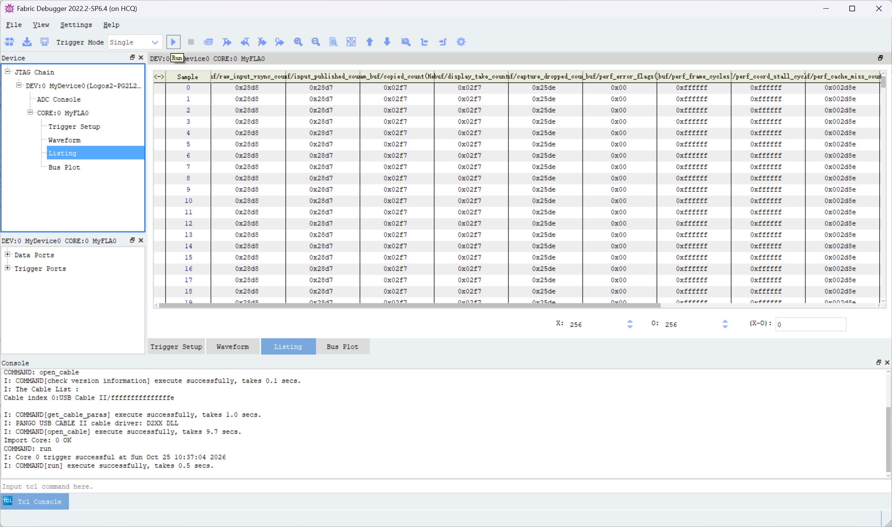
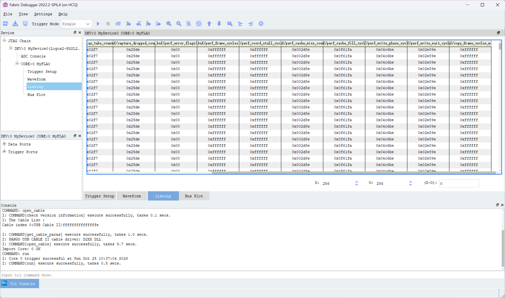
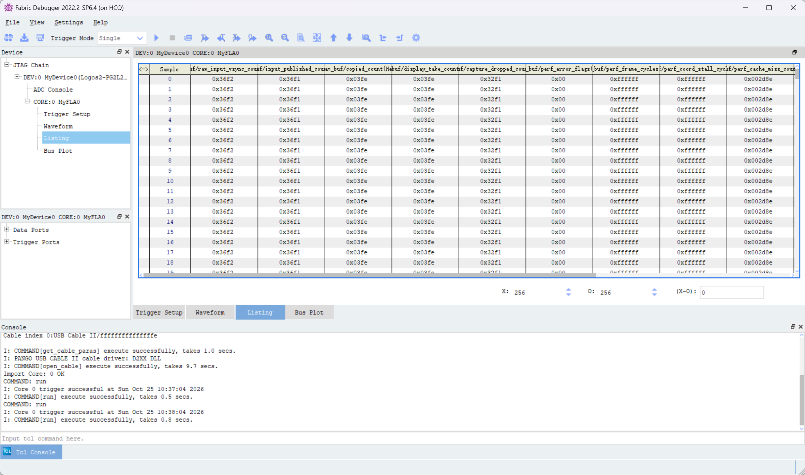
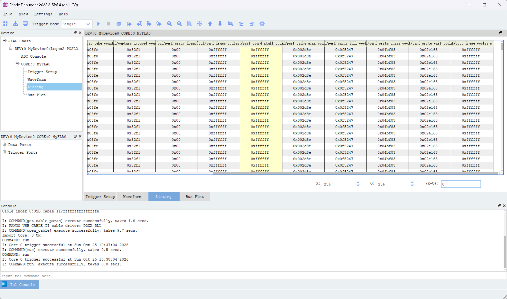

# 新增插值算法：讨论与 Stage 9 实测分析

> 本文整理本轮有关新增插值算法、串口选择模式和 Stage 9 上板计数的讨论。截图只作为调试证据；截图中的软件界面和数值不视为操作指令。

## 讨论记录

1. 用户询问能否编写其他插值算法，并讨论了先完成角度纠正还是直接加入新算法。决定以 Stage 8 角度纠正为基础，独立创建 Stage 9 插值测试工程，便于逐种算法对比。
2. 用户指定双三次核为 Catmull–Rom（Keys 参数 `a=-0.5`），确认 Stage 9 方案，并要求每个测试工程附带对应 Fabric Debugger 配置（FIC）以便实板测帧率。
3. 用户要求先创建 Git 分支 `新插值算法` 并切换。Stage 9 工程位于 [`stage9_bicubic_catmull_rom`](../../fpga/project/stage9_bicubic_catmull_rom/README.md)。软件参考、规划器、4×4 cache 读取、插值 RTL 和 1280×720 全帧仿真均通过。最初不含 UART 的构建关键 DDR 时钟 slack 为 +0.037 ns；结果与哈希见[结果记录](../results/stage9-bicubic-catmull-rom.md)。该结果只适用于当时的 RTL 和位流。
4. 用户询问能否未来通过串口选择插值模式。结论是可以：后续需要命令解析、帧边界生效控制，以及同时存在的两套算法硬件或其他运行时可切换结构。当前 UART 仅接收字节，没有命令解析；本次加入的编译期模式选择也不受串口控制。
5. 用户提供 4 张 Fabric Debugger 截图，请求分析原因并将聊天记录保存到本文。
6. 讨论 UART 接收接口时确认开发板为盘古 200Pro+。厂家手册列出板载 CP2102 USB-UART，`UART0_RX` 接 FPGA P14，`UART0_TX` 接 K19。最初 Stage 9 主工程尚未使用 P14；L8 已接 DDR `mem_dq[3]`，因此没有照搬 DDR 自测子工程里的 L8 UART 映射。用户确认加入 P14 上的 115200/8-N-1 字节接收器，暂不加入包协议、CRC、算法切换或 TX。设计说明见 [`Stage 9 UART RX 接口设计`](../superpowers/specs/2026-10-25-stage9-uart-rx-interface-design.md)。
7. 用户进一步要求只要不影响主算法，就直接加到 `stage9_bicubic_catmull_rom`。工程已加入 UART RX 模块、顶层端口和 P14 约束；接收字节保留在内部 `uart_rx_data/uart_rx_valid` 信号上，没有接入像素算法或角度参数。
8. 用户要求生成位流上板测试。2026-10-25 11:24 的完整 PDS 流程确实生成 9,188,552 字节 `.sbit`，SHA-256 为 `892F3D325FCFE033BCAAE8C85467EC5C10CF71FF49238981F3DB1BCEFDFC8B59`，并核对了 256 通道配套 FIC（SHA-256 `D1FDB7592A3BCF4979C8B4B0A9596ACB6E865D5F23BA1F6EF994263379A90DF7`）。但后置时序显示 `Some Constraints Violated`：`ddrphy_sysclk` 125 MHz setup 最差 slack 为 **-0.179 ns**、13 个失败端点，所以构建脚本按规则报错。该位流只能作为有时序风险的试测文件，不能记录为通过时序的交付版本。
9. 用户接着要求在同一 Stage 9 工程加入双线性插值，并在综合前选择算法，默认仍用已实现的 Catmull–Rom 双三次；用户确认口语中的“三线性”在此指“双三次”，不是三维三线性。经比较编译期选择、`generate` 参数和运行时双通路后，用户确认采用编译期选择，不新建工程。现有双三次实例路径保留，双线性复用 Stage 8 已带来的 2×2 规划器、cache 读取器和流水插值器；两种模式只编译其中一条。双线性启用严格 2×2 黑边；双三次仍用严格 4×4 黑边。设计见[编译期插值选择说明](../superpowers/specs/2026-10-25-stage9-compile-time-interpolation-design.md)。
10. 默认模式通过 64×8 帧仿真，双线性模式通过同尺寸帧仿真；半像素双线性数值和输出反压单元仿真也通过。PDS 分别综合两种模式：默认双三次使用 24,758 LUT/14,310 寄存器，与引入选择功能前的 UART 版相同；双线性使用 23,558 LUT/12,073 寄存器。可见编译期选择未同时保留两套采样硬件。当前代码修改后，11:24 生成的位流已不是这次源码的构建产物。需要重新运行完整 PDS 构建并检查时序，才能给上板测试提供对应的新 `.sbit/.fic`。

## 截图与采样时刻

Fabric Debugger 控制台记录了两次成功触发，约相隔 60 秒：10:37:04 与 10:38:04（截图显示的本地时间）。截图副本保存在本文旁边的 `assets/新增算法/`：

| 采样 | Listing | 右侧性能计数 |
|---|---|---|
| 10:37:04 |  |  |
| 10:38:04 |  |  |

## 60 秒累计帧计数

以下数字由两次截图的十六进制累计计数直接相减：

| 计数器 | 10:37:04 | 10:38:04 | 增量 | 约每秒 |
|---|---:|---:|---:|---:|
| 原始输入 VSYNC | `0x28d8` (10,456) | `0x36f2` (14,066) | 3,610 | 60.17 |
| 输入帧发布 | `0x28d7` (10,455) | `0x36f1` (14,065) | 3,610 | 60.17 |
| 处理完成 | `0x02f7` (759) | `0x03fe` (1,022) | 263 | 4.38 |
| 显示取用新帧 | `0x02f7` (759) | `0x03fe` (1,022) | 263 | 4.38 |
| READY 输入帧覆盖 | `0x25de` (9,694) | `0x32f1` (13,041) | 3,347 | 55.78 |

在该测量窗口中，`3,610 = 263 + 3,347`：新发布的输入帧里，263 帧完成处理，3,347 帧在仍处于 READY 状态时被较新的输入帧覆盖。处理完成和显示取用计数增量相同，因此这一窗口的显示新帧速率约为 4.38 fps；输入约为 60.17 fps。`perf_error_flags` 两次均为 `0x00`，表示所映射的错误标志没有置位；这不表示没有帧覆盖，帧覆盖由单独计数器记录。

这些是约 60 秒窗口的累计计数差，不是 HDMI 扫描刷新率。原始 VSYNC 与发布计数的累计值只差 1，且两者窗口增量相同。仅凭这一组快照不能判定所有未发布帧的具体路径。

## `0xffffffff` 性能值的原因

截图中 `perf_frame_cycles`、`perf_coord_stall_cycles` 和 `copy_frame_cycles_max` 显示为 `0xffffffff`。这不能按一个有效的 32 位周期值解释：Stage 9 RTL 中这些量的声明宽度是 **24 位**，最大值为 `24'hffffff`，并在达到上限后停止增加。FIC 也只映射相应的 24 个信号位。Fabric Debugger 将 24 位全 1 显示为八位十六进制的具体扩展方式未由截图单独证明；结合 RTL，安全解释是底层 24 位字段已经全 1 并饱和，UI 显示可能做了符号扩展。

24 位计数在 125 MHz 下最多表示约 **16,777,215 周期 / 0.1342 秒**。因此截图的帧周期和坐标停顿值只能说明至少到达该上限，不能用来计算实际单帧周期。`copy_frame_cycles_max` 同样只有 24 位，不能给出超过上限的最大帧周期。

定义依据：[`frame_identity_transform_engine.sv`](../../fpga/project/stage9_bicubic_catmull_rom/source/rtl/memory/frame_identity_transform_engine.sv) 中 `frame_cycle_count` 和 `coord_stall_count` 均为 24 位饱和计数器；完成帧时才把它们快照到 `perf_frame_cycles` 和 `perf_coord_stall_cycles`。[`fram_buf.v`](../../fpga/project/stage9_bicubic_catmull_rom/source/rtl/fram_buf.v) 中 `copy_frame_cycles_max` 也是 24 位。

## 当前最可能的吞吐瓶颈

RTL 直接显示，`cached_bicubic_neighbor_reader` 每接收一个有效像素，要按顺序执行 **4 次 2×2 Tile Cache 查询**，每次等待响应后才启动下一次查询；四组样本收集完毕并交付下游后，读取器才回到空闲态接受下一个像素。实现见[`cached_bicubic_neighbor_reader.sv`](../../fpga/project/stage9_bicubic_catmull_rom/source/rtl/memory/cached_bicubic_neighbor_reader.sv)。一帧 1280×720 因而需要 921,600 × 4 = **3,686,400 次 2×2 查询**。

这会让邻域读取器长时间对上游施加反压，与截图中饱和的 `perf_coord_stall_cycles` 和很低的完成帧增量相符。基于当前 RTL 与实测数据，**串行四次查询是首要的结构性吞吐嫌疑点**。这属于有证据支持的原因判断，但截图没有单独测出每个内部状态的周期，不能把全部停顿精确归因给该模块。

另外，最近完成帧的截图快照中，cache miss 为 `0x002d8e`（11,662），cache fill cycles 约 `0x0f5xxx`（约 100 万），write phase 约 `0x04bxxx`（约 31 万），write wait 约 `0x02exxx`（约 19 万）。这些是不同阶段的帧内计数，部分周期可能重叠，**不能直接相加**。它们比饱和的总周期上限小，但由于总计数已饱和，现有数据不足以完成精确帧周期分解。

## 建议的下一步

1. 先把总帧周期、坐标停顿及最大帧周期计数扩展到至少 32 位，并同步更新 Fabric Debugger FIC 映射；保留饱和语义，避免把全 1 误当作有效测量值。
2. 增加读取器各状态的周期计数，区分 cache 命中查询、miss/refill 等待、插值器反压和 DDR 写等待，重新烧录匹配的 `.sbit/.fic` 后做同样的 60 秒差分测量。
3. 优化 4×4 邻域收集：评估按行/窗口复用像素的 line buffer 或并行 cache 读通路，减少每个输出像素四次串行查询造成的接受速率限制。优化后先跑 1280×720 全帧仿真，再构建并进行同条件实板 A/B 测试。
4. 串口模式选择作为独立控制功能接入：先确定协议、模式编号与校验，再在帧边界锁存模式，避免一帧中途换算法。模式控制本身不会解决当前 4×4 读取器吞吐瓶颈。
