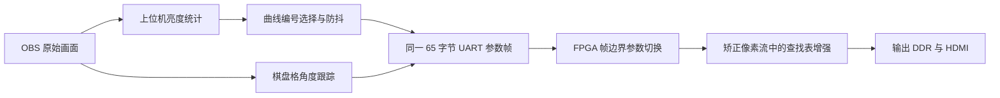

# 自适应图像增强实施计划

更新时间：2026-10-29。本文记录图像增强分支的设计、实施顺序和验证状态。

## 基准与目标

- FPGA 基准工程：`stage8_720p60hz_bilinear_uart_angle_correction_65byte_k3_test`。Stage11 从这个含 K3 的工程完整复制，保留 1280×720 双线性矫正链路、65 字节版本 `02` UART、单应矩阵和 K3 支路；Stage8 基准不随增强实验修改。
- 比赛目标：对夜间、强光等复杂光照场景，自适应选择图像增强参数，并在矫正链路中应用，比较极端光照下的矫正效果。
- Stage11 已将 UART 偏移 43 定义为曲线编号 `0–5`，44–62 仍须全零；Stage11 新位流支持曲线编号。Stage8 K3 基准位流仍要求 43–62 全零。

## 数据流与模块边界



上位机负责从 OBS 的原始帧判断场景，FPGA 负责逐像素映射。串口由一个进程独占，角度矩阵和增强编号共用同一递增序号及 ACK。编号 `0` 关闭、`1` 夜间提亮、`2` 强夜间提亮、`3` 高光压缩、`4` 强高光压缩、`5` 亮暗混合；六条曲线均已在 Stage11 RTL 中实现。查找表无法恢复输入中已经饱和丢失的纹理。

当前方案是**局部检测、整帧选一条曲线**：局部亮区或暗区可以触发模式，但 FPGA 首版对该输出帧的所有像素应用同一条曲线，并非只处理检测到的图块。先用这版验证协议、帧同步和实际画质；若混合场景的全帧曲线明显损害正常区域，再评估分区增强。上图中的查找表接入位置为暂定方案，最终位置需按赛题对“预处理”的要求确认。

## 分步实施

### 1. 上位机光照检测与选择

独立的纯计算模块输入 BGR 帧，按固定步长采样，计算整帧亮度均值、分位数、暗部和高光比例，并将采样图划分为最多 8×8 个图块。相邻 2×2 图块窗口的极亮像素比例达到 30% 时识别局部强光，极暗像素比例达到 70% 时识别局部暗区。整帧和局部结果共同决定候选编号；两类区域同时存在时选择 `5:mixed`，不再直接显示为 `bypass`。连续 3 帧选择相同候选才切换当前编号，避免阈值附近抖动。观察入口只读取 OBS 或视频文件，不打开串口。

阈值仍是待实拍校准的起点：亮度 `<=64` 计为暗部，`>=245` 计为高光；整帧中位数 `<=40` 且暗部比例 `>=55%` 选强夜间，中位数 `<=80` 且暗部比例 `>=35%` 选夜间；中位数 `>=225` 或高光比例 `>=30%` 选强高光，中位数 `>=185` 或高光比例 `>=10%` 选高光。局部强光或暗区也可触发相应普通模式。单幅图像无法可靠区分黑色物体与欠曝光暗区，因此局部暗区识别仍需用实拍场景排查误报；这些编号不代表已验证的画质增益。

验收：合成暗帧、正常帧、高光帧、局部亮斑、局部暗区和亮暗混合帧能得到预期编号；小面积孤立暗点不触发夜间模式；单帧扰动不触发切换；非法帧明确报错；观察入口输出整帧与局部统计和稳定编号。

### 2. 曲线设计与电脑端对照

为编号 `0–5` 生成每通道 8 位、256 项的单调映射表：`0` 为恒等映射；`1/2` 分别为普通、较强的暗部提亮；`3/4` 分别为普通、较强的亮部压缩；`5` 在同一条曲线中兼顾暗部提亮和亮部压缩。先用 OBS 实拍的正常、暗光、局部强光、亮暗混合画面离线处理，保存原图与处理图，比较暗部可辨细节、亮部层次和正常区域的颜色变化，再固定表值。此时的曲线是设计候选，不能把检测模式出现等同于画质改善。

验收：旁路逐像素恒等；所有曲线有确定的 256 项表值、单调且输出范围为 `0–255`；实拍对照明确记录每条曲线的收益和副作用。已裁剪成纯白的高光只能避免后续显示继续过亮，不能恢复丢失的纹理。

### 3. 65 字节协议分配

保留版本 `02`、总长 65 字节、矩阵偏移 7–42、CRC 偏移 63–64 和 CRC 覆盖范围 2–62。Stage11 已分配偏移 43 为增强曲线编号，合法范围为 `0–5`；偏移 44–62 仍必须全零。FPGA 只接受合法编号，ACK 回显扩展区；旧的全零请求仍表示关闭增强。上位机包生成、FPGA 接收解析和协议仿真已完成。

验收：合法编号 ACK；越界编号和非零保留字节 NACK 且不更新参数；旧全零请求保持兼容。

### 4. FPGA 增强与帧边界

暂定在双线性插值输出到结果写入 DDR 之间加入带 `valid/ready` 的查找表流水级，对 RGB 三通道使用相同 8 位曲线，保持其余像素位和帧元数据同步。增强编号与单应矩阵在同一输出帧边界从 pending 切换到 active，避免半帧换曲线。关闭模式应逐像素等同当前基准，不增加 DDR 读写量。

赛题中的“预处理”可能被严格解释为几何矫正之前。RTL 接入前会核对输入帧写入 DDR 前的接口和竞赛验收表述；若必须先增强再矫正，则将同一查找表模块接入输入像素链路，并处理输入帧参数锁存与输出帧对应关系。不能把矫正之后的处理误称为矫正前预处理。

验收：旁路一致性、RGB 查表数值、反压和帧元数据对齐、帧边界原子更新、全帧仿真；随后完整 PDS 布线，检查 125 MHz 时序及位流/FIC 一致性。

### 5. 共用实时脚本与实板评估

当前由 `host/pose/track_obs_adaptive_enhancement.py` 独占串口，使用同一包、递增序号和 ACK 发送角度矩阵与曲线编号。默认联合模式启动时需完整棋盘锁定一次角度；之后棋盘暂时丢失仍可携带最后一次 ACK 的矩阵更新光照。加 `--identity` 可只测光照，但会把角度矩阵设为单位矩阵。对正常、夜间、局部强光及亮暗混合场景保存输入/输出对照和选曲线日志，测量暗部可辨细节、高光饱和比例、几何残差及实际处理帧率。

验收：ACK/CRC/序号正确，光照切换无半帧混用，棋盘格丢失仍能更新光照且角度保持；实测吞吐与原基准同条件比较。只有板上数据支持时才报告改善幅度。

## 当前进度

- [x] 明确使用 Stage8 的 65 字节 K3 工程作为增强开发基准；Stage11 已把扩展区字节 43 用于曲线编号，Stage8 仍要求扩展区全零。
- [x] 第一步：整帧和局部光照统计、稳定编号选择、无串口观察入口与定向测试。OBS 实拍验证了取帧及多种场景切换；固定场景下的阈值校准仍可继续。
- [x] 第二步：生成六条可调候选曲线，并对现有 90 张图生成 LUT、对照图和指标；候选不是最终画质参数，需用后续有纹理且受控的重拍数据调参。
- [x] 第三步接口：固定协议字节 43 为曲线编号、44–62 保留；Stage11 RTL、上位机发包、ACK 校验及协议仿真已更新。
- [x] 第四步初版：Stage11 RTL 已接入帧锁存的 RGB LUT，ROM 可由 JSON 参数重新生成；完整 PDS 构建和时序检查通过，实板验证继续进行。
- [x] 第五步初版：新增 `host/pose/track_obs_adaptive_enhancement.py`，复用 OBS 原始帧分类、65 字节 Stage11 请求与 ACK 校验；可单独测光或与角度跟踪共用 COM7。实板动态切换和画质对照仍待运行。

Stage 11 接口已固定并接入 RTL：65 字节版本 `02` 的偏移 43 为曲线 ID `0–5`，44–62 为零，CRC 覆盖范围不变；矩阵和曲线在输出帧边界原子提交。支持非零曲线编号的位流已完成构建；板上需烧录对应版本。定义见 [`stage11-adaptive-image-enhancement-interface.md`](../plan/stage11-adaptive-image-enhancement-interface.md)。

2026-10-29 用户反馈首批上板曲线偏弱，已加强 1–5 号参数并重跑 90 张样本对照；新 Stage11 PDS 完整构建通过，慢角 `ddrphy_sysclk` WNS `+0.097 ns`、TNS 0。新曲线需要烧录本次生成的 `.sbit` 后再测试。

第一步文件：[`lighting_profile.py`](../../host/pose/lighting_profile.py) 为纯计算模块，[`preview_lighting_profiles.py`](../../host/pose/preview_lighting_profiles.py) 是观察入口，[`test_lighting_profile.py`](../../host/pose/test_lighting_profile.py) 是离线测试。在仓库根目录运行：

```powershell
.\.venv\Scripts\python.exe host\pose\test_lighting_profile.py -v
.\.venv\Scripts\python.exe host\pose\preview_lighting_profiles.py --source 2
```

观察脚本默认每 15 帧及编号变化时打印亮度统计、候选编号和稳定编号；`--source` 也可以接视频文件路径。它不打开 COM7，不向当前位流发送扩展字节。运行时用 `Ctrl+C` 退出。

### 当前工作区快照（2026-10-29）

第一步代码和计划文档已恢复到 `Image-Enhancement` 分支。OBS 虚拟摄像机观察确认亮度数据随手电筒和场景变化；旧整帧规则曾把可见局部强光判为 `bypass`。当前版本增加局部窗口统计和 `5:mixed` 观察编号。用户提供的实拍日志在约 2710 帧内出现 `0–5` 六种编号，包含 `local_dark`、`local_highlight` 的变化；用户说明当时正在主动切换场景，因此过渡段的模式变化不能据此判为不稳定。用户主观观察各类场景的编号基本合适，可以推进下一阶段；这不等同于已验证增强后的画质或 FPGA 效果。

采集脚本不打开 UART；实时脚本负责向 Stage11 板卡发送增强编号。候选配置位于 `host/pose/lighting_curve_parameters.json`；修改参数后运行 `python host/pose/compare_lighting_curves.py`，默认对 `host/pose/output/lighting_samples/` 的每张图应用 0–5 全部曲线，生成每类对照图、逐图 CSV 指标和 `lighting_luts.json`。再运行 `python host/pose/generate_lighting_lut_rom.py` 同步生成 Stage11 ROM。后续重拍只需通过 `--input` 指向新样本目录并调整参数；UART 与像素接口不变。

## 2026-10-29 现存样本计算与参数记录

**数据口径：**以 `host/pose/output/lighting_samples/` 中现存的 `sample_*.png` 为准，六类各 15 张，共 90 张 1280×720 原始帧。采集记录 `manifest.jsonl` 有 95 条，包含 5 条已替换图片的历史记录，本节不把它们计入统计。重新运行 `host/pose/compare_lighting_curves.py` 后得到 540 组“原图 × 曲线”对照，输出在 `host/pose/output/lighting_curve_comparison/`。以下亮度分类数值由 `analyze_bgr` 每 8 行/列采样一次计算；曲线作用指标由全分辨率图像计算。表内为 15 张图的中位数，方括号内为最小值和最大值；亮度范围为 0–255。

| 类别 | 中位亮度 | 暗像素 ≤64 | 高光像素 ≥245 | 局部暗区 | 局部高光 |
|---|---:|---:|---:|---:|---:|
| 0 正常 | 164 [130, 183] | 3.5% [3.3, 11.4] | 0% | 13.9% [13.6, 63.6] | 0% |
| 1 暗光 | 86 [43, 138] | 38.9% [16.2, 58.8] | 0% | 98.8% [78.8, 100] | 0% |
| 2 极暗 | 4 [4, 4] | 98.1% [97.4, 98.7] | 0% | 100% | 0% |
| 3 高光 | 205 [188, 207] | 3.3% | 0% | 13.6% | 0% |
| 4 强高光 | 243 [191, 250] | 3.3% | 49.2% [20.6, 73.5] | 13.6% | 100% [87.8, 100] |
| 5 亮暗混合 | 98 [67, 166] | 16.3% [9.7, 47.4] | 7.5% [4.4, 11.1] | 82.8% [70.2, 100] | 49.8% [34.9, 68.9] |

90 张现存图按当前规则重新分类，均与所在目录编号一致。这只能检查采集与分类程序的一致性：目录编号本来就是该程序自动给出的，**不能据此证明阈值准确**。目前先保留分类阈值：暗像素 ≤64、高光像素 ≥245；夜间条件为中位数 ≤80 且暗像素 ≥35%，或局部暗区 ≥70%；强夜间为中位数 ≤40 且暗像素 ≥55%；高光条件为中位数 ≥185、高光像素 ≥10% 或局部高光 ≥30%；强高光为中位数 ≥225 或高光像素 ≥30%；亮暗条件同时满足时优先选 5。要独立校准阈值，后续需人工标注场景和过渡帧，尤其检查黑色物体造成的局部暗区误判。

### 曲线参数与离线作用

当前 `lighting_curve_parameters.json` 和已构建的 Stage11 ROM 使用下表“当前参数”。`gamma` 公式为 `255 × (x/255)^gamma`；高光肩部在 `x > knee` 时为 `knee + (255-knee) × ((x-knee)/(255-knee))^power`；5 号先做 gamma 再做肩部。结果四舍五入为 0–255 的单调 256 项查找表。

| ID | 当前参数 | 对本类 15 张图的平均作用 |
|---:|---|---|
| 0 | 恒等 | 平均亮度 153.3 → 153.3，RGB 平均绝对变化 0 |
| 1 | gamma 0.68 | 平均亮度 93.8 → 120.2，原暗区平均提亮 24.3 灰度级 |
| 2 | gamma 0.45 | 平均亮度 8.2 → 37.0，原暗区平均提亮 28.2 灰度级 |
| 3 | knee 112，power 1.55 | 平均亮度 189.3 → 170.9 |
| 4 | knee 88，power 1.80 | 平均亮度 224.9 → 212.5；输出灰度 ≥250 比例由 37.8% 降至约 0% |
| 5 | gamma 0.65，knee 155，power 1.65 | 平均亮度 121.5 → 146.6，原暗区平均提亮 30.1 灰度级；输出灰度 ≥250 仍为 4.8%，与原图基本相同 |

**明天拟更新的参数：仅修改 5 号为 `gamma=0.65, knee=120, power=2.80`。** 用现存 15 张混合图离线重算后，原暗区平均提亮 29.9 灰度级；中亮区（原灰度 65–180）平均提亮 15.5 灰度级；输出灰度 ≥250 比例由当前曲线的 4.8% 降到约 0.1%；全图平均亮度为 133.5。新表关键点：`64→104, 137→128, 205→180, 250→246`。相比当前 5 号 `64→104, 137→160, 205→206, 250→250`，保留暗区提亮并更明显压缩亮区，同时减小正常中亮区域被抬高的幅度。1–4 号暂保留上述参数；0 号保持恒等。该建议是依据亮度指标选出的**待实板观察候选**，并非有参考真值的最优曲线；不能恢复输入中已经丢失的纹理。

### 当前进度与下次继续的位置

- 已完成：Stage11 从 Stage8 K3 基准复制；UART 偏移 43 的 0–5 号协议、ACK/CRC、帧边界原子切换和 RGB LUT RTL 已接入；实时 OBS/COM7 脚本与采集脚本可用。当前强化后的 1–5 号曲线位流已完整构建，慢角 `ddrphy_sysclk` WNS `+0.097 ns`、TNS 0。此前单次上板测试证明曲线能改变画面，仍缺受控的逐场景画质对比。
- 今天完成：按现存 90 张 PNG 重算六类统计与 540 组曲线对照，提出上面的 5 号新参数。**本次只更新本文档和离线对照输出；JSON、RTL ROM、位流及板上参数均尚未改为新 5 号。**
- 明天第一步：在 `host/pose/lighting_curve_parameters.json` 把 5 号 `knee` 改为 `120`、`power` 改为 `2.80`，`gamma` 仍为 `0.65`；运行 `python host/pose/compare_lighting_curves.py` 复核新旧混合图，再运行 `python host/pose/generate_lighting_lut_rom.py` 生成 `stage11_720p60hz_adaptive_image_enhancement_test/source/rtl/correction/lighting_lut_rom.sv`。ROM 是生成文件，不手改 256 项常量。
- 随后：重新构建 Stage11 位流并核对时序，通过 PDS 烧录新位流。用相同 OBS 相机设置和同一场景依次发送 `0` 与 `5`，观察暗部细节、高光层次、正常色块及颜色偏移；再测 1–4 号。保存原始帧、显示输出及 ACK 日志。若 5 号使正常区域偏色或偏暗，再据同一批样本微调 gamma/knee/power 并重建。
