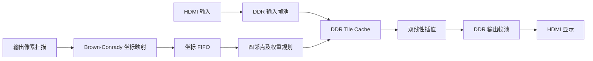

# 720p60 畸变算法现状与上板交接

_更新于 2026-10-23；盘古 200Pro+（PG2L200H）。本记录合并 Stage 5/6 实板结果与 Stage 6 广角试值工作；实施细节见[完整计划](../plan/720p60-distortion-correction.md)。_

## 当前状态

| 阶段 | 已完成及证据 | 仍需确认 |
| --- | --- | --- |
| Stage 4 片上算法演示 | 固定径向映射、坐标 FIFO、2×2 取样规划、片上源图和双线性插值输出 720p60 HDMI。完整帧仿真检查 921,600 个像素；[板上照片](../results/stage4-algorithm-demo-board-2026-10-22.jpg)与[预期图](../results/stage4-algorithm-demo-preview.png)的彩色分区、弯曲网格和黑边一致 | 实际 HDMI 模式和长时间稳定性 |
| Stage 3 视频帧池 | 双帧池 CDC 修正版已有真实画面实板反馈；先前诊断约 59.5 帧/秒 | 持续 30 分钟稳定性和完整错误计数 |
| Stage 5 DDR 单位映射 | 真实 HDMI 输入经 DDR Tile Cache、单位映射、双线性插值和输出帧池已上板出完整静态图；运动帧实测处理 **29.11 fps** | 处理链路瓶颈与 60 fps 优化 |
| Stage 6 固定 Brown-Conrady 试值 | 已在真实帧工程接入 `k1/k2/p1/p2`；仿真和两套 PDS 构建通过；已收到当前版本实板画面对比和约 61 秒 Debugger 计数：处理/显示 **21.28 fps**，输入发布 **59.39 fps**；所示错误计数为 0 | 直线矫正精度仍需同机位标定图验证；当前系数是视觉试值 |
| 相机正式标定 | 坐标和采样接口可承载定点映射 | 真实内参、畸变系数、OpenCV 同帧参考和精度验收 |

**当前 Stage 6 系数是为了观察明显变化而选的试值。120° 视场角无法唯一确定镜头内参和畸变参数。**

## 从片上演示到真实视频

Stage 4 的源图是一张原本笔直的片上网格，演示公式故意令输出网格向外弯曲：

```text
source = output + (output-center) * r² / 2²³
```

Stage 5 则将真实 HDMI 帧接入 DDR 读取路径，用单位映射核对取样、缓存、插值、帧所有权和输出写入。Stage 6 在相同真实帧链路中切换坐标映射；上一版仅用了正向纯径向试值 `k1=+0.25`，用户的板上画面仍可见明显桶形弯曲。当前版本改为负径向项及切向项的固定广角试值，已烧录并拍摄原图/矫正图对比。画面确实发生几何重映射，但拍摄角度与取景不同，仍不能据此量化直线矫正误差。



公共源坐标为有符号 Q16.16，RGBX8888 高 24 位依次为 R/G/B，低 8 位为零。流水线按 `valid/ready` 传递 `pixel_id`、`frame_id`、`param_version` 和 `sof/eol/eof`。DDR 读取器在输入槽或帧号切换时失效缓存，发出不可反压的 DDR 突发读前预留完整返回空间；输出帧在写事务排空后才发布。

关键 RTL：Stage 4 的[`demo_radial_mapper.sv`](../../fpga/rtl/correction/demo_radial_mapper.sv)仍用于合成演示；Stage 6 使用独立的[`stage6_brown_mapper.sv`](../../fpga/rtl/correction/stage6_brown_mapper.sv)。真实帧链路还包含[`cached_neighbor_reader.sv`](../../fpga/rtl/memory/cached_neighbor_reader.sv)、[`pixel_tile_cache.sv`](../../fpga/rtl/memory/pixel_tile_cache.sv)和[`pipelined_bilinear_interpolator.sv`](../../fpga/rtl/correction/pipelined_bilinear_interpolator.sv)。

## Stage 5 运动帧率实测（已上板）

使用 `stage5_identity_fps_debug` 位流播放运动画面，在 Fabric Debugger 中于 **12:22:11** 和 **12:23:12** 捕获 Listing，间隔约 **61 秒**：

| 计数器 | 第一次 | 第二次 | 增量 | 速率 |
| --- | ---: | ---: | ---: | ---: |
| 输入帧发布 `input_published_count` | 23,196 | 26,844 | 3,648 | **59.80 fps** |
| 算法完成 `copied_count` | 11,290 | 13,066 | 1,776 | **29.11 fps** |
| 显示取得新帧 `display_take_count` | 11,290 | 13,066 | 1,776 | **29.11 fps** |
| 输入帧丢弃 `capture_dropped_count` | 11,904 | 13,776 | 1,872 | **30.69 帧/秒** |

截图中可见的 `copy_error_count` 和 `output_dropped_count` 两次均为 0；其余未显示的错误计数没有读数，不能据此认定为零。原始截图和通道说明见[Stage 5 帧率诊断记录](../results/stage5-fps-diagnostic.md)及[独立更新记录](2026-10-22-stage5-fps-update.md)。

输入发布接近 60 fps，但单位映射处理链路每秒只完成约 29.1 帧，当前实测吞吐未达到 720p60。要达到 60 fps，完成帧吞吐需约为当前的 **2.06 倍**；按 1280×720 折算，约从 **26.8 Mpixel/s** 提升到 **55.3 Mpixel/s**。显示器即使按 60 Hz 扫描，仍可能重复显示同一处理帧；显示刷新率不等于新帧生成率。理想 DDR 仿真约 14.77 ms/帧（约 67.7 fps），与实板结果不同。DDR 并发争用、缓存命中及等待和处理调度均可能影响吞吐，现有计数不足以定位主因。

**29.11 fps 是 Stage 5 单位映射版本的实测值，不能当成当前 Stage 6 Brown 映射的实测帧率。**

## Stage 6 当前广角试值

输出到源图的归一化坐标以 `(640,360)` 为中心，尺度为 512：

```text
x = (u-640)/512, y = (v-360)/512, r2 = x*x+y*y
k1 = -0.25, k2 = +0.0625, p1 = +0.03125, p2 = -0.03125
source_x = 640 + 512 * [x*(1+k1*r2+k2*r2*r2) + 2*p1*x*y + p2*(r2+2*x*x)]
source_y = 360 + 512 * [y*(1+k1*r2+k2*r2*r2) + p1*(r2+2*y*y) + 2*p2*x*y]
```

硬件采用分级定点运算。正中心 `(640,360)` 是固定点，但周围像素也会变化：例如输出 `(800,360)` 约取源图 `(791.5,361.6)`，输出 `(1000,500)` 约取 `(937.3,488.3)`。此前正径向版本主要使边缘更弯；当前负径向系数按桶形矫正方向取源，并加入非零 `p1/p2`。用户提供的原图/矫正图显示画面取景和几何形状发生变化，说明映射在工作；但两张照片的相机拍摄角度不同，画面仍有弯曲，因此不能仅凭照片判断当前变形量是矫正不足还是过度。需用标定板和固定机位验证。

`stage6_radial_ddr` 原有 PDS 文件仍以 `demo_radial_mapper.sv` 为映射模块路径；该工程及 `stage6_radial_fps_debug` 的此文件均由同一 `stage6_brown_mapper.sv` 复制，内容哈希一致。遗留的 `RADIAL_DENOM_SHIFT` 参数在当前 Stage 6 映射中不参与计算。

### 当前构建结果

| 工程 | 用途 | PDS 2022.2-SP6.4 后布局结果 | 位流 SHA-256 |
| --- | --- | --- | --- |
| [`stage6_radial_ddr`](../../fpga/project/stage6_radial_ddr/README.md) | 正常画面观察 | `All Constraints Met`；DDR 125 MHz 建立裕量 **+0.524 ns** | `0338BB4EA7F5C98EBE5EC3BF8A2B9DE9589888AB25AA715D90F3B2921195E725` |
| [`stage6_radial_fps_debug`](../../fpga/project/stage6_radial_fps_debug/README.md) | 同系数帧率计数 | `All Constraints Met`；DDR 125 MHz 建立裕量 **+0.322 ns** | `102126244AFDBB2477A0A914A040A4E6981DA7FA564EAADD8326BDD6E65ABB9A` |

[Stage 6 定向仿真脚本](../../fpga/sim/Run-Stage6RadialPipeline.ps1)已核对中心、非中心及四角的源坐标、DDR 图块取样和元数据顺序并通过。两套位流分别用于画面观察和帧率诊断；本次帧率实测如下。详细构建记录见[普通工程结果](../results/stage6-radial-ddr.md)及[帧率诊断结果](../results/stage6-radial-fps-diagnostic.md)。

### Stage 6 实板帧率（2026-10-23）

Fabric Debugger Console 时间为 **08:32:14** 和 **08:33:15**，实际间隔 61 秒：

| 计数器 | 第一次 | 第二次 | 增量 | 速率 |
| --- | ---: | ---: | ---: | ---: |
| 输入发布 `input_published_count` | `0x0011d5` | `0x001ffc` | 3,623 | **59.39 fps** |
| 算法完成 `copied_count` | `0x00000664` | `0x00000b76` | 1,298 | **21.28 fps** |
| 显示取新帧 `display_take_count` | `0x00000664` | `0x00000b76` | 1,298 | **21.28 fps** |
| 输入丢帧 `capture_dropped_count` | `0x0b70` | `0x1484` | 2,324 | **38.10 帧/秒** |

`copy_error_count` 两次均为 0，`output_dropped_count` 两次均为 0。当前试值下，输入约 59.4 fps，而处理和显示约 21.3 fps；输入帧持续被丢弃。相比 Stage 5 单位映射实测的 29.11 fps，当前映射版本吞吐更低约 7.83 fps。需进一步检查映射运算带来的时序/调度影响和 DDR Tile Cache 未命中成本，不能把该数据当成标定参数版本的最终性能。

## 本轮上板步骤与后续工作

1. 下一步固定相机，用棋盘格或 ChArUco 标定板采集多个角度和位置的图像，求出真实 `fx/fy/cx/cy` 及 `k1/k2/p1/p2`；120° 镜头需同时评估 Brown 模型拟合残差，必要时改用鱼眼模型。
2. 将标定内参与畸变系数转换为 FPGA 定点参数，更新 Stage 6 映射后，用未参与标定的直线/棋盘格验证矫正效果，并保留同机位原始帧作对照。
3. 性能方面，当前 Stage 6 约 21.28 fps，目标 60 fps 需约 **2.82 倍**处理吞吐提升。检查映射计算流水、DDR 读请求/返回、Tile Cache 命中与未命中成本，以及采集和显示并发占用；优化后复测计数和丢帧，再做长时间稳定性测试。
4. 按[实施计划](../plan/720p60-distortion-correction.md)验收源坐标误差、视野损失、资源、时序和吞吐。

本次合并保留了[Stage 5 帧率独立记录](2026-10-22-stage5-fps-update.md)供查看原始测量背景；当前工程决策以本文及对应 `docs/results/` 构建记录为准。
