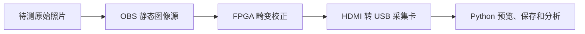

# 实拍畸变校正效果验证

_盘古 200Pro+ 720p60 FPGA 项目；记录日期：2026-10-30。本文记录验证照片准备情况和后续 FPGA 输出采集流程。_

---

## 📋 验证目标

本轮验证使用已有相机标定系数，不重新标定。固定使用当前已标定的 Brown-Conrady 参数（含 `k3`），先检查 FPGA 对网格图的畸变校正效果；角度校正暂设为 0°／单位变换，灯光增强关闭或固定，避免混入其他处理效果。

待测原图通过 OBS 静态图像源送入 FPGA，FPGA HDMI 输出接入 HDMI 转 USB 采集卡，再由电脑上的 Python/OpenCV 脚本预览和保存。处理帧率仍以 FPGA 板上计数器为准，不使用采集卡读帧率替代。

## 🖼️ 已有验证照片

照片位于 `host/verification/`，共 8 张 PNG，文件名为 `0.png` 至 `7.png`。当前检查结果如下：

| 照片 | 构图 | 用途与限制 |
|---|---|---|
| `0.png`、`1.png` | 棋盘格完整，位于画面中部 | 居中基准；两张可用于重复性检查 |
| `2.png`–`5.png` | 棋盘格偏向画面边缘，部分图案被画面裁切 | 可用于对应边缘区域的局部观察；不适合整板网格残差统计 |
| `6.png`、`7.png` | 棋盘格完整，平面内有旋转 | 检查网格旋转后线条是否仍保持平直 |

这些照片足以开始第一轮验证。它们是效果验证图，不用于重新拟合标定系数。当前仅完成了照片数量和构图检查；尚未采集与这些输入照片一一对应的 FPGA HDMI 输出，也尚未计算直线残差、黑边比例或 MTF50。

## ⚙️ 首轮测试设置

1. 烧录并记录当前 K3 工程对应的 `.sbit` 和 `.fic`；保存两个文件的 SHA-256、参数包序号及 PDS 时序记录。
2. 将 OBS 画布、输出及连接 FPGA 输入的显示输出设为 1280×720；使用静态图像源，避免实时相机画面变化。
3. 尽量按 1:1 显示 1280×720 原图，关闭 OBS 裁切和缩放；不对原图做预先矫正。
4. 角度校正设为 0°／单位变换，保持已标定 Brown 系数（含 `k3`）生效；灯光增强关闭或固定。
5. 将 FPGA HDMI 输出接入采集卡，采集卡设为 1280×720；关闭自动缩放、锐化和降噪等图像处理。
6. 对 `0.png`–`7.png` 逐张输入并保存输出，按序号配对，例如 `0_input.png` 与 `0_fpga.png`。

## 📐 后续分析

- 在 `0.png`、`1.png`、`6.png`、`7.png` 及各自 FPGA 输出上检测网格线，按中心、中场、边缘分区统计点到拟合直线的垂直残差（均值、P95 和最大值）。
- 对 `2.png`–`5.png` 只分析仍可见且足够长的局部网格线，并注明图案裁切，不与完整棋盘格的整板统计混为一谈。
- 在白底网格区域估算有效画面比例和黑边面积；理论越界区域可与同参数 OpenCV `valid_mask` 对照。
- 若要测重采样清晰度，另拍斜边测试图；在中心及边缘的可比 ROI 计算 MTF50，并注明这是数字重采样后的清晰度变化。
- 需要比较 K3 开/关时，使用相同输入照片、相同角度和相同采集设置，分别保存两种配置的 FPGA 输出；不改变相机或 OBS 画面缩放。

## 🧾 结果记录要求

每次采集至少记录输入照片名、输出照片名、工程/位流版本、`.sbit/.fic` 哈希、UART 参数版本、角度设置、K3 状态、灯光增强设置和采集卡分辨率。图像质量指标来自采集卡保存的 FPGA 输出；帧率与丢帧数据来自 FPGA 计数器。静态图片用于可重复的图像质量比较，不代表实时动态场景的帧率表现。
