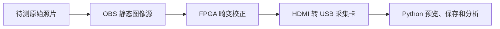

# 实拍畸变校正效果验证

_盘古 200Pro+ 720p60 FPGA 项目；记录日期：2026-10-30。本文记录验证照片准备情况和后续 FPGA 输出采集流程。_

---

## 📋 验证目标

本轮验证使用已有相机标定系数，不重新标定。固定使用当前已标定的 Brown-Conrady 参数（含 `k3`），先检查 FPGA 对网格图的畸变校正效果；角度校正暂设为 0°／单位变换，灯光增强关闭或固定，避免混入其他处理效果。

待测原图通过 OBS 静态图像源送入 FPGA，FPGA HDMI 输出接入 HDMI 转 USB 采集卡，再由电脑上的 Python/OpenCV 脚本预览和保存。处理帧率仍以 FPGA 板上计数器为准，不使用采集卡读帧率替代。



## 🖼️ 已有验证照片

照片位于 `host/verification/`，共 8 张 PNG，文件名为 `0.png` 至 `7.png`。当前检查结果如下：

| 照片 | 构图 | 用途与限制 |
|---|---|---|
| `0.png`–`3.png` | 棋盘格完整或接近完整 | 用于网格直线度和黑边评估；其中 `2.png`、`3.png` 可与居中图分区比较 |
| `4.png`–`7.png` | 书封面黑白边框的不同近景和倾斜角度 | 当前斜边算法均可提取 SFR/MTF50，适合工程试测；边缘区域较小且照片有纹理、噪点，不作为标准化测量图 |

这些照片用于效果验证，不用于重新拟合标定系数。`0.png`–`3.png` 可分析网格直线度；`4.png`–`7.png` 可作为斜边清晰度试测图。当前这些数值均来自原图离线检查，尚未采集对应的 FPGA HDMI 输出，不能当作 FPGA 校正结果。

## ⚙️ 首轮测试设置

1. 烧录并记录当前 K3 工程对应的 `.sbit` 和 `.fic`；保存两个文件的 SHA-256、参数包序号及 PDS 时序记录。
2. 将 OBS 画布、输出及连接 FPGA 输入的显示输出设为 1280×720；使用静态图像源，避免实时相机画面变化。
3. 尽量按 1:1 显示 1280×720 原图，关闭 OBS 裁切和缩放；不对原图做预先矫正。
4. 角度校正设为 0°／单位变换，保持已标定 Brown 系数（含 `k3`）生效；灯光增强关闭或固定。
5. 将 FPGA HDMI 输出接入采集卡，采集卡设为 1280×720；关闭自动缩放、锐化和降噪等图像处理。
6. 对 `0.png`–`7.png` 逐张输入并保存输出，按序号配对，例如 `0_input.png` 与 `0_fpga.png`。

## 📐 后续分析

- 在 `0.png`–`3.png` 对应的 FPGA 输出上检测棋盘内角点。完整棋盘为 9×6；对每一行、每一列的角点拟合直线，汇总点到线的正交残差均值、P95、最大值，以及 P95 相对网格间距的百分比。书封面图不要使用网格直线度结果，因为文字和边框可能造成角点误检。
- 黑边面积先统计从画面边界可连通的近黑区域，再扣除同编号原图在相同位置已有的暗像素。输出黑边估计占画面百分比、原始近黑候选百分比及掩码 PNG。此法是图像估计，原图与输出如有大幅缩放、平移或裁剪，会影响扣除效果；可再与同参数 OpenCV `valid_mask` 对照。
- SFR 和 MTF50 只对合格斜边输出。当前 `4.png`–`7.png` 的离线筛选均通过；原图估值约为 0.171、0.283、0.106、0.112 cycles/pixel。正式值要在 OBS 把对应原图送入 FPGA 后，从采集卡得到的 FPGA 输出重新计算。若需要更可控的标准测试图，可另拍白纸与哑光黑卡组成的约 5°–10° 斜边；无需打印。
- 需要比较 K3 开/关时，使用相同输入照片、相同角度和相同采集设置，分别保存两种配置的 FPGA 输出；不改变相机或 OBS 画面缩放。

## 🧾 结果记录要求

每次采集至少记录输入照片名、输出照片名、工程/位流版本、`.sbit/.fic` 哈希、UART 参数版本、角度设置、K3 状态、灯光增强设置和采集卡分辨率。图像质量指标来自采集卡保存的 FPGA 输出；帧率与丢帧数据来自 FPGA 计数器。静态图片用于可重复的图像质量比较，不代表实时动态场景的帧率表现。

## 💻 HDMI 采集与自动测量脚本

`host/verification/measure_hdmi_sfr.py` 使用与 `host/pose/preview_hdmi_usb_capture.py` 相同的 Windows DirectShow 视频设备索引（默认 `1`）。stage13 HDMI 输出为 1280×720；预览脚本无参数运行时也默认请求 1280×720。关闭预览窗口后，在 OBS 稳定显示一张测试图时，测量命令显式使用相同尺寸，例如第 0 张：

```powershell
.\.venv\Scripts\python.exe host\verification\measure_hdmi_sfr.py --image-id 0 --width 1280 --height 720
```

脚本自动采一帧，终端分别打印网格直线度、黑边估计面积、MTF50 和 SFR。MTF50 定义为归一化 SFR 从低频起首次下降穿过 0.5 的频率，单位为 `cycles/captured-pixel`；若 Nyquist 频率前没有交点，则记录为不可用。每次运行在 `host/verification/capture_results/` 保存未标注的 FPGA 输出原图 `image_<编号>_<时间戳>_fpga.png`，并在终端单独打印完整路径；该 PNG 可直接插入 Word，与 OBS 原图对比。脚本还保存网格角点图、黑边掩码，并向 `measurements.jsonl` 追加记录；有效 SFR 另存完整曲线 CSV 和标出边缘区域的 PNG。依次把 `--image-id` 改为 `1` 至 `7` 即可累计八次。采集卡的实际帧尺寸会写入记录；若与请求的 1280×720 不同，终端会警告。为保持 MTF50/SFR 单位可比，避免采集卡把 720p 上采样到 1080p。

脚本默认读取 `host/verification/<image-id>.png` 作为黑边扣除参照；若 OBS 使用了其他原图，可用 `--reference-image 路径` 指定。找不到合格边时仍保存网格与黑边结果，并记录 SFR/MTF50 不可用的原因。此脚本提供工程性斜边 SFR/MTF50 估计，不声称获得 ISO 12233 认证测量。不同分辨率下的频率单位均为 `cycles/captured-pixel`，比较时应保持输入、FPGA 输出和采集卡设置一致。

若另外拍摄白纸与哑光黑卡形成的斜边图，可命名为 `host/verification/8.png` 并在 OBS 显示，然后运行：

```powershell
.\.venv\Scripts\python.exe host\verification\measure_hdmi_sfr.py --image-id 8 --width 1280 --height 720
```

这张图无需打印；它测量包含相机成像和 HDMI 链路在内的工程 SFR/MTF50。网格直线度在这张图上会显示不可用，属于正常情况。现有照片是否能给出 SFR/MTF50，取决于自动斜边质量筛选结果。
