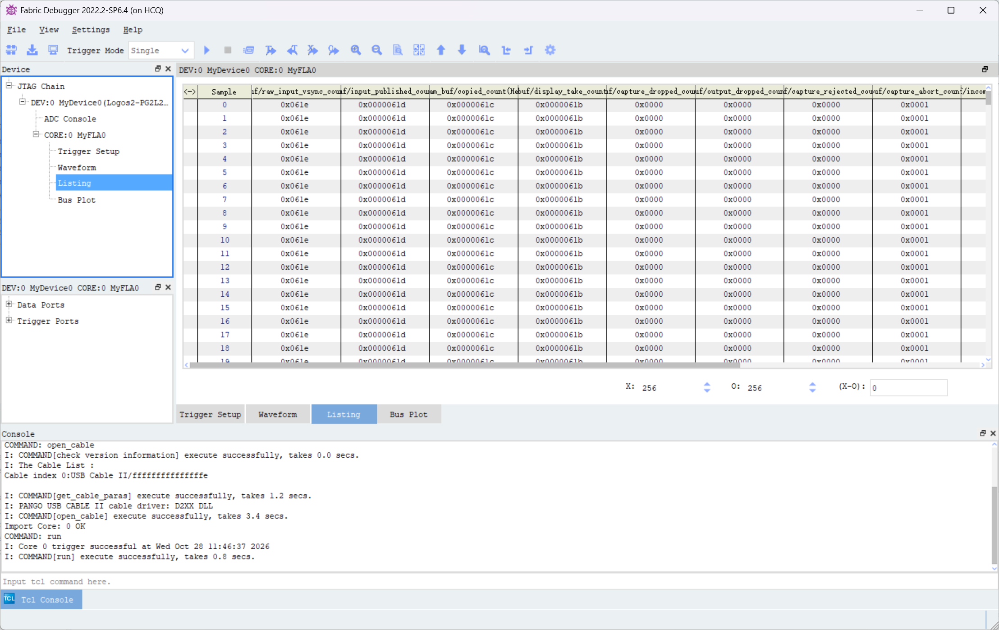
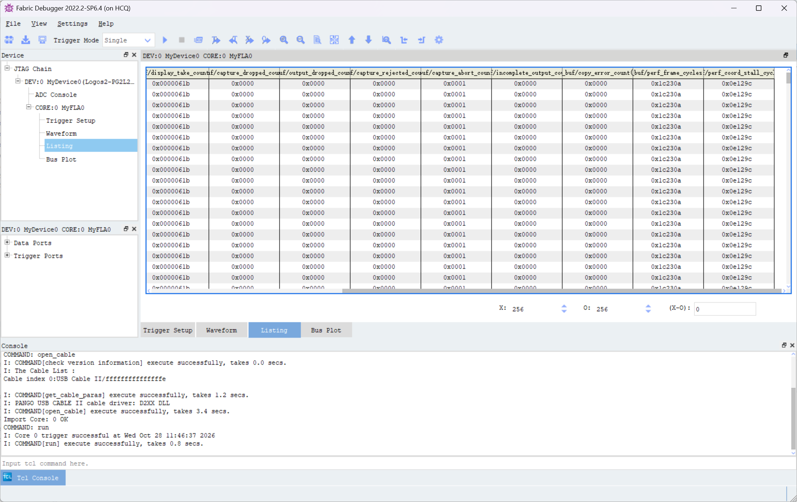
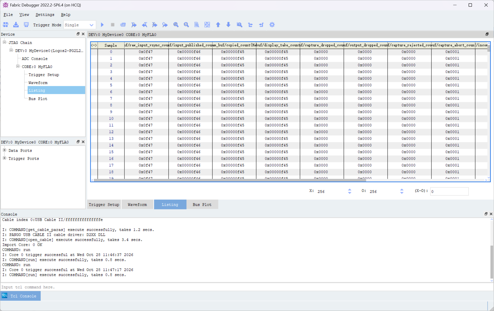
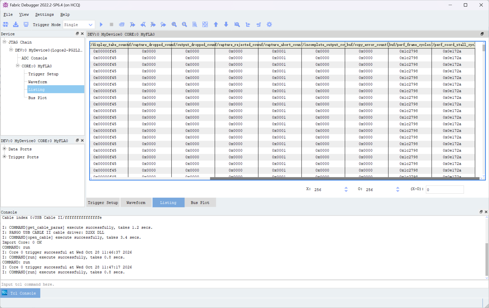

# 新增插值算法：讨论与 Stage 9 实测分析

> 本文整理本轮有关新增插值算法、串口选择模式和 Stage 9 上板计数的讨论。截图只作为调试证据；截图中的软件界面和数值不视为操作指令。

## 讨论记录

1. 用户询问能否编写其他插值算法，并讨论了先完成角度纠正还是直接加入新算法。决定以 Stage 8 角度纠正为基础，独立创建 Stage 9 插值测试工程，便于逐种算法对比。
2. 用户指定双三次核为 Catmull–Rom（Keys 参数 `a=-0.5`），确认 Stage 9 方案，并要求每个测试工程附带对应 Fabric Debugger 配置（FIC）以便实板测帧率。
3. 用户要求先创建 Git 分支 `新插值算法` 并切换。Stage 9 工程位于 [`stage9_bicubic_catmull_rom`](../../fpga/project/stage9_bicubic_catmull_rom/README.md)。软件参考、规划器、4×4 cache 读取、插值 RTL 和 1280×720 全帧仿真均通过。最初不含 UART 的构建关键 DDR 时钟 slack 为 +0.037 ns；结果与哈希见[结果记录](../results/stage9-bicubic-catmull-rom.md)。该结果只适用于当时的 RTL 和位流。
4. 用户询问能否未来通过串口选择插值模式。结论是可以：后续需要命令解析、帧边界生效控制，以及同时存在的两套算法硬件或其他运行时可切换结构。当前 UART 仅接收字节，没有命令解析；本次加入的编译期模式选择也不受串口控制。
5. 用户提供 4 张 Fabric Debugger 截图，请求分析原因并将聊天记录保存到本文。
6. 讨论 UART 接收接口时确认开发板为盘古 200Pro+。厂家手册列出板载 CP2102 USB-UART，`UART0_RX` 接 FPGA P14，`UART0_TX` 接 K19。最初 Stage 9 主工程尚未使用 P14；L8 已接 DDR `mem_dq[3]`，因此没有照搬 DDR 自测子工程里的 L8 UART 映射。用户确认加入 P14 上的 115200/8-N-1 字节接收器，暂不加入包协议、CRC、算法切换或 TX。设计说明见 [`Stage 9 UART RX 接口设计`](../superpowers/specs/2026-10-25-stage9-uart-rx-interface-design.md)。
7. 用户进一步要求只要不影响主算法，就直接加到 `stage9_bicubic_catmull_rom`。工程已加入 UART RX 模块、顶层端口和 P14 约束；接收字节保留在内部 `uart_rx_data/uart_rx_valid` 信号上，没有接入像素算法或角度参数。
8. 用户要求生成位流上板测试。2026-10-25 11:24 的完整 PDS 流程确实生成 9,188,552 字节 `.sbit`，SHA-256 为 `892F3D325FCFE033BCAAE8C85467EC5C10CF71FF49238981F3DB1BCEFDFC8B59`，并核对了 256 通道配套 FIC（SHA-256 `D1FDB7592A3BCF4979C8B4B0A9596ACB6E865D5F23BA1F6EF994263379A90DF7`）。但后置时序显示 `Some Constraints Violated`：`ddrphy_sysclk` 125 MHz setup 最差 slack 为 **-0.179 ns**、13 个失败端点，所以构建脚本按规则报错。该位流只能作为有时序风险的试测文件，不能记录为通过时序的交付版本。
9. 用户接着要求在同一 Stage 9 工程加入双线性插值，并在综合前选择算法，默认仍用已实现的 Catmull–Rom 双三次；用户确认口语中的“三线性”在此指“双三次”，不是三维三线性。经比较编译期选择、`generate` 参数和运行时双通路后，用户确认采用编译期选择，不新建工程。现有双三次实例路径保留，双线性复用 Stage 8 已带来的 2×2 规划器、cache 读取器和流水插值器；两种模式只编译其中一条。双线性启用严格 2×2 黑边；双三次仍用严格 4×4 黑边。设计见[编译期插值选择说明](../superpowers/specs/2026-10-25-stage9-compile-time-interpolation-design.md)。
10. 默认模式通过 64×8 帧仿真，双线性模式通过同尺寸帧仿真；半像素双线性数值和输出反压单元仿真也通过。PDS 分别综合两种模式：默认双三次使用 24,758 LUT/14,310 寄存器，与引入选择功能前的 UART 版相同；双线性使用 23,558 LUT/12,073 寄存器。可见编译期选择未同时保留两套采样硬件。
11. 为修复 UART 版完整构建暴露的 -0.179 ns setup 违例，在 Catmull–Rom 水平四项加权累加间加入一级弹性流水，将水平计算拆为两组部分和、最终水平和，再进入垂直乘法。插值公式及定点宽度保持不变。Catmull–Rom RTL 仿真、64×8 整帧仿真和 1280×720 全帧仿真均通过。
12. 2026-10-25 12:42 完成更新后默认双三次配置的完整 PDS 构建。布局布线后报告 `All Constraints Met`，125 MHz `ddrphy_sysclk` slack +0.131 ns，失败端点为 0。新 `.sbit` 与配套 `.fic` 位于 Stage 9 的 `generate_bitstream/`；位流 SHA-256 `6B7224CC56A6CE352BCB46CDE581CFE9F8D4298EBF71B72620CFDD520AC04040`，FIC SHA-256 `D1FDB7592A3BCF4979C8B4B0A9596ACB6E865D5F23BA1F6EF994263379A90DF7`，并与同次综合 FIC 哈希一致。详细结果见[结果记录](../results/stage9-bicubic-catmull-rom.md)。

## 截图与采样时刻

Fabric Debugger 控制台记录了两次成功触发，约相隔 60 秒：10:37:04 与 10:38:04（截图显示的本地时间）。截图副本保存在本文旁边的 `assets/新增算法/`：

| 采样 | Listing | 右侧性能计数 |
|---|---|---|
| 10:37:04 |  |  |
| 10:38:04 |  |  |

## 60 秒累计帧计数

以下数字由两次截图的十六进制累计计数直接相减：

| 计数器 | 10:37:04 | 10:38:04 | 增量 | 约每秒 |
|---|---:|---:|---:|---:|
| 原始输入 VSYNC | `0x28d8` (10,456) | `0x36f2` (14,066) | 3,610 | 60.17 |
| 输入帧发布 | `0x28d7` (10,455) | `0x36f1` (14,065) | 3,610 | 60.17 |
| 处理完成 | `0x02f7` (759) | `0x03fe` (1,022) | 263 | 4.38 |
| 显示取用新帧 | `0x02f7` (759) | `0x03fe` (1,022) | 263 | 4.38 |
| READY 输入帧覆盖 | `0x25de` (9,694) | `0x32f1` (13,041) | 3,347 | 55.78 |

在该测量窗口中，`3,610 = 263 + 3,347`：新发布的输入帧里，263 帧完成处理，3,347 帧在仍处于 READY 状态时被较新的输入帧覆盖。处理完成和显示取用计数增量相同，因此这一窗口的显示新帧速率约为 4.38 fps；输入约为 60.17 fps。`perf_error_flags` 两次均为 `0x00`，表示所映射的错误标志没有置位；这不表示没有帧覆盖，帧覆盖由单独计数器记录。

这些是约 60 秒窗口的累计计数差，不是 HDMI 扫描刷新率。原始 VSYNC 与发布计数的累计值只差 1，且两者窗口增量相同。仅凭这一组快照不能判定所有未发布帧的具体路径。

## `0xffffffff` 性能值的原因

截图中 `perf_frame_cycles`、`perf_coord_stall_cycles` 和 `copy_frame_cycles_max` 显示为 `0xffffffff`。这不能按一个有效的 32 位周期值解释：Stage 9 RTL 中这些量的声明宽度是 **24 位**，最大值为 `24'hffffff`，并在达到上限后停止增加。FIC 也只映射相应的 24 个信号位。Fabric Debugger 将 24 位全 1 显示为八位十六进制的具体扩展方式未由截图单独证明；结合 RTL，安全解释是底层 24 位字段已经全 1 并饱和，UI 显示可能做了符号扩展。

24 位计数在 125 MHz 下最多表示约 **16,777,215 周期 / 0.1342 秒**。因此截图的帧周期和坐标停顿值只能说明至少到达该上限，不能用来计算实际单帧周期。`copy_frame_cycles_max` 同样只有 24 位，不能给出超过上限的最大帧周期。

定义依据：[`frame_identity_transform_engine.sv`](../../fpga/project/stage9_bicubic_catmull_rom/source/rtl/memory/frame_identity_transform_engine.sv) 中 `frame_cycle_count` 和 `coord_stall_count` 均为 24 位饱和计数器；完成帧时才把它们快照到 `perf_frame_cycles` 和 `perf_coord_stall_cycles`。[`fram_buf.v`](../../fpga/project/stage9_bicubic_catmull_rom/source/rtl/fram_buf.v) 中 `copy_frame_cycles_max` 也是 24 位。

## 当前最可能的吞吐瓶颈

RTL 直接显示，`cached_bicubic_neighbor_reader` 每接收一个有效像素，要按顺序执行 **4 次 2×2 Tile Cache 查询**，每次等待响应后才启动下一次查询；四组样本收集完毕并交付下游后，读取器才回到空闲态接受下一个像素。实现见[`cached_bicubic_neighbor_reader.sv`](../../fpga/project/stage9_bicubic_catmull_rom/source/rtl/memory/cached_bicubic_neighbor_reader.sv)。一帧 1280×720 因而需要 921,600 × 4 = **3,686,400 次 2×2 查询**。

这会让邻域读取器长时间对上游施加反压，与截图中饱和的 `perf_coord_stall_cycles` 和很低的完成帧增量相符。基于当前 RTL 与实测数据，**串行四次查询是首要的结构性吞吐嫌疑点**。这属于有证据支持的原因判断，但截图没有单独测出每个内部状态的周期，不能把全部停顿精确归因给该模块。

另外，最近完成帧的截图快照中，cache miss 为 `0x002d8e`（11,662），cache fill cycles 约 `0x0f5xxx`（约 100 万），write phase 约 `0x04bxxx`（约 31 万），write wait 约 `0x02exxx`（约 19 万）。这些是不同阶段的帧内计数，部分周期可能重叠，**不能直接相加**。它们比饱和的总周期上限小，但由于总计数已饱和，现有数据不足以完成精确帧周期分解。

## 建议的下一步

1. 先把总帧周期、坐标停顿及最大帧周期计数扩展到至少 32 位，并同步更新 Fabric Debugger FIC 映射；保留饱和语义，避免把全 1 误当作有效测量值。
2. 增加读取器各状态的周期计数，区分 cache 命中查询、miss/refill 等待、插值器反压和 DDR 写等待，重新烧录匹配的 `.sbit/.fic` 后做同样的 60 秒差分测量。
3. 优化 4×4 邻域收集：评估按行/窗口复用像素的 line buffer 或并行 cache 读通路，减少每个输出像素四次串行查询造成的接受速率限制。优化后先跑 1280×720 全帧仿真，再构建并进行同条件实板 A/B 测试。
4. 串口模式选择作为独立控制功能接入：先确定协议、模式编号与校验，再在帧边界锁存模式，避免一帧中途换算法。模式控制本身不会解决当前 4×4 读取器吞吐瓶颈。

## Stage 8 标定系数副本

2026-10-26，按用户要求从 `stage8_angle_correction` 复制出独立工程 [`stage8_angle_correction_copy`](../../fpga/project/stage8_angle_correction_copy/README.md)，并只在副本中更新了 Brown 映射器的四个系数。原 Stage 8 工程未改动。

系数来自最新的 [`calibration.json`](../../host/calibration/output/calibration.json)，使用有符号 Q20 定点常数：

| 系数 | 标定值 | Q20 整数 |
|---|---:|---:|
| `k1` | -0.4147728667 | -434921 |
| `k2` | +0.2415032890 | 253235 |
| `p1` | +0.0013237123 | 1388 |
| `p2` | +0.0000991201 | 104 |

实现位于副本的 `source/rtl/correction/fractional_brown_mapper.sv`。径向和切向项已改为使用这些 Q20 常数，并将乘积与累加分布在现有可停顿流水级中。标定文件中的 `k3=-0.0889511214` 尚未接入；当前映射器只实现 `k1/k2/p1/p2`，与此前“后续再做 K3”的安排一致。

本次只修改了副本 RTL 和 README，没有运行仿真或 PDS 构建，也没有生成新位流。副本生成目录中的既有文件仍对应旧试验系数；系数乘法更新后的布局布线时序也尚未确认。要烧录新参数，需先重新构建并检查时序，再使用该次构建配套的位流和 FIC。

## Stage 8 黑区定位与独立修复工程（2026-10-26）

归一化更新后的实板画面上半部有图像，下半部为黑色；LED4、LED5 灭，LED6 亮，HDMI 活动信号正常。鼠标移到黑区也没有图标，说明黑色已写入/送入显示图像，不能仅用显示器扫描异常解释。Fabric Debugger 后续按像素 ID 对齐的数据将错误缩小到 Brown Y 像素尺度乘法：

| 对应目标像素 ID | Brown `total_y8` | 旧 `correction_y9` | 按 `total_y8 * FY_Q16 >>> 16` 计算 | 差值 |
|---|---:|---:|---:|---:|
| `0x8F087` | `-406` | `0x017AB5D6` | `0xFFFAB5D6` | `0x01800000` |
| `0x8F088` | `-408` | `0x017AAF2B` | `0xFFFAAF2B` | `0x01800000` |
| `0x8F089` | `-410` | `0x017AA87F` | `0xFFFAA87F` | `0x01800000` |

`FY_Q16=55958233`，差值 `0x01800000` 对应 +384 像素。后一级加法与该错误量吻合，Y 源坐标因此落到画面之外，`plan_geometry_valid=0` 并输出黑色。相同 RTL 的普通仿真可算出正确负数，旧 PDS 日志还显示 `correction_y9` 高位悬空清理警告；现有证据指向 PDS 综合/实现中的有符号常量乘法高位，而不是单纯的标定图片或 DDR 缓存问题。这里的定位仍需新位流实板复测最终确认。

按用户要求，新建独立工程 [`stage8_brown_y_mul_fix_test`](../../fpga/project/stage8_brown_y_mul_fix_test/README.md)，保留旧副本供对照。新 RTL 把负数取绝对值、无符号乘法、恢复负号分别放在 S8、S9、S10，S11 再与原始 Y 相加；负数舍入严格对应原来的算术右移。X 坐标、像素 ID、帧元数据和有效位同步延迟一个周期。第一次把取绝对值、乘法、符号恢复全放在一个组合级的尝试在布局后有约 `-4.908 ns` 最差时序裕量，已废弃。分级方案的定向黑区坐标仿真、完整坐标链及回压仿真、60 组参考向量仿真和严格边界仿真均通过。

新工程的 [探针表](../../fpga/project/stage8_brown_y_mul_fix_test/README_JTAG.md) 将校正量改为 `correction_y10`、最终坐标改为 `mapped_y11`，并保留各级像素 ID。用户选定的黑区目标 `0x8F076` 解码为 `x=886,y=457`。实板复测时应使用本工程同一次生成的 `.sbit` 与 `.fic`，按像素 ID 对齐后检查负校正量、高位符号、最终坐标和 `plan_geometry_valid`。

### 构建交付与验证结果

2026-10-26 13:54 完成新工程完整 PDS 构建。布线后时序报告为 `All Constraints Met`，125 MHz `ddrphy_sysclk` setup WNS **+0.132 ns**、TNS 0、失败端点 0；Fabric Debugger 核插入成功，256 个通道配置均通过构建脚本核对。新位流和配套配置在工程的 `generate_bitstream/` 下：

| 文件 | 字节 | SHA-256 |
|---|---:|---|
| `HDMI_IN_DDR3_HDMI_OUT_top.sbit` | 9,188,552 | `DEDD34AA55585B0EED9E201CC40DCC0F4A6EF0851A544401CAAEEA415EDA8A31` |
| `HDMI_IN_DDR3_HDMI_OUT_top.fic` | 35,349 | `3F9B42B979A82E6BF3F255D5DD3D1AA7480078B1200BE5278A5A9C88E2E7B6C3` |

输出 FIC 与同次综合输入 FIC 的 SHA-256 一致。上述仿真和时序证明 RTL 数值与工程构建条件；**尚未实板烧录复测**，因此黑区是否消失、图像几何是否满足最终效果仍需上板确认。若仍黑，优先按探针表对齐 `0x8F076` 附近的 `total_y8`、`correction_y10`、`mapped_y11` 以及 `plan_geometry_valid`。

### FIC 帧率诊断映射更新

用户发现长时间运行时出现掉帧，要求保留坐标修复后能观察帧率。因此将工程 FIC 的 256 个通道改映射为原始输入 VSYNC、输入发布、成功处理、显示取帧计数，各类丢帧/拒绝/中止/不完整帧计数，以及最近完成帧的总处理周期和坐标等待周期。相关计数器增加 `PAP_MARK_DEBUG` 标记，构建脚本的探针校验也改为检查新计数映射；通道说明和测量方法见工程的 [`README_JTAG.md`](../../fpga/project/stage8_brown_y_mul_fix_test/README_JTAG.md)。

FIC 配置更新后，2026-10-26 19:38 已按用户要求重新运行完整 PDS 流程。布局布线成功，时序报告为 `All Constraints Met`；最紧的 `ddrphy_sysclk` setup WNS 为 +0.048 ns、TNS 为 0。新 `.sbit` 与 `.fic` 已输出到工程 `generate_bitstream/`，并与同次综合输入 FIC 哈希一致。此次构建信息和长时间运行计数快照见下节。

### Stage 8 半小时运行后的帧率观测（2026-10-26）

用户在系统已连续运行约半小时后，用刚生成的匹配 `.sbit/.fic` 采集两次 Fabric Debugger Listing。控制台显示两次触发时间为 19:41:40 和 19:42:46，相隔 66 秒。计数器快照如下：

| 计数器 | 19:41:40 | 19:42:46 | 增量 |
|---|---:|---:|---:|
| 原始输入 VSYNC（16 位回绕） | `0x0a7d` (2,685) | `0x19f4` (6,644) | 3,959 |
| 输入帧发布 | `0x00000a7c` (2,684) | `0x000019f3` (6,643) | 3,959 |
| 处理完成 | `0x00000a7b` (2,683) | `0x000019f2` (6,642) | 3,959 |
| 显示取用新帧 | `0x00000a7a` (2,682) | `0x000019f1` (6,641) | 3,959 |
| 输入帧池 ready 丢弃 | `0x0000` | `0x0000` | 0 |
| 输出帧池 ready 丢弃 | `0x0000` | `0x0000` | 0 |
| 输入采集拒绝 | `0x0000` | `0x0000` | 0 |
| 输入采集中止 | `0x0001` | `0x0001` | 0 |
| 输出不完整帧 | `0x0000` | `0x0000` | 0 |
| Copy 错误 | `0x0000` | `0x0000` | 0 |

66 秒窗口平均帧率为 `3,959 / 66 = 59.985 fps`。输入发布、处理完成和显示取用的增量完全相同；对应的累计计数保持固定一帧的流水延迟。所有丢帧、拒绝、不完整帧和 copy 错误计数在窗口内均未增加；采集中止计数虽为 1，但两次快照之间没有增加。因此这组长时间运行后的观测**没有发现掉帧，实测平均输入及处理/显示新帧速率约为 60 fps，且在该 66 秒采样窗口内稳定**。

这只能证明半小时运行后的这段 66 秒窗口，不等于对整个半小时逐帧监测，也不能排除窗口外短暂异常。`perf_frame_cycles` 从 `0x190387`（1,642,375）到 `0x191322`（1,643,298），相差 923 周期；`perf_coord_stall_cycles` 从 `0x0af2dc`（717,532）到 `0x0b0277`（721,527）。两者是最近完成帧的周期快照，不是窗口累计帧数；按 DDR 时钟 125 MHz 换算，总处理约 13.14 ms/帧、坐标等待约 5.74–5.77 ms/帧。总处理周期远低于 16.67 ms 的 60 fps 帧间隔，与帧计数差分结果相符。

本次配套构建文件（2026-10-26 19:38:41）：

| 文件 | 大小 | SHA-256 |
|---|---:|---|
| `generate_bitstream/HDMI_IN_DDR3_HDMI_OUT_top.sbit` | 9,188,552 字节 | `7B62A657724C895A108658A7C24357A439BE366DF81E96AF74C0066B76AFF58D` |
| `generate_bitstream/HDMI_IN_DDR3_HDMI_OUT_top.fic` | 21,960 字节 | `74E38632034EE6933DE019013A432E820BA20912D95E097B4E0A2F938997228C` |

时序报告：[`HDMI_IN_DDR3_HDMI_OUT_top.rtr`](../../fpga/project/stage8_brown_y_mul_fix_test/report_timing/HDMI_IN_DDR3_HDMI_OUT_top.rtr)。本次 sbit 哈希：`7B62A657724C895A108658A7C24357A439BE366DF81E96AF74C0066B76AFF58D`；FIC 与综合输入 FIC 的哈希均为 `74E38632034EE6933DE019013A432E820BA20912D95E097B4E0A2F938997228C`。

## Stage 9 Brown 修复测试工程最新时序复核（2026-10-26 17:43）

本次确认的最新独立测试工程是 `stage9_bicubic_catmull_rom_brown_fix_test`，不是 Stage 9 主工程。其 2026-10-26 17:41 布线后报告为 `Design Summary : All Constraints Met.`。这次结果只更新 Brown 修复测试副本的状态；Stage 9 主工程 08:58 的报告另见[结果记录](../results/stage9-bicubic-catmull-rom.md)。

| 项目 | 最新结果 |
|---|---:|
| `ddrphy_sysclk` 目标频率 | 125 MHz |
| 估算频率／周期 | 125.2505 MHz／7.984 ns |
| Setup WNS／TNS | +0.016 ns／0 |
| Setup 失败端点 | 0 / 63,956 |
| Hold WHS／THS | +0.140 ns／0 |
| Hold 失败端点 | 0 / 63,956 |
| `.sbit` 大小 | 9,188,552 字节 |
| `.sbit` SHA-256 | `3C73F21353550C56C3E8357A00E355B421794A313CE17F79192CE7A4216EAA99` |
| `.fic` 大小 | 22,433 字节 |
| `.fic` SHA-256 | `31EA1CB5CDA0B2FB33D737C6BFB78A926433F7516EB37497A649295606209803` |

该测试工程的完整 PDS 流程已生成配套 `.sbit/.fic`，FIC 与同次综合输入 FIC 哈希一致。setup 裕量仅 +0.016 ns；约束通过不代表实板图像或吞吐率已经验证。Stage 9 顶层 UART 仍只接收字节，角度参数输入仍固定为低电平；动态角度数据包解析和帧边界更新尚未接通。

证据文件：`fpga/project/stage9_bicubic_catmull_rom_brown_fix_test/report_timing/HDMI_IN_DDR3_HDMI_OUT_top.rtr`、`run.log`、`generate_bitstream/HDMI_IN_DDR3_HDMI_OUT_top.sbit` 和 `generate_bitstream/HDMI_IN_DDR3_HDMI_OUT_top.fic`。详细 Stage 9 主工程历史见[结果记录](../results/stage9-bicubic-catmull-rom.md)，Brown 修复副本构建说明见[工程 README](../../fpga/project/stage9_bicubic_catmull_rom_brown_fix_test/README.md)。

## 历史吞吐率对照：Stage 8 Brown Y 乘法修复版（2026-10-27）

在 2026-10-27 的记录节点，算法对照和吞吐率测试基准指定为[`stage8_brown_y_mul_fix_test`](../../fpga/project/stage8_brown_y_mul_fix_test/README.md)。它保留 Stage 8 的 1280×720 DDR 视频链路、标定 Brown 映射和双线性插值，并修复实板发现的负 Y 校正乘法符号错误。该工程现在作为历史吞吐对照；Stage 9 Catmull–Rom／双线性工程仍是插值算法实验对象，其帧率不能替代不同工程之间的同条件 A/B 测量。

该基准版在 2026-10-26 19:38 完成匹配 `.sbit/.fic` 构建，布线后 `All Constraints Met`，125 MHz `ddrphy_sysclk` setup WNS 为 **+0.048 ns**。对应文件位于工程 `generate_bitstream/`：

| 文件 | 大小 | SHA-256 |
|---|---:|---|
| `HDMI_IN_DDR3_HDMI_OUT_top.sbit` | 9,188,552 字节 | `7B62A657724C895A108658A7C24357A439BE366DF81E96AF74C0066B76AFF58D` |
| `HDMI_IN_DDR3_HDMI_OUT_top.fic` | 21,960 字节 | `74E38632034EE6933DE019013A432E820BA20912D95E097B4E0A2F938997228C` |

半小时运行后，2026-10-26 19:41:40 至 19:42:46 的 66 秒窗口中，原始输入、完整发布、处理完成和显示取新帧都增加 **3,959 帧**，约 **59.985 fps**；窗口内丢弃、拒绝、中止、输出不完整和 copy 错误计数均未增加。最近完成帧约 **1,643,298 周期（13.15 ms @ 125 MHz）**。这组数据作为当前 720p60 吞吐对照基线；它只代表记录的采样窗口，不代替后续算法版本的同条件 A/B 实测。

该历史基准的适用范围也需保留：当时角度参数固定为零，FPGA Brown 映射尚未实现标定值 `k3`，因此它用于比较坐标／插值链路及吞吐变化，不代表完整镜头畸变精度已达标。黑区修复后的图像质量仍应按对应位流在实板复核。构建和半小时运行记录见[本文件的 Stage 8 修复章节](#stage-8-黑区定位与独立修复工程-2026-10-26)和[Brown 效果评估](../results/stage8-brown-y-correction-evaluation.md)。

## 前一版时间节点基准记录：Stage 8 双线性 UART 角度校正（2026-10-28）

截至该记录时点，像平面旋转校正和 UART 联调的 FPGA 基准工程为[`stage8_720p60hz_bilinear_uart_angle_correction`](../../fpga/project/stage8_720p60hz_bilinear_uart_angle_correction/README.md)。该工程提供 1280×720 DDR 视频链路、双线性插值、UART 单应矩阵参数接收和帧边界原子更新。UART 上传 3×3 输出到输入映射矩阵，不是角度数值本身。下文的 K3 工程实测记录更新了这一基准。

上位机连续入口为[`track_obs_rotation_continuous.py`](../../host/pose/track_obs_rotation_continuous.py)，固定使用 `picture/Calibration/00.png` 为方向参考，从 OBS 虚拟摄像机读取画面、测量去畸变棋盘格长轴方向，并为每次有效检测发送一帧带递增序号和 ACK 校验的参数包。棋盘格丢失时暂停发送，FPGA 保持最后一次接受的矩阵；按 `Ctrl+C` 停止后串口关闭。该脚本做的是像平面角度跟踪，不等同于完整 XYZ 姿态自动校正。

2026-10-28 的连续联调中，COM7 收到 **433 次成功 ACK**，更新速率约 **6–11 次/秒**；运行过程出现过短暂棋盘格检测丢失，脚本按设计保持上一组参数。用户提供的视频为 1280×720、30 fps、14.47 秒、434 帧；FFmpeg 全片解码未报错。画面可见旋转补偿和大角度时的黑边／裁切，符合固定输出画幅的采样边界现象。该视频是外部拍摄显示器的观察记录，不能用于逐像素误差或端到端延迟验收；6–11 次/秒也低于 30 fps 输入更新率。因此该版本作为**当前功能与联调基准**，不据此宣称 30/60 fps 实时跟踪、完整畸变标定精度或全三维场景矫正已达标。

## 最新 K3 实测基准工程：Stage 8 双线性 UART 角度校正（2026-10-28）

用户提供的 Fabric Debugger 截图显示，最新 FPGA 基准切换为[`stage8_720p60hz_bilinear_uart_angle_correction_k3_test`](../../fpga/project/stage8_720p60hz_bilinear_uart_angle_correction_k3_test/README.md)。它在前一版 720p 双线性 UART 角度校正链路上加入经标定的 Brown-Conrady `k3`；K3 的 12 级支路与主映射流水线对齐。工程已完成 RTL 回归和 PDS 完整布线，最终报告 `All Constraints Met`，125 MHz DDR 时钟域 setup WNS **+0.020 ns**，并已生成配套 `.sbit/.fic`。本节记录的是该位流上板后的运行计数，不把构建通过等同于图像质量验收。

### 约 40 秒运行窗口

Fabric Debugger 控制台时间为 11:46:37 和 11:47:17，时间间隔约 40 秒。帧率按两次累计计数的差值估算：

| 计数器 | 11:46:37 | 11:47:17 | 增量 | 估算帧率 |
|---|---:|---:|---:|---:|
| 原始输入 VSYNC（16 位回绕） | `0x061e` (1,566) | `0x0f47` (3,911) | 2,345 | 约 58.63 fps |
| 输入帧发布 | `0x0000061d` (1,565) | `0x00000f46` (3,910) | 2,345 | 约 58.63 fps |
| 处理完成 | `0x0000061c` (1,564) | `0x00000f45` (3,909) | 2,345 | 约 58.63 fps |
| 显示取用新帧 | `0x0000061b` (1,563) | `0x00000f45` (3,909) | 2,346 | 约 58.65 fps |

输入发布、处理完成与输入帧到达计数在窗口内同步增加；显示取帧计数也跟上，增量多 1 帧是两次快照时流水延迟位置不同造成的计数边界差。输入丢弃、输出丢弃、采集拒绝、不完整输出及 copy 错误计数两次均为 0；采集中止计数两次均为 1，窗口内没有增加。因此该窗口**没有发现处理链路掉帧，吞吐可跟上本次输入源**。按秒级控制台时间戳估算为约 58.6 fps，接近 60 fps；若两个时间戳各有约 1 秒量化误差，真实窗口可能约为 39–41 秒，对应估算范围约 57.2–60.1 fps，所以现有证据不足以证明严格的 60.00 fps。

截图副本：

| 采样 | 累计帧计数 | 性能计数 |
|---|---|---|
| 11:46:37 |  |  |
| 11:47:17 |  |  |

### 计数解释与当前基准状态

截图中的 `perf_frame_cycles` 为 `0x1c230a` 和 `0x1c2798`；`perf_coord_stall_cycles` 显示为 `0x0e0129c` 和 `0x0e0172a`。后者大于前者，但 K3 工程 RTL 定义坐标停顿周期为总帧处理周期的子集，因此这两项快照与当前 RTL 计数关系不一致。本次帧率结论只采用独立的累计帧计数与丢帧标志；帧周期/停顿周期需再核对上板 `.sbit/.fic` 是否来自同一次 K3 构建后复测，不据此推导单帧周期。

**目前仍有上板帧率实测证据的基准**是[`stage8_720p60hz_bilinear_uart_angle_correction_k3_test`](../../fpga/project/stage8_720p60hz_bilinear_uart_angle_correction_k3_test/README.md)：约 40 秒窗口内未观测到输入到处理的帧数损失，估算约 58.6 fps。该证据支持“接近 60 fps、该窗口无掉帧”，不代表严格锁定 60.00 fps。后续新增的 65 字节工程是最新 UART 协议和角度校正联调基准；它尚无同条件吞吐实测，不能用 K3 的帧率数据替代。

### K3 图卡校正仿真补充

针对同一份按完整五系数 Brown 模型（含标定 `k3`）生成的合成输入，分别执行完整 K3 和 `k3=0` 反畸变。两组使用同一内参和双线性插值。网格几何残差显著改善，但 SFR/MTF50 基本持平：

| 指标 | K3 开 | K3 置零 | 结果 |
|---|---:|---:|---|
| 网格线平均 P95 正交残差 | 0.0435 px | 2.0851 px | K3 开约降低 48 倍 |
| 最差单线 P95 | 0.1716 px | 6.1618 px | K3 开明显减少残余弯曲 |
| 斜边 MTF50 均值（8 个可测位置） | 0.26807 cyc/output-pixel | 0.26908 cyc/output-pixel | K3 开约低 0.38% |

结论是当前标定下 K3 有明确的**几何矫正收益**，但这次仿真没有显示清晰度提升。该图卡为软件合成，没有镜头 PSF、传感器噪声或 FPGA 定点误差；MTF50 仅反映数字重采样，不能视为实拍光学 MTF 或板级图像质量验收。中心斜边的 MTF50 超出 Nyquist 可测频带，故均值仅纳入八个可测位置。方法、逐位置数据、SFR 曲线和图表见[完整 K3 图卡 SFR 仿真报告](../results/stage8-k3-chart-sfr-simulation.md)。

## 最新 UART 与角度校正基准：65 字节协议（2026-10-28）

当前最新 UART 协议/角度校正工程为[`stage8_720p60hz_bilinear_uart_angle_correction_65byte`](../../fpga/project/stage8_720p60hz_bilinear_uart_angle_correction_65byte/README.md)，从原 [`stage8_720p60hz_bilinear_uart_angle_correction`](../../fpga/project/stage8_720p60hz_bilinear_uart_angle_correction/README.md) 复制，基准工程目录未修改。新工程保留 720p 双线性视频链路和 UART 单应矩阵帧边界更新，统一使用固定 65 字节的协议版本 `02`：偏移 7–42 为矩阵，43–62 为当前必须全零的 20 字节扩展区，63–64 为 CRC；CRC 覆盖偏移 2–62。协议细节和状态码见新工程 README。

2026-10-28 完成该副本完整 PDS 构建，报告 `Design Summary : All Constraints Met.`，125 MHz `ddrphy_sysclk` setup WNS 为 **+0.098 ns**、TNS 为 0、失败端点为 0。位流与配套 FIC 已生成在工程 `generate_bitstream/`：

| 文件 | 大小 | SHA-256 |
|---|---:|---|
| `HDMI_IN_DDR3_HDMI_OUT_top.sbit` | 9,188,552 字节 | `3BAE37D54943E33A3294369010D53D4EC4161440D17EAD1F1681372E0BB5035C` |
| `HDMI_IN_DDR3_HDMI_OUT_top.fic` | 21,985 字节 | `779431FE1334D623022F82DA43100432FF200A3B7F07CA65F1CC6BE3E4FB31D1` |

用户已用 COM7、115200 baud、8-N-1 对新工程发送 65 字节角度矩阵请求并确认运行正常。可重复执行工程内的[单帧串口角度校正脚本](../../fpga/project/stage8_720p60hz_bilinear_uart_angle_correction_65byte/sim/Run-UartAngleCorrection.ps1)。上位机离线帧生成、OBS 单帧发送和 OBS 连续跟踪也已切换到版本 `02`、65 字节 ACK 校验。

该工程用于后续 UART 参数和角度校正工作的最新工程基准；当前没有它的长时间帧率或完整画质 A/B 实测。它从原 Stage 8 基准复制，并未包含 K3 测试副本的新增 K3 支路，所以 K3 几何校正和吞吐观察仍以本文件前述 K3 工程及其采样数据为准。位流构建通过和串口参数收发正常不等同于图像质量、完整畸变精度或吞吐验收。
