# Stage13 运动防抖当前方案

## 项目基线

Stage13 工程位于 `fpga/project/stage13_720p60_motion_stabilization_test`，由稳定的 Stage11 720p60 图像增强工程复制而来，作为独立开发副本。Stage11 原工程未修改。目录此前误命名为 `stage13_1080p60_motion_stabilization_test`，已更正为 `stage13_720p60_motion_stabilization_test`，以匹配实际基线。当前工程保留 720p60 数据流并增加运动平移补偿接口，**没有集成 Stage12 超分辨率链路**；超分暂缓移植，后续时序优化后再评估。此次只改目录名和文档引用，未改 RTL，也未重跑 PDS；既有构建日志/数据库中的绝对路径仍可能显示旧目录名。

当前方案由上位机估计全局平移，FPGA 在图像采样坐标上执行补偿。第一版针对画面整体水平和垂直抖动，不处理旋转、缩放、滚动快门或局部运动。

**±24 px 校正通路已上板验证（用户于 2026-11-01 确认）。**固定 UART 参数包的 ACK、`dx/dy` 正负方向、输出帧边界更新和接近每轴 ±24 px 时的边缘裁切均已检查。此结论针对 FPGA 参数接收与采样坐标补偿通路；上位机自动光流估计与补偿的连续视频闭环效果仍需单独评价。

## 数据流

```mermaid
flowchart LR
    camera["OBS / UVC 摄像头帧"] --> host["Python：稀疏 LK 光流与全局 dx/dy"]
    host --> filter["死区、路径低通、补偿限幅"]
    filter --> uart["65 字节 UART v2：Q16.16 dx/dy"]
    uart --> bank["FPGA：校验并暂存 pending 参数"]
    bank --> boundary["输出帧边界原子切换"]
    boundary --> coord["Brown 映射后的源取样坐标加 dx/dy"]
    coord --> sample["DDR 读取邻域并双线性插值"]
    sample --> enhance["Stage11 图像增强"]
    enhance --> output["720p60 HDMI 输出"]
```



正 `dx` 会使 FPGA 从输入图像右侧多取像素，因此输出内容向左移；正 `dy` 同理让输出内容向上移。dx 和 dy 都以源图像像素为单位，横纵方向使用相同的像素限幅，不按画面宽高比换算。

## 上位机算法

脚本 `host/pose/stage13_motion_stabilization.py` 从连续 OBS/UVC 帧运行稀疏 Lucas–Kanade 光流，以前后向一致性和中位数共识剔除不可靠特征。估计值经过 `0.10 px/frame` 默认死区后参与位移积分；路径的低通趋势用于区分持续移动和短时抖动。补偿量使用 `path - trend`，与测得的画面位移同号：FPGA 将 dx/dy 加到源图取样坐标，因此同号采样偏移会把画面内容移回平滑路径。

默认视频源为 OBS Virtual Camera 2，默认串口为 COM7、115200 baud。默认 FPGA 坐标为 1280×720。输入若与目标宽高比不同，会等比例缩放并居中补黑边，不再拉伸变形；dx/dy 仍按 FPGA 坐标画布像素计。运行时窗口可查看：

- `flow`：原始光流测量，用于观察估计噪声。
- `motion`：死区处理后参与控制的位移。
- `trend`：累计路径的低通趋势，不是当前帧位移。
- `correction`：限制幅度后的 FPGA 采样坐标补偿。

图像本身不能完全判断操作者意图，快速主动移动仍可能被识别成抖动。默认丢弃置信度低于 `0.25` 的帧，并丢弃全局位移模长超过 `40 px/frame` 的单帧估计，避免低置信度大跳变污染累计路径；这两个门限可用 `--min-confidence` 和 `--max-motion-per-frame` 调整。终端与退出汇总会分别累计跟踪失败、置信度不足和位移超限次数。

## UART 协议与 FPGA 行为

Stage13 沿用固定 65 字节协议版本 `02`、原序号和 CRC-16/CCITT-FALSE。偏移 43 保留增强曲线 ID；偏移 44–47 是有符号小端 Q16.16 `dx`，偏移 48–51 是有符号小端 Q16.16 `dy`；偏移 52–62 必须为零。CRC 覆盖偏移 2–62。

偏移 6 的标志位定义如下：

| 标志 | 含义 |
|---|---|
| bit 0 | 更新单应矩阵；清零时保留 FPGA 当前单应矩阵 |
| bit 1 | 启用平移补偿；Stage13 上位机平移包置位 |
| bit 7:2 | 必须为零 |

有效请求进入 pending 参数组，在下一输出帧边界切换为 active。平移加在 Brown 映射后的取样坐标上，边缘按现有严格黑边策略处理。Stage11 仍把 bit 0 当作 `pose_valid`，所以 Stage13 包只用于 Stage13 工程。

## 当前限幅与终端观察

当前代码已将上位机默认补偿限幅、封包范围校验和 Stage13 RTL UART 范围校验改为 **每轴 ±24 px**。协议中的 Q16.16 对应有符号整数范围 ±1,572,864。24 px 是第一轮调试上限；更大的位移会裁掉更多输入视场，后续按画面效果调整。

用户提供的终端记录显示，旧版 `correction` 多次顶到 ±8 px，说明原上限确实在截断补偿。记录中也有 `flow` 约 −60 px 的瞬时跳变，但置信度约 0.2–0.3；这些低置信度大值不能直接作为新的限幅依据。当前改为 ±24 px，不把限幅直接设到 ±60 px。

后续静止日志进一步显示，约 `(+69,+37) px/frame` 和 `(-20,+51) px/frame` 的估计仅有 `0.21–0.23` 置信度，因旧默认门限 `0.20` 而被接受；静止后 flow 回落至约 ±0.06 px，motion 被 `0.10 px/frame` 死区归零，correction 随低通状态逐步衰减。之后摇晃日志显示拒绝主要来自置信度门限（589 次），于是将默认置信度门限从 `0.35` 降至 `0.25`，同时保留 `40 px/frame` 位移模长门限。最新日志末段为 `accepted=590`、`invalid=133`，其中置信度拒绝 124 次、位移超限 9 次、跟踪失败 0 次，约 82% 的估计通过。复核坐标定义后发现旧版使用了反号 `trend-path`，现已修正为 `path-trend`。±24 px 固定参数包的补偿方向已上板检查；自动光流估计生成的补偿在连续视频中的效果仍需单独评价。静止时 `trend` 仍可能显示很大的历史坐标，但它不是当前位移或 UART 输出量。

## FPGA 自主估计的独立验证计划

后续把防抖估计迁移到 FPGA 时，先在独立实验工程验证算法和时序，再将通过验证的模块移植回稳定基准。算法选择低分辨率灰度块匹配 SAD，不在第一版直接移植 Python 稀疏 LK。独立测试目录已按当前命名要求建立为 `fpga/project/stage13_motion_estimator_sad_test/`，目前仍为空；后续以现有 720p60 补偿工程为起点建立工程副本，保留相同的 PG2L200H 器件、输入时钟和坐标补偿接口。已通过 ±24 px 板测的基准工程在独立算法验收前不接入 SAD 改动。

### 阶段顺序

1. **固定输入输出约定。** 比较第 n−1 帧与第 n 帧来估计相机位移，再将结果用于后续输出帧。dx/dy 统一使用 FPGA 源图像像素单位；目标限幅为每轴 ±24 px，并定义置信度不足时保持上一个有效值还是回到零。估计与应用的帧延迟需要明确记录。
2. **±24 px 校正通路已验证。** 当前 `.sbit` 已支持每轴 ±24 px，用户于 2026-11-01 完成上板检查：固定 UART 包的 ACK、`dx/dy` 正负方向、帧边界更新及接近限幅时的边缘裁切均符合预期。旧 ±8 px 位流仅作历史记录，无须为这一已完成的检查重复构建。SAD 尚未接入，本项结果只证明现有参数与坐标补偿通路。
3. **用 Python 建立 SAD 参考模型。** 暂不改 RTL。用实际摄像头录像测试静止、水平/垂直及快速抖动、主动平移、局部运动、低纹理和亮度变化，确定下采样比例、块大小、搜索范围和置信度门限。记录下采样引起的位移粒度，例如四分之一分辨率下一个匹配像素对应原图 4 px。
4. **评估缓存与计算资源，并补齐独立工程。** 从 HDMI 输入流抽取亮度，估算当前/参考两张缩小帧的片上 RAM、块数量、SAD 运算量、处理周期和时序余量。优先评估四分之一分辨率；若双帧缓存占用过大，再评估八分之一分辨率，并增加局部精细搜索。RTL 算法实验在已创建的 `stage13_motion_estimator_sad_test` 空目录内建立独立副本；保持同一 PG2L200H 器件、720p60 时钟和坐标接口，改动及输出仅留在该测试工程。
5. **实现低分辨率双帧采集。** 在 HDMI 输入像素流上提取亮度并下采样，写入当前帧/参考帧双缓冲；仅在完整帧边界交换 buffer。处理 `pixclk_in` 到核心处理时钟的跨时钟同步，同时尽量不改变现有整帧 DDR 和图像变换数据流。
6. **实现 SAD 块匹配。** 从图像多个区域选块，在限定搜索窗中求 SAD 最小值，输出每块候选 dx/dy 和匹配代价。先做串行、少量块、低资源版本并测量处理周期；只有无法满足帧预算时再评估并行化。
7. **实现全局筛选与稳定化。** 对块位移做离群值过滤，统计主运动和有效块支持度，输出全局 dx/dy、置信度及有效标志。支持不足或匹配不可信时不让异常值污染状态；可信结果再经过定点低通、静止死区和 ±24 px 限幅，并在输出帧边界锁存到现有取样坐标补偿接口。
8. **先在独立 SAD 工程完整验证，再迁移。** 用确定性合成帧确认位移方向、静止噪声、限幅和低置信度行为；再对同一视频逐帧比较 Python 与 RTL 结果，接入实际 720p60 摄像头，检查连续运行、资源、处理周期和 PDS 布线时序。满足预先约定的精度、误检率、帧率及时序后，才把验证通过的模块迁移回已完成 ±24 px 板测的基准工程；回归图像增强、UART 手动 dx/dy、720p60 输出和时序，再生成集成位流。

### 工程边界

- 独立 SAD 工程用于快速试错和算法验证，失败时可整体丢弃，不污染已完成 ±24 px 板测的基准工程。
- 独立 SAD 工程与基准工程共用同一器件、视频时钟、输入尺寸、UART/补偿单位约定，避免“仿真能跑、集成无法闭合时序”。
- 第一阶段仅估计全局二维平移，不实现旋转、缩放、滚动快门或多深度视差补偿。
- 算法验证和完整视频系统验证分开记录；testbench 通过不能替代独立 SAD 工程的 PDS 布线时序与板上摄像头验证。

## 构建与验证状态

| 项目 | 状态 |
|---|---|
| Stage13 Python 光流与 UART 封包 | 已实现；当前默认限幅 ±24 px |
| Stage13 RTL 解析 dx/dy、帧边界锁存和坐标补偿 | 已写入源代码；当前解析范围 ±24 px |
| ±8 px 版本 PDS 构建 | 历史记录：曾完成；报告 `All Constraints Met`，慢角 `ddrphy_sysclk` setup WNS `+0.111 ns`、TNS 0、失败端点 0；不代表当前位流 |
| 当前 Stage13 `.sbit` | 用户于 2026-11-01 确认已支持每轴 ±24 px，且已用于固定 UART 包板测；具体哈希未在本文件归档 |
| 旧 ±8 px `.sbit` | 历史位流，SHA-256 `3D80A2708F9459959E292B01B0BD742A06A9F50BE79ED4ADA56004F60AF08291`；不可作为当前版本依据 |
| ±24 px 校正通路板上验证 | **已完成**（用户于 2026-11-01 确认）：固定 UART 包、正负 `dx/dy`、ACK、帧边界更新及接近 ±24 px 的裁切均已检查；输入/输出画面、补偿值及当前 `.sbit/.fic` 身份已记录 |
| Python SAD 参考模型 | 尚未实现；仓库目前只有 Stage13 稀疏 LK 上位机脚本 |
| 独立 SAD 算法工程 | `stage13_motion_estimator_sad_test` 目录已创建、目前为空；尚无 RTL、PDS 工程或板测结果，不改动已验证的补偿基准 |

近期顺序：±24 px 校正通路板上验收已完成。下一步用这次记录的基线视频建立 Python SAD 参考模型，逐帧保存块位移和匹配代价，并确定下采样比例、块大小、搜索范围及全局置信度规则；随后估算双帧 RAM 与处理周期，再在独立 SAD 测试工程实现 FPGA 估计器。验证通过后才考虑迁移到 Stage13 稳定基准。

## 运行命令

从工程根目录执行 dry-run 查看上位机实时估计，不打开串口：

```powershell
& '.\.venv\Scripts\python.exe' host\pose\stage13_motion_stabilization.py --dry-run --display
```

烧录与串口连接准备好后，移除 `--dry-run` 即开始向 COM7 发送实时补偿：

```powershell
& '.\.venv\Scripts\python.exe' host\pose\stage13_motion_stabilization.py --source 2 --port COM7 --display
```

## 2026-11-01：Stage13 FPGA 自主运动防抖估计计划

本节单独记录运动防抖估计器的后续路线，不改变上述 Stage12 超分辨率工作的状态。测试目录 `fpga/project/stage13_motion_estimator_sad_test/` 已创建，**目前是空目录**，没有 RTL、PDS 工程、仿真、位流或构建结果。此前防抖文档建议的 `stage14_motion_estimator_sad_test` 只是临时名称；按本次命名要求使用上述 `stage13_` 目录。现有 `stage13_720p60_motion_stabilization_test` 保留为上位机估计、UART 补偿与画面观察的基准。

### 目标与固定接口

第一版在 FPGA 内估计相邻输入帧的**全局二维平移**，用低分辨率灰度块匹配 SAD 代替 Python 稀疏 LK 光流；估计结果经过全局筛选、置信度判断、路径低通与限幅后，送入现有 Brown 映射后的源图采样坐标补偿接口。正 `dx/dy` 分别令输出内容向左/向上移动；单位始终是 1280×720 源图像像素，每轴补偿限幅为 ±24 px。保留 Stage13 的帧边界原子锁存与严格黑边规则。第一版只处理平移，不加入旋转、缩放、滚动快门或局部物体运动补偿。

估计第 `n-1` 帧到第 `n` 帧的位移，结果最早只能用于后续输出帧；实现时必须记录输入帧号、估计完成时刻、应用帧号和实际延迟。现有上位机在 OBS 画面突变时会先看到原始位移，再出现反向补偿，之后逐渐跟随新位置；FPGA 自主估计器也需用实测帧关联判断是否改善了这种可见响应，不能仅凭取消 UART 推断零延迟。

### 实施顺序

1. **核对现有校正通路。**【已完成，2026-11-01；用户确认】已检查当前 `.sbit/.fic`、±24 px 范围、UART ACK、正负方向、输出帧边界更新及裁切效果，并保存输入、输出和补偿记录作为 SAD 对照。具体文件身份和测量数值沿用用户保存的板测记录。

2. **建立 Python SAD 参考。**用同一批 1280×720 录制帧比较静止、水平/垂直抖动、突变后保持、往返移动、主动平移、局部运动、低纹理和亮度变化。先评估四分之一分辨率灰度图、分布在多个区域的纹理块及有界搜索窗；扫块大小、步长、搜索范围和候选数量，保存逐帧块位移与 SAD 最优/次优代价。四分之一分辨率的整数匹配步长相当于原图 4 px，需评估局部精细搜索或亚像素拟合，不能直接沿用 LK 版本的 0.10 px/frame 静止死区。

3. **冻结全局估计与置信度规则。**对各块候选按纹理强度、匹配代价和最优/次优差距筛选，再用中位数或主位移共识剔除局部运动和误匹配。定义有效块数量、空间覆盖、共识比例及置信度门限；低置信度、超搜索范围或帧缺失时，明确规定状态保持或向零衰减，避免异常值进入累计路径。与现有脚本比较位移符号、误检、漏检及静止噪声。

4. **估算存储、运算与帧预算。**按实际下采样率计算两张灰度帧的 RAM 占用、块数×候选数×块像素数的 SAD 运算量、读口需求和最坏处理周期。四分之一分辨率的两张 8 位 320×180 图约需 112.5 KiB；若片上 RAM 或读口不足，再比较八分之一分辨率及局部精细搜索。以 125 MHz、720p60 约 2,083,333 周期/帧为预算，并把 DDR 视频链、时钟跨域和帧边界等待计入实际余量。

5. **建立独立工程并采集灰度双帧。**在空目录内以已验证的 Stage13 源码建立独立 PDS 副本，保持 PG2L200H、720p60 输入、时钟、引脚和现有补偿接口约定。在 HDMI 输入像素流提取亮度并下采样，写当前/参考帧双缓冲；仅完整帧可供匹配，帧边界交换缓冲，并处理 `pixclk_in` 与估计器时钟之间的同步和帧所有权。

6. **实现 SAD 块匹配与全局位移。**先做少量块、串行候选的可测资源版本，输出每块位移、代价和有效标志；随后接入第 3 步冻结的离群筛选与置信度。只有测得周期超预算时才增加并行度或缓存读口。位移换算回源图像像素，保持 X/Y 符号与 Stage13 UART 定义一致。

7. **实现定点稳定化与接口提交。**对可信全局位移累计路径并做低通，按 `correction = path - trend` 产生源采样坐标补偿；根据 SAD 实测分辨率设置死区、单帧位移门限和每轴 ±24 px 限幅。无效估计不得污染路径；参数只在输出帧边界进入 active。保留 UART 手动补偿作为隔离诊断入口，明确两种来源的选择优先级。

8. **逐级验收再决定集成。**先用确定性合成帧检查位移方向、边界、低纹理、置信度、限幅和停顿；再对相同视频逐帧比对 Python 与 RTL 的块位移、全局值和补偿输出。完成独立工程的 PDS 布线后检查 RAM/APM/LUT、setup WNS/TNS 与最坏处理周期，再用真实 720p60 摄像头测新处理帧率、丢帧、可见抖动和补偿延迟。达到预先记录的精度、误检率、帧率及时序要求后，再考虑移植到现有 Stage13 基准；回归图像增强、UART 手动位移、边缘黑边和连续输出。

   当前完成范围仅为**空测试目录与实施计划**。Python SAD、RTL、仿真、PDS 构建和板上验收均尚未开始。
