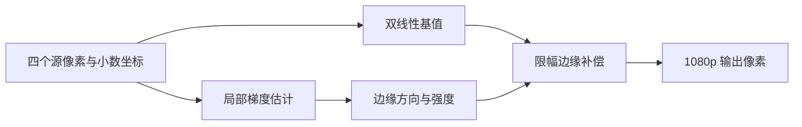

# FPGA 720p 到 1080p 超分辨率方案

_比较基准：`stage8_720p60hz_bilinear_uart_angle_correction_65byte`；独立验证工程：`stage12_720p_to_1080p30_bilinear_adaptive_sharpen_test`。目标为 1280×720 输入、1920×1080p30 输出。Stage12 RTL、全帧仿真和 PDS 时序均已通过；理想化 DDR 仿真约 32.87 fps，尚未进行实板帧率和视觉 A/B 验证。_

---

## 🎯 目标与基准

当前比较基准使用 1280×720 双线性插值、DDR 帧缓存、单应角度校正和 65 字节 UART 参数协议。Stage12 从较早的 Stage 5 identity DDR 项目复制，保留 720p 输入采集，只在副本中改成 1920×1080、30 Hz 输出；不接入 Brown 畸变、角度校正、Stage 11 图像增强或 UART。输入 MS7200 EDID 仍限制电脑输出 720p60；它与 FPGA 输出 HDMI 时序分开。

第一阶段选择**双线性插值加自适应锐化/边缘补偿**。重点是在复用现有四个邻点的前提下提升边缘观感，不增加每个输出像素的 DDR 邻点读取。该方法属于边缘保持型放大，不应宣称能恢复输入中从未采集到的真实细节。

后续保留两条研究方向：更强的传统边缘导向算法（DCCI/NEDI/EDI），以及神经网络超分或多帧融合。它们先记录为备选，不纳入第一阶段实现范围。

## 🔁 第一阶段数据通路

采样规划器和 Stage12 插值器复用 `p00/p10/p01/p11`、`fx/fy` 和四邻点有效掩码，不增加 DDR 邻点读取。[Stage12 自适应插值器](../../fpga/project/stage12_720p_to_1080p30_bilinear_adaptive_sharpen_test/source/rtl/correction/adaptive_bilinear_sharpener.sv) [采样规划器](../../fpga/project/stage12_720p_to_1080p30_bilinear_adaptive_sharpen_test/source/rtl/correction/bilinear_sample_planner.sv)

### 当前 RTL 算法

1. 对 R/G/B 通道分别计算原双线性结果和四邻点均值。
2. 若某通道四邻点 `max-min >= EDGE_THRESHOLD`（默认 12），输出 `bilinear + ((bilinear - mean) >>> 2)`；低对比区域保留双线性值。
3. 将补偿结果限制在该通道四邻点的最小值与最大值之间，RGBX 最低字节保持 0。
4. 采用四级弹性流水：邻点/权重采集、水平乘加、垂直乘法、末级求和和补偿；保持 ready/valid 元数据对齐。
5. 目的坐标以像素中心 3:2 映射到源坐标：`src=(dst+0.5)×2/3−0.5`，输出坐标首尾越界由现有边界复制采样处理。PDS 不支持此器件路径中的 RTL 常数除法，映射 RTL 改用精确 3 相位查表和乘常数求商。

阈值、补偿增益和限幅先作为 RTL 参数或常量，不扩展 UART 协议。这样可以先在同一位宽、同一输入图像和同一几何参数下比较原双线性与补偿模式。

### FPGA 约束与主要风险

- **读取带宽：**复用当前 2×2 四邻点，不增加 DDR 请求；算法不应引入额外邻域读取。
- **逻辑开销：**增加亮度差、绝对值、比较、方向选择和定点限幅，整体比 4×4 插值或 CNN 小，但具体 LUT、寄存器和时序变化必须以新构建为准。
- **流水线：**计算应拆入弹性流水级，并维持目标接收间隔为每周期一个有效像素；不能因补偿逻辑让下游反压显著增加。
- **时序：**首轮 Stage12 完整 PDS 布线的 DDR 处理时钟域 WNS 为 −2.368 ns（78 个 setup 端点失败），关键路径在垂直乘加。将垂直乘法和末级求和/补偿分开后，最终完整 PDS 报告为 `All Constraints Met`，DDR 时钟域 WNS **+0.403 ns**、TNS 0，并生成 `.sbit`。[Stage12 构建说明](../../fpga/project/stage12_720p_to_1080p30_bilinear_adaptive_sharpen_test/README.md) [详细结果](../results/stage12-super-resolution-feasibility.md)
- **吞吐：**1080p30 每帧像素数增加，算法吞吐、DDR 竞争和 HDMI 输出要在目标分辨率下共同验证；720p 实测不能直接证明 1080p30 可达。

## 🧪 第一阶段验证计划

1. 映射器和锐化器的定向 Vivado 仿真通过：映射测试覆盖首/中/尾坐标、元数据和反压；锐化测试覆盖高对比补偿与低对比保护。
2. 完整 Stage12 PDS 已通过，记录 LUT/寄存器/DRM 和 WNS/TNS 见[详细结果](../results/stage12-super-resolution-feasibility.md)。
3. 整帧仿真已覆盖 2,073,600 输出像素、16,200 个 128 像素突发、帧排空发布和输入/输出槽地址边界；理想 DDR 模型下约 32.87 fps。
4. 上板待办：下载配套位流，测显示器锁定、实际处理 fps/丢帧，并用相同输入对照 Stage 8 双线性与 Stage 12 边缘效果。

只有画质对照和 1080p30 实板数据都支持时，才把补偿版设为默认模式。

## 🧭 后续保留方向

### DCCI、NEDI 与其他强边缘导向方法

这类方法进一步利用边缘方向和局部统计来重建轮廓，适合斜线、细线和高对比边界的后续画质比较；DCCI、NEDI 和快速边缘导向方法各自采用不同的估计过程。[^1][^2][^3] 它们的具体运算和邻域大小依算法而异；较大窗口通常意味着更多行缓存、邻点读取、方向判断和乘加逻辑。

项目已有的 Catmull–Rom 4×4 邻域实验说明读取结构是关键风险：其读取器曾对每个输出像素串行执行四次 2×2 Tile Cache 查询，文档将该结构列为主要吞吐嫌疑点。[Stage 9 读取分析](./new-algorithm.md#当前最可能的吞吐瓶颈) 因此在评估 DCCI/NEDI 前，应先设计 4×4 窗口的行缓存或像素复用方案，再做画质和实测吞吐 A/B 比较。

该方向保持为**第二阶段传统算法候选**，不与第一阶段的 2×2 轻量方案混在一起实现。

### 神经网络超分与多帧融合

| 方向 | 可能收益 | 主要代价与风险 | 当前定位 |
| --- | --- | --- | --- |
| 轻量 CNN（如 ESPCN、FSRCNN） | 学习图像先验，可能生成单帧插值无法提供的纹理细节[^4][^5] | 需要匹配 1.5×放大比例的数据训练/模型、定点量化、卷积乘加阵列和特征缓存；可能生成看似锐利但不真实的细节 | 先在 PC 上评估画质和模型，再核对 FPGA 资源与时序 |
| 多帧超分 | 对齐带亚像素位移的多帧后融合观测信息，存在恢复真实高频细节的机会[^6] | 需要亚像素配准、跨帧缓存和运动/遮挡处理；动态目标、相机转动和视差可能造成重影 | 作为后续研究，不作为当前实时输出承诺 |

多帧方法的收益依赖输入帧之间存在可用的亚像素采样差异，并能可靠配准；如果相邻帧只是重复采样或场景运动无法补偿，多帧本身不会自动增加有效细节。神经网络方案还需检查模型输出是否会把噪声或压缩伪影误认为纹理。

## 📌 当前决策

- 当前实施候选已更新：**轻量 3:2 残差 CNN 超分**，用于运动视频整体清晰度；输入为 720p60，HDMI 输出保持 1080p60，每秒至少产生 30 张新的处理帧，其余扫描周期允许重复显示最近处理帧。
- 网络优先在低分辨率亮度域运行，预测叠加到双线性 3:2 基值上的有界残差；每个 2×2 输入块对应 3×3 输出相位。拟用 8 通道特征、两个 depthwise-separable 块和 9 相位输出头，8 位定点；RGB 色度先沿用双线性。
- 当前工程实测约 44.7 张新处理帧/秒，但加入 CNN 和畸变校正后的处理率尚未知。先完成软件训练/量化/连续视频 A/B，再在独立 Stage12 副本中实现行缓存卷积和相位重排；不覆盖已验证的 streaming line-buffer 工程。
- 评估至少包括 Y-PSNR/SSIM、斜边或细线分辨能力、连续帧清晰度波动、伪纹理、边缘振铃、PDS 资源及时序和板上处理帧率。模型输出需限制残差幅度，避免平坦区噪声被放大。
- 当前 Stage12 的双线性加自适应锐化保留为 FPGA 回退/基线；CNN 通过相同视频画质对比并实测达到至少 30 张新帧/秒后，才考虑作为默认方案。
- 后续传统算法：**DCCI/NEDI/EDI 等强边缘导向方法**，先解决大邻域读取和窗口复用。
- 后续研究方向：**多帧融合超分**，运动配准与重影抑制先离线评估，不纳入当前 FPGA 首版。
- Stage 8 保持为比较基线；Stage12 是独立副本，未修改 Stage 5/8/10/11。
- 当前 RTL 测试通过不表示画质更好；布局布线时序、持续 1080p30 吞吐和上板画面仍是待验证项。

---

[^1]: Rouf, M. et al. (2016). “Fast edge-directed single-image super-resolution.” *Electronic Imaging*. https://doi.org/10.2352/ISSN.2470-1173.2016.15.IPAS-027
[^2]: Yu, S. et al. (2013). “Performance Evaluation of Edge-Directed Interpolation Methods for Images.” https://arxiv.org/abs/1303.6455
[^3]: Li, X. and Orchard, M. T. (2001). “New edge-directed interpolation.” *IEEE Transactions on Image Processing*, 10(10), 1521–1527. https://doi.org/10.1109/83.951537
[^4]: Dong, C. et al. (2016). “Accelerating the Super-Resolution Convolutional Neural Network.” *ECCV*. https://arxiv.org/abs/1608.00367
[^5]: Shi, W. et al. (2016). “Real-Time Single Image and Video Super-Resolution Using an Efficient Sub-Pixel Convolutional Neural Network.” *CVPR*. https://arxiv.org/abs/1609.05158
[^6]: Lafenetre, J. et al. (2023). “Implementing Handheld Burst Super-Resolution.” *Image Processing On Line*. https://doi.org/10.5201/ipol.2023.460

## 🛠️ Stage12 streaming 行缓存黑屏排查（2026-10-30）

用户反馈最近烧录的 `stage12_1080p60_streaming_linebuffer_test` 出现 HDMI 有信号但黑屏、LED5/LED6/LED7 不亮。检查行缓存状态机和引用计数更新后，发现根因：3 位有符号 `ref_delta` 与 16 位无符号 `row_refs` 混合运算，负增量 `-1` 可能被零扩展，导致已完成的像素查询没有正确释放行槽。三行缓存填满后，顺序 DMA 可能一直等不到空闲槽，帧处理停止推进，符合黑屏和输出活动灯不亮的表现。

已修复为显式将 `ref_delta` 符号扩展到 16 位再更新引用计数，并在独立 Stage12 工程重新生成位流。PDS 完成调试核插入、布局布线和位流生成，报告 `All Constraints Met`：125 MHz DDR 域 WNS **+0.711 ns**，148.5 MHz HDMI 输出域 WNS **+1.207 ns**，TNS 为 0；资源为 24 DRM、9,906 LUT、9,967 FF。

- 修正版位流：[`.sbit`](../../fpga/project/stage12_1080p60_streaming_linebuffer_test/generate_bitstream/HDMI_IN_DDR3_HDMI_OUT_top.sbit)，SHA-256：`ED0C273E1DA8DF71958A64A8741278C77DFDA0C8DEC960F496EFB362420CBC33`。
- 配套调试文件：[`.fic`](../../fpga/project/stage12_1080p60_streaming_linebuffer_test/generate_bitstream/HDMI_IN_DDR3_HDMI_OUT_top.fic)，SHA-256：`A9A129747ED49C53C5EC4FABC43241C6D73E664649CE76698F392953B2E5DEDD`。
- 板上状态：用户已烧录修正版并确认画面恢复。Fabric Debugger 两次快照显示相关计数持续增长。

### 修复后实板帧率

Fabric Debugger 两次采样时间为 12:39:12 和 12:39:56，间隔约 44 秒。`input_published_count` 从 `0x0DB9`（3513）增至 `0x1816`（6166），增加 2653 帧，输入约 **60.3 fps**。`display_take_count` 从 `0x0A2D`（2605）增至 `0x11DD`（4573），增加 1968 帧，处理后被显示端接收的更新约 **44.7 fps**，超过 30 fps。

第二张快照的 `copy_last_frame_cycles=0x002AE981`（2,812,289 周期），按 125 MHz 计算为约 **22.50 ms/帧**，即约 **44.45 fps**，与两次计数差值估算相符。请求阻塞计数为 609 周期（约 0.022%），第一张为 683 周期。采样间隔来自控制台秒级时间戳，因此计数差的 fps 是近似值；单帧周期是交叉核验。该结果确认当前样机处理速率超过 30 fps，但低于 1080p60 显示扫描率，因此显示器仍会重复部分处理帧。后续应延长采样并在相同输入源下与 cache8/双线性基线比较画质和吞吐。

_最后更新：2026-10-30_

## 🧠 运动视频 CNN 超分实现进度（2026-10-30）

目标已调整为运动视频整体清晰度：720p60 输入、1080p60 HDMI 扫描，每秒至少 30 张新的超分处理帧。根据该目标，当前实施候选从双线性加锐化改为 3:2 轻量亮度残差 CNN；保留现有双线性加锐化作回退。采用每 2×2 个输入像素生成 3×3 输出相位的结构，网络输出有界残差并与双线性基值相加，先不把 Brown 畸变校正并入 Stage12 实验工程。

设计和任务分解见 [`运动视频超分设计`](../superpowers/specs/2026-10-30-motion-video-sr-design.md) 与 [`实施计划`](../superpowers/plans/2026-10-30-motion-video-sr.md)。软件原型目录为 [`host/super_resolution`](../../host/super_resolution/README.md)，已建立 3:2 相位 CNN、配对帧退化生成、合成运动图卡生成、训练入口、int8 权重导出和视频指标入口。当前开发环境为独立 `.venv-sr`（Python 3.13、PyTorch 2.15 CPU、OpenCV 5、NumPy 2.5），避免更改工程原有 Python 3.14 环境。另已创建独立 FPGA 候选 [`stage12_1080p60_cnn_sr_test`](../../fpga/project/stage12_1080p60_cnn_sr_test/README.md)，目前 RTL 仍为基线双线性加锐化，未接入 CNN。

早期 16 帧合成图卡实验只用于确认软件流程，因训练集与评估集相同，不作为模型效果证据。真实视频的留出评估和当前网络调整记录如下。已有 44.7 张新处理帧/秒的板测来自无 CNN、无 Brown 的 streaming line-buffer 版本，不能作为新设计的 30 fps 结论。

用户随后提供 `host/super_resolution/video/video_20261030_131922.mp4`（3840×2160、约 60.074 fps、1528 帧、25.44 秒）。已按场景时间段生成严格同源配对：0–15 秒训练 301 帧、15–21 秒验证 120 帧、21–25.4 秒留出测试 264 帧；4K 帧先缩为 1920×1080 参考，再施加轻度模糊/噪声并下采样到 1280×720。数据和模型保存在忽略目录 `host/super_resolution/.work/`；实验 int8 权重快照保存在 [`weights/bicubic_residual_int8_experimental.json`](../../host/super_resolution/weights/bicubic_residual_int8_experimental.json)。完整训练设置与结果见[报告](../results/stage12-cnn-sr-training.md)。

实验环境切换到 CUDA PyTorch 2.15.0+cu132，训练实际使用 RTX 5070 Laptop GPU。首个双线性基底 CNN 在留出测试段低于双三次，因此已改为双三次基底上的残差 CNN。验证选出的第 25 轮模型在 264 帧留出测试段得到：CNN **44.329 dB**、双三次 **43.805 dB**、Lanczos4 **43.796 dB**、双线性 **42.038 dB**；Y-PSNR 比双三次高约 0.52 dB，帧间误差从 1.338 降到 0.663。权重对称 int8 仿真只使 PSNR 降约 0.003 dB，但该仿真仍以浮点激活和偏置进行，不是 RTL 定点结果。现有训练/验证/测试片段来自同一段约 25 秒视频，不能代表跨场景泛化。下一关是整数激活/累加器位宽、流式 RTL、PDS 与板测；模型卷积估算约 383M MAC/帧（30 fps 约 11.5 GMAC/s），不是时序保证。已有 44.7 张新处理帧/秒的板测来自无 CNN、无 Brown 的 streaming line-buffer 版本，不能作为新设计的 30 fps 结论。

随后新增户外独立视频 `video_20261030_142255.mp4`（3840×2160、60.072 fps、663 帧、11.04 秒），内容含盆栽、庭院树叶和镜头移动，未用于训练。按同样退化生成 221 对测试帧，权重 int8 浮点模拟 CNN 达到 **40.111 dB**，双三次为 **39.651 dB**，Lanczos4 为 **39.766 dB**；CNN 帧间误差 **1.020**，双三次 **2.101**。这表明该拍摄方式能提供有用的独立场景评估素材。完整数据见[训练报告](../results/stage12-cnn-sr-training.md)。建议继续按该格式拍，并补室内细纹理、快速运动、低照度等场景；板上 RTL/时序/30 fps 尚未验证。

用户又新增 5 段 4K60 视频。已用 Rubik 低照度、草地/灌木、街道行人车辆和棋盘格片段继续训练；云层视频用作验证，庭院视频仍保持独立测试。多场景模型权重 int8 浮点模拟在庭院测试上得到 **39.924 dB**，双三次 **39.651 dB**，Lanczos4 **39.766 dB**；帧间误差 **1.041**，双三次 **2.101**。多场景训练、视频清单和边界见[训练报告](../results/stage12-cnn-sr-training.md)，权重快照见 [`bicubic_residual_multiscene_int8_experimental.json`](../../host/super_resolution/weights/bicubic_residual_multiscene_int8_experimental.json)。模型仍需整数激活、偏置/累加器实现，FPGA 综合、时序与板上 30 fps 还未验证。

## 2026-10-30：Stage11 功能与 1080p60 超分辨率集成构建

新增独立工程 `stage12_1080p60_stage11_super_resolution_test`，基于 Stage11 calibrated baseline，保留 65 字节 UART、帧边界单应/K3 参数、lighting LUT 和 cache8 读取；输出改为 1920×1080@60 Hz，在双线性采样处加入 Stage12 自适应锐化，并扩大输出帧池。3:2 像素中心坐标在单应变换前折算，避免 720p 中间帧 DDR 往返。后续板上检查发现首轮的齐次坐标缩放实现错误，首轮位流不能作为有效畸变矫正版使用，见下文修复记录。

首轮 PDS 2022.2-SP6.4 完整布线和位流生成通过，最终 `All Constraints Met`；125 MHz DDR 域 setup WNS +0.125 ns，148.5 MHz HDMI 输出域 +1.715 ns。工具时序通过并未发现映射器的坐标量纲错误；该首轮位流已在下文标记作废。

## 2026-10-30：Stage12 单应映射无效问题修复

复核 `stage12_1080p60_stage11_super_resolution_test` 时确认，首轮集成 RTL 虽然实例化了 Stage11 单应与 Brown K3 畸变链，但把 3:2 坐标变换后的齐次分子、分母统一放大了 6 倍；原有分母范围检查和倒数查找表仍按未缩放的 Q30 范围工作。因此单位单应的分母也会越界，映射坐标被标记为无效，解释了上板输出没有可见变化。首轮 `.sbit`（SHA-256 `B27C7A0ECCC8E753994E0C9A4B136ACC612BD1C14C888BACA03B8DCC2DA53C96`）作废，不应继续烧录。

修复后先用 3:2 mapper 产生像素中心对齐的 Q16.16 坐标，再进入 Stage11 单应与已标定 Brown K3 映射；并在宽乘法前寄存单应参数、坐标与元数据。流水吞吐仍为每周期一个像素，增加一拍延迟。Stage11 的 UART、帧边界单应/K3 更新、lighting LUT 与 cache8 均保留。单应/Brown 链、60 个参考向量、严格四邻点黑边、K3 参考和 3:2+单位单应仿真均通过。

修复版 PDS 2022.2-SP6.4 完整布线和位流生成通过，`All Constraints Met`：125 MHz DDR 域 setup WNS **+0.052 ns**，148.5 MHz HDMI 时钟域 **+1.764 ns**，TNS 均为 0。新配套文件在 `stage12_1080p60_stage11_super_resolution_test/generate_bitstream/`：`.sbit` SHA-256 `490DD940074C7141D63D47D9F9C20B34F679C860D38A7EC9BA2774B69381D8B4`；`.fic` SHA-256 `680DFAAFDB1FA79F243D339F80410A5A54E8A88BF9873F7EDE0392F460BBC24C`。生成时尚未完成上板验证；后续烧录与处理帧率测量见下节。

## 2026-10-30：Stage12 上板显示与处理帧率

用户已将修复版烧录 FPGA 并确认显示正常。该工程输出栅格配置为 **1920×1080、60 Hz**，像素时钟为 **148.5 MHz**；Fabric Debugger 截图显示处理和显示计数正常增长。截图中没有显示器 OSD 或 HDMI 接收端模式信息，因此 1080p60 的结论来自工程时序配置和用户确认画面显示，不能单凭这些调试器截图独立验证显示器实际锁定模式。

两次 Fabric Debugger `run` 约相隔 28 秒。`raw_input_vsync_count` 从 `0x19d5` 增至 `0x206d`（+1688，约 **60.3 fps**）；`copied_count` 和 `display_take_count` 均从 `0x0fae` 增至 `0x13af`（各 +1025，约 **36.6 fps**）。同期 `capture_dropped_count` 从 `0x0a24` 增至 `0x0cbb`（+663），`output_dropped_count` 保持 0。说明 FPGA 的 HDMI 扫描输出按 60 Hz 配置运行，但新处理画面约以 36.6 fps 更新；处理帧率超过 30 fps 目标，尚未达到每秒处理 60 帧。

帧周期计数器也支持该估算：`perf_frame_cycles=0x344f7d`（3,428,221 周期）和 `0x346534`（3,433,780 周期），以 125 MHz `core_clk` 换算分别约 **36.46 fps** 和 **36.40 fps**。两次读数与计数器增量估算一致。错误与不完整输出计数均为 0。

功能默认状态：单应矩阵上电为单位矩阵，UART 下发有效姿态参数后才产生对应角度/单应变换；标定 Brown K3 映射在像素数据链中运行；自适应锐化器持续工作，仅对超过阈值的边缘增强；lighting LUT 默认 profile 0 为恒等曲线，选择其他 UART profile 才应用相应曲线。

## 2026-10-30：运动视频超分首版 RTL 实验

在独立 `stage12_1080p60_cnn_sr_test` 工程中接入 3:2 相位选择的四抽头 Q7 RGB 插值器。系数来自五段训练视频的 720p/1080p 配对帧，并按 25% 学习系数、75% 双线性系数混合；九个相位的系数和均为 128，以保留平坦区域亮度。该硬件仍只读取 2×2 邻域，**不是已训练的 7×7 残差 CNN**。原 CNN 权重的整数激活、特征行缓存和相位输出头尚未接入 RTL。

采用独立庭院片段均匀抽样的 20 帧评估，该实验滤波器 Y-PSNR 为 **36.616 dB**，同一脚本中的双线性为 **36.550 dB**，双三次为 **39.153 dB**。这里的采样帧数和颜色/缩放实现与上文完整 CNN 测评不同，数值不可直接横向比较；只支持该脚本内的相对比较。增益很小，尚不能断言有可见的细节提升。系数和脚本分别在 `host/super_resolution/weights/phase_filter_q7_experimental.json`、`host/super_resolution/fit_phase_filter.py`。

ModelSim 定向仿真覆盖九个相位、元数据和反压，结果 PASS。整帧仿真覆盖 2,073,600 个输出像素、16,200 次输出写突发、720 行源读取，**2,349,194 个 125 MHz 周期/帧，理想 DDR 模型约 53 fps**，超过 30 fps 仿真门槛，但不代表实板帧率。整帧仿真还暴露初始行缓存会在 `source_frame_start` 前预取的问题；候选工程加了 `frame_armed` 门控并重跑通过。已验证的 streaming 工程未修改。

PDS 2022.2-SP6.4 完整构建通过，插入 Fabric DebugCore 并生成候选工程自己的位流，最终 `All Constraints Met`：125 MHz DDR 域 setup WNS **+0.605 ns**，输出相关时钟域 WNS **+2.133 ns**，TNS 均为 0。综合资源为 **8,762 LUT、7,877 寄存器、22 DRM**。配套文件：[`候选 .sbit`](../../fpga/project/stage12_1080p60_cnn_sr_test/generate_bitstream/HDMI_IN_DDR3_HDMI_OUT_top.sbit)，SHA-256 `19CD13CE3A0E158CBA212C937E40262F916C49B554925B53A4768D6EFC7FD3E0`；[`候选 .fic`](../../fpga/project/stage12_1080p60_cnn_sr_test/generate_bitstream/HDMI_IN_DDR3_HDMI_OUT_top.fic)，SHA-256 `2D45FB9810F8586BE6C49EEF013AE98527BA6F158833EFBE9A6A4659F9CBE266`。实板显示、运动视频画质和持续处理帧率尚未测量；这版的微小离线增益不足以替代计划中的 CNN。

## 2026-10-30：Stage12 真正 CNN 独立工程搭建

用户确认首版相位滤波位流已上板成功，要求另建真正使用训练权重的 CNN 测试工程，工程名以 `stage12_` 开头。详细实施计划见 [`Stage12 真正流式 CNN 超分辨率实施计划`](../superpowers/plans/2026-10-30-stage13-true-cnn-sr.md)。已创建隔离副本 `stage12_1080p60_true_cnn_sr_test`，PDS 独立副本构建通过；这次构建仍是相位滤波基线，不能当作 CNN 位流。

模型未达标的复核与改进：修复评估脚本重复写入 CNN 行的错误后，原街道独立测试 CNN 仅 25.915 dB，双三次 25.871 dB，Lanczos4 26.166 dB。训练改为每帧四个纹理块、庭院纹理验证选模后，街道 CNN 达 26.711 dB、比当前自适应锐化高约 1.90 dB；权重 int8 浮点模拟为 26.710 dB。加入相邻帧损失的后续模型在街道达 26.792–26.852 dB，但云层视频的帧间误差仍高于双三次。

本轮基于 `model_temporal_last.pt` 完成了整数激活参考、每层 int8 权重/int32 偏置/Q31 requant 参数导出和 golden 向量。街道留出集 155 帧 int8 激活参考为 26.7927 dB，浮点 CNN 为 26.7921 dB；云层验证集 127 帧分别为 48.6803/48.7036 dB。云层的时域误差仍为 0.8670，高于双三次 0.7230，场景门控还未进 RTL。独立副本基线 PDS 报告 WNS +0.605 ns（DDR）、+2.133 ns（输出相关时钟），资源 14 APM、24 DRM、9,481 LUT；对应位流仍是旧相位滤波逻辑。量化结果、SHA-256 和剩余 RTL 工作详见[实施进展记录](../results/stage13-true-cnn-sr.md)。CNN 推理 RTL、全帧仿真和 30 fps 板测尚未完成，因此目前没有可交付的 CNN 位流。

随后开始了 RTL 输入链路：RGBX 转亮度、3×3 流式窗口和训练权重驱动的 8 通道 stem 已加入独立工程；ModelSim 的色彩/元数据、窗口排列、stem golden 对比通过，PDS compile 通过。现阶段 stem 仍是孤立模块，尚未串入完整推理与帧池，所以该候选仍没有 CNN 功能位流。

## 2026-10-31：Stage11 超分集成工程吞吐优化副本

为单独开展吞吐诊断与优化，从 `fpga/project/stage12_1080p60_stage11_super_resolution_test` 建立独立工程 `fpga/project/stage12_1080p60_stage11_sr_optimization_test`。基线工程保持不变。副本保留 Stage11 UART、帧边界单应/K3 参数、lighting LUT、cache8 读取器、3:2 坐标映射、自适应双线性锐化及 1080p60 输出配置；创建时未修改 RTL。

副本沿用原 PDS 工程配置和源代码，未带入原工程的综合/布局布线目录、位流和仿真工作库；少量根目录历史构建日志作为归档副本保留，不代表新工程构建结果。它目前是待优化的源码副本，没有可用于烧录的有效位流；之后必须在副本内独立仿真、构建，并配对使用本副本生成的 `.sbit/.fic`。

### 已知性能基线与诊断判断

原集成工程在 2026-10-30 的实板窗口中，原始输入约 60.3 fps，处理完成/显示端取得新帧约 36.6 fps；约 28 秒内 `capture_dropped_count` 增加 663，`output_dropped_count` 未增加。最近完成帧为 3,428,221–3,433,780 个 125 MHz 周期（约 27.43 ms），与约 36.5 fps 相符。该结果表明处理链路跟不上输入，显示扫描 60 Hz 不代表处理帧也有 60 fps。

输出从 1280×720 放大到 1920×1080，每个输入帧要处理 2,073,600 个输出像素，是 720p 像素数的 2.25 倍。现有坐标与插值流水以每周期一个有效像素为设计目标，但实测平均约每 1.65 周期完成一个输出像素，存在反压。结合当前每个输出坐标都经 Tile Cache 查询 2×2 邻点、未命中后等待 DDR 行回填的结构，采样端 Cache/DDR 等待是优先排查对象；现有整帧周期和坐标停顿计数尚不足以把等待精确归因到 Cache、DDR 响应或下游反压。不能仅凭已约束路径通过来断定吞吐充足；125 MHz DDR 域 WNS 仅 +0.052 ns，提升时钟频率的余量也很小。

### 优化计划

1. **建立可比较的诊断基线。**在优化副本中扩充 Fabric Debugger 探针，分别统计坐标 FIFO 满/空、Cache 命中与未命中、Cache 回填周期、DDR 地址等待、首拍/拍间等待、输出写等待及各级 ready/valid 停顿；记录输入发布、处理完成、显示取帧与丢帧计数。用固定输入、相同 UART 参数和至少 30 秒窗口采集基线。优先利用现有信号增加观测，避免把多个结构改动混在一起。
2. **优先评估 3:2 邻域复用。**建立源行缓存与滑动窗口，复用相邻输出像素所需的重叠源像素，减少逐输出像素发起独立 Cache 查询和 DDR 读取。先在单位单应/无 Brown 或固定几何下验证 3:2 相位与窗口复用，再逐步接回单应与 Brown 映射；对非单调、越界或窗口不连续坐标保留原 Tile Cache 路径作为回退。核对像素顺序、边界黑像素、帧/参数版本及反压行为。
3. **按计数结果优化 DDR 读取。**若分解计数确认未命中回填或 DDR 首拍延迟占主导，再设计行/Tile 预取、相邻请求合并或多笔 outstanding 读取。确保返回数据与像素元数据有序对应，并检查读写并发对 DDR 仲裁的影响。只有在测得高冲突/高复读后，再调整 Cache 容量与替换策略。
4. **分阶段验证并记录收益。**每次只改变一个主要结构：定向仿真检查边界、元数据和反压；整帧仿真核对 2,073,600 个输出像素、DDR 读写地址与帧排空发布；随后独立 PDS 完整布线并查看资源、时序裕量；最后烧录副本配套位流做同场景 A/B。比较最近及最长帧周期、持续新处理帧率、输入/输出丢帧和画质。当前要求若为每秒至少 30 张新处理帧，实板门槛是持续达到 30 fps；目标 60 fps 则需单独按 60 fps 验收。
5. **之后再评估 CNN 的增量预算。**本优化副本当前仍是 Stage11 几何/亮度功能与双线性加锐化，不包含已训练 CNN。先测得缓存/DDR 优化后的真实余量，再接入整数激活 CNN；CNN 所需 MAC、行缓存、定点位宽、PDS 资源和时序都需独立核验，不能用当前 36.6 fps 或无 CNN 的 44.7 fps 板测替代 CNN 帧率结论。

优化副本 README 记录了隔离边界和构建约束。第一轮诊断已在副本中将帧率/丢帧、整帧及坐标停顿、Cache 回填、DDR 首拍等待和 Cache miss 映射到 Fabric Debugger 的 256 个 FIC 通道；对应 `PAP_MARK_DEBUG` 标记、FIC 生成脚本及构建脚本信号校验已更新。当前只增加观测映射，未修改像素数据通路。2026-10-31 完成副本 PDS 全构建，报告 `All Constraints Met`；DDR 125 MHz 慢角 setup WNS **+0.029 ns**、TNS 0。配套位流 SHA-256：`F007C99EA111FB660B824F92D97E70CF12E44A3B9AADF01AA4CFB1309100BE44`；FIC SHA-256：`F1D2999CEAFBE86E16229E46453EC45EB75B15F1B5B089262C7FDE01112A9334`。这次构建仅证明诊断副本完成布线和位流生成，尚待用户烧录后采集至少两个带时间戳的板上快照，才能判断当前主要吞吐等待来源。

### 2026-10-31：首组板上帧计数截图分析

用户提供 Fabric Debugger 两次运行截图，时间为 10:30:42 与 10:31:19，间隔 37 秒。截图前六项基础映射仍与诊断版 FIC 相同：原始输入 VSYNC 从 `0x0878` 到 `0x113b`（+2,243，约 **60.62 fps**）；输入发布从 `0x0877` 到 `0x113a`（+2,243，约 **60.62 fps**）；处理完成和显示取帧均从 `0x0523` 到 `0x0a75`（各 +1,362，约 **36.81 fps**）；输入 READY 丢弃从 `0x0352` 到 `0x06c3`（+881，约 **23.81 帧/秒**）；输出 READY 丢弃保持 `0`。并且 `2,243 = 1,362 + 881`，与输入发布后未及时处理、READY 输入帧被覆盖的计数关系吻合。

因此目前可以把吞吐缺口定位在**输入帧发布之后、处理完成之前**；显示取帧与处理完成同步，输出帧池没有显示出队列丢弃，输入发布也跟上原始 VSYNC。它支持“处理引擎处理速率不足，输入 READY 帧被覆盖”的判断，但不能单独证明具体是 Cache miss、DDR 响应、坐标反压还是其他处理停顿。

截图列头仍显示旧 FIC 的 `capture_rejected_count`、`capture_abort_count`、`incomplete_output_count`、`copy_error_count` 等标签；诊断副本新 FIC 在通道 144 起改映射为 `perf_frame_cycles`、`perf_coord_stall_cycles`、Cache 回填和 DDR 首拍等待等。因此截图前六个帧计数可以使用，但**第七列之后必须按实际烧录的 `.sbit/.fic` 配对关系确认，当前不能依据旧列名解读，也不能将画面中看似错误计数的值作为有效故障证据**。请在 Fabric Debugger 导入优化副本本次构建生成的配套 FIC，并确认列头出现 `perf_cache_fill_cycles`、`perf_read_first_beat_wait_cycles` 与 `perf_cache_miss_count`；再采集同样的时间窗口，以定位处理引擎内部主要等待来源。

### 2026-10-31：第二组帧计数复核

新增截图时间为 10:34:29 与 10:34:59，间隔 30 秒。原始输入/输入发布从 `0x084a/0x0849` 增至 `0x0f42/0x0f41`，均增加 1,784 帧（约 **59.47 fps**）；处理完成/显示取帧从 `0x0507` 增至 `0x0942`，均增加 1,083 帧（约 **36.10 fps**）；输入 READY 丢弃从 `0x0340` 增至 `0x05fd`，增加 701 帧（约 **23.37 帧/秒**）；输出 READY 丢弃仍为 0。再次满足 `1,784 = 1,083 + 701`，与前一组结果一致：处理端约 36 fps，未处理到的输入帧被覆盖。

第二组截图的列头仍显示旧 FIC 的 `capture_rejected_count` 等通道，没有出现新 FIC 的 Cache 回填/DDR 首拍/Miss 列。因此这次只加强了处理级吞吐不足的证据，仍未取得有效的内部停顿分解；旧 FIC 对应的新映射之后的值不可用于判断 Cache、DDR 或错误计数。

### 2026-11-01：原 Stage12 测试工程修正 FIC 映射并完成诊断位流

按用户要求，直接在现有 `stage12_1080p60_stage11_super_resolution_test` 工程修改，没有新建测试工程。定位到先前诊断生成器只替换了 `triggerChannel` 位映射，却保留旧的 `triggerBus` 和 `busInserter` 总线标签；因此 FIC Listing 仍显示 `capture_rejected_count`、`capture_abort_count` 等旧列名。随后 PDS 构建也曾在布线中途停止，旧 `.sbit/.fic` 不能代表新映射。

已在该工程新增 `Configure-ThroughputDiagnostics.ps1`，统一重建 bus 标签、插入器位范围和 256 条 triggerChannel 映射；重新执行完整构建并成功生成位流。输入/输出帧率和丢帧保留在通道 0–143；通道 144–255 依次映射整帧周期、坐标停顿、Cache 回填周期、DDR 首拍等待和 Cache miss 低 16 位。构建脚本现在会区分“位流生成成功”和“时序闭合”，不会因时序违例阻止复制配套 FIC，也不会把违例报成通过。

本次慢角时序**未闭合**：`ddrphy_sysclk` 125 MHz WNS **−0.166 ns**、TNS **−7.968 ns**，48 个端点违例；148.5 MHz `pll_gen_clk` 输出时钟 WNS +2.693 ns，其余所列域通过。位流已生成，可以用于短时诊断采集，但它不是 timing-closed 的交付版本；若板上异常或数据不稳定，应停止用这版做性能结论。尚未烧录本次位流，也尚无新 FIC 计数，因此 Cache/DDR 具体等待占比仍未定位。

- 配套位流：[`HDMI_IN_DDR3_HDMI_OUT_top.sbit`](../../fpga/project/stage12_1080p60_stage11_super_resolution_test/generate_bitstream/HDMI_IN_DDR3_HDMI_OUT_top.sbit)，SHA-256：`1A31D1E9C4B7050552D52308664730324417C9962F8BE1F99FA08EDFC61876D9`。
- 配套 FIC：[`HDMI_IN_DDR3_HDMI_OUT_top.fic`](../../fpga/project/stage12_1080p60_stage11_super_resolution_test/generate_bitstream/HDMI_IN_DDR3_HDMI_OUT_top.fic)，SHA-256：`7AF363ED8D34D9FAFFBE8C1DDE9F04061B73700106130DABB54667317C226D6C`。
- 最终报告：[`HDMI_IN_DDR3_HDMI_OUT_top.rtr`](../../fpga/project/stage12_1080p60_stage11_super_resolution_test/report_timing/HDMI_IN_DDR3_HDMI_OUT_top.rtr)。

上板后需在 Fabric Debugger 导入上述新 `.fic`，确认旧 error/abort 列已替换为新性能计数，再采两个带时间戳的快照。与旧截图相比，帧率计数仍可用于定位总处理端约 36 fps 的瓶颈；新映射提供判断具体停顿位置的数据。

### 2026-11-01：新 FIC 板测定位 Cache/DDR 回填瓶颈

用户已烧录诊断位流并导入新 FIC。Fabric Debugger 控制台时间戳为 08:18:41 与 08:19:14，间隔 33 秒；列头出现 `perf_frame_cycles`、`perf_coord_stall_cycles`、`perf_cache_fill_cycles`、`perf_read_first_beat_wait_cycles` 和 `perf_cache_miss_count`。两次运行后这些逐帧计数均保持在相近范围，符合“最近完成帧快照”的 RTL 语义。

帧计数增量：`raw_input_vsync_count` 从 `0x0b96` 到 `0x1353`，增加 1,981 帧（**60.03 fps**）；`input_published_count` 同样增加 1,981；`copied_count` 从 `0x0708` 到 `0x0bbb`，增加 1,203 帧（**36.45 fps**）；`display_take_count` 也增加 1,203；`capture_dropped_count` 从 `0x048b` 到 `0x0795`，增加 778（**23.58 帧/秒**）；`output_dropped_count` 仍为 0。满足 `1,981 = 1,203 + 778`，再次确认帧率缺口发生在输入发布到处理完成之间。

两次最近完成帧的性能值：

| 指标 | 08:18:41 | 08:19:14 | 占整帧周期 |
| --- | ---: | ---: | ---: |
| `perf_frame_cycles` | `0x345fb6` (3,432,374) | `0x345f64` (3,432,292) | — |
| `perf_coord_stall_cycles` | `0x14bb46` (1,358,662) | `0x14bae5` (1,358,565) | 约 39.6% |
| `perf_cache_fill_cycles` | `0x0ddce8` (908,520) | `0x0ddf49` (909,129) | 约 26.5% |
| `perf_read_first_beat_wait_cycles` | `0x07c1d0` (508,368) | `0x07c3fd` (508,925) | 约 14.8% |
| `perf_cache_miss_count` | `0x26ab` (9,899) | `0x26ab` (9,899) | — |

按 125 MHz DDR 域时钟，最近完成帧约需 **27.46 ms**，对应约 **36.4 fps**，与 33 秒窗口的处理帧增量吻合。坐标提交停顿接近总处理周期的 40%；Cache miss 回填约占 26.5%，其中等待 DDR 首拍约占整帧 14.8%。这几类计数在硬件时序上有重叠，不能简单求和；但两次采样都显示稳定的 Cache 回填和 DDR 首拍等待，足以把主瓶颈定位为：**Tile Cache miss 触发 DDR 回填，回填期间缓存/下游未就绪反压坐标提交流水，导致每帧周期升至约 3.43M**。帧周期比 60 fps 对应的 2.08M 周期预算高约 65%，因此输入 READY 帧持续被覆盖。下一步应优先减少 cache miss 或隐藏回填延迟（邻域/Tile 复用、预取/合并读），并用同一组计数做 A/B；不应先优化坐标算术。

Debugger 控制台仍出现 `Debugger-4002 ... bus name ... fail to import` 警告。尽管有此警告，Listing 已显示新列，数值非零且两次测量一致；因此当前可以用这些通道值做吞吐定位，但 FIC 总线导入警告仍需单独核查。诊断位流的 DDR 慢角 WNS 为 −0.166 ns，结果用于定位时应保留时序未闭合这一限制。

### 2026-11-01：补充输出反压与 DDR 仲裁停顿探针

为分解约 45 万个未能由 Cache 回填直接解释的坐标停顿，在同一 Stage12 测试工程给 `frame_identity_transform_engine` 增加逐帧 `perf_output_backpressure_cycles`，统计 `COLLECT` 期间结果有效但输出双缓冲未接收的周期；将 FIC 重新映射为帧率、整帧周期、坐标停顿、Cache 回填、DDR 首拍、Cache miss、输出反压和 DDR 读仲裁等待。三项帧计数改映射低 16 位，适用于本次 30–60 秒快照窗口。其他 RTL 数据通路未改，因此这版是定位位流，不能预期它本身提升处理帧率。

本次完整 PDS 布线和位流生成成功，`All Constraints Met`；125 MHz DDR 慢角 WNS **+0.053 ns**，TNS 为 0。新的输出反压计数与 FIC 已包含在配套文件中：

- 位流：[`.sbit`](../../fpga/project/stage12_1080p60_stage11_super_resolution_test/generate_bitstream/HDMI_IN_DDR3_HDMI_OUT_top.sbit)，SHA-256：`91EFD0D546280D37E42EC4C29EA5B31BA8EB769D784DA5207BE6B26D08552128`。
- FIC：[`.fic`](../../fpga/project/stage12_1080p60_stage11_super_resolution_test/generate_bitstream/HDMI_IN_DDR3_HDMI_OUT_top.fic)，SHA-256：`147EEA6D72FC36802A4B88C102281EBC125653A7CA4B194BE25B67F33A48A0B6`。
- 时序报告：[`.rtr`](../../fpga/project/stage12_1080p60_stage11_super_resolution_test/report_timing/HDMI_IN_DDR3_HDMI_OUT_top.rtr)。

需烧录该 `.sbit` 并导入配套 FIC 后，再采集两次计数。若 `perf_output_backpressure_cycles` 接近未解释的停顿量，应先优化双缓冲排空/写入节奏；若很低而读仲裁等待较大，则转向 DDR 请求调度/预取；若二者都低，停顿主要在坐标至 Cache 查询之间，需要进一步打点各级 ready/valid。采集完成前不据此选择下一项结构优化。

### 2026-11-01：恢复原缓存配置并生成 Cache lookup 阻塞原因诊断版

按用户要求停止缓存扩容候选，`fram_buf.v` 已恢复为 **16 组×8 路**（32×4 像素 Tile 的形状不变）。没有把未完成布线的 32 组候选作为交付版本。当前版本用于进一步定位，不改变 Cache 容量和图像处理算法。

为让 Cache 在 `lookup_ready=0` 时也能观察到一个稳定的待处理请求，`cached_neighbor_reader` 将 `lookup_valid` 与 `lookup_ready` 解耦；请求只在 `valid && ready` 时被缓存接受，既有握手语义保持不变。Cache 输出互斥的 lookup 阻塞原因，处理引擎在一帧期间累计、在完成帧时快照以下 5 个 21 位周期计数：

| FIC 信号 | 含义 |
| --- | --- |
| `perf_reader_meta_fifo_stall_cycles` | reader 元数据 FIFO 已满，阻止新查询 |
| `perf_cache_fill_block_cycles` | Cache lookup 被正在执行的 DDR Tile 回填阻塞 |
| `perf_cache_invalidate_block_cycles` | Cache lookup 被帧边界失效过程阻塞 |
| `perf_cache_retry_miss_block_cycles` | S2 miss 持有请求，或回填后的 retry 阶段阻塞 lookup |
| `perf_cache_capacity_block_cycles` | 返回像素 FIFO 容量不足，阻止新 lookup |

FIC 保留累计帧计数、整帧周期、总坐标停顿、Cache miss 数和 DDR 首拍等待，并用 256 个通道完整映射上述新计数。累计帧计数使用低 12 位，板测两次快照应间隔小于约 68 秒；性能原因计数是最近完成帧的完整快照，直接读取，不跨快照相减。原因计数在 Cache lookup 入口统计，可能因上游弹性流水而与 `perf_coord_stall_cycles` 有周期偏移，不应要求逐周期完全相等；五类 Cache/reader 阻塞原因之间按 RTL 条件互斥。

PDS 已完成综合、布线、FIC 核插入和位流生成，报告为 `All Constraints Met`；125 MHz `ddrphy_sysclk` 慢角 WNS **+0.065 ns**、TNS **0**。本版为诊断位流，处理吞吐不预期因计数器增加而提升。配套产物：

- 位流：[`.sbit`](../../fpga/project/stage12_1080p60_stage11_super_resolution_test/generate_bitstream/HDMI_IN_DDR3_HDMI_OUT_top.sbit)，SHA-256：`F7EE5AF41178100EB8FA13050EFDB798D915D8A54FFBB7DFDE607404900845F9`。
- FIC：[`.fic`](../../fpga/project/stage12_1080p60_stage11_super_resolution_test/generate_bitstream/HDMI_IN_DDR3_HDMI_OUT_top.fic)，SHA-256：`D1334DAC406A172A176BE6565AAC53DFB06E9C1817C21412DCF8D31B89C68407`。
- 时序报告：[`.rtr`](../../fpga/project/stage12_1080p60_stage11_super_resolution_test/report_timing/HDMI_IN_DDR3_HDMI_OUT_top.rtr)。

板测时烧录该 `.sbit` 并导入同目录配套 `.fic`。采集一次稳定画面下的 FIC Listing 即可读到最近完成帧的五类阻塞周期；再用两个相隔 30–60 秒的累计计数快照计算处理帧率和输入丢帧率。依据五个原因计数中占比最大的项决定下一步优化位置。

### 2026-11-01：Cache 容量阻塞二级诊断

用户板测显示容量阻塞约 43.8 万周期，其中 metadata FIFO-full 与 Cache invalidate 连续为 0；原 FIC 未映射 RTL 已有的输出反压计数。为区分 Cache 在途流水 reservation 用尽与响应 FIFO 实际存满，本版在 Cache 增加 `perf_cache_capacity_pipe_block_cycles` 子计数：其统计总 capacity 阻塞中 `fifo_count < RESPONSE_FIFO_DEPTH` 的周期；因此 `perf_cache_capacity_block_cycles - perf_cache_capacity_pipe_block_cycles` 可估算响应 FIFO 物理存满造成的部分。FIC 原 metadata FIFO-full 槽改映射该子计数，原 invalidate 槽改映射低 21 位 `perf_output_backpressure_fic`。总 capacity、fill、retry、DDR 首拍等待与帧率计数均保留。

新诊断位流已完成布线和 FIC 核插入，但慢角 125 MHz `ddrphy_sysclk` 有轻微时序违例：WNS **-0.070 ns**、TNS **-3.360 ns**、48 个 setup endpoints failing。该版本用于读取新增 FIC 计数；时序未闭合，不作为最终性能版本。产物：

- 位流：[`.sbit`](../../fpga/project/stage12_1080p60_stage11_super_resolution_test/generate_bitstream/HDMI_IN_DDR3_HDMI_OUT_top.sbit)，SHA-256：`55DAE733A81F763868B02C2A48373EBB67807383BA7CA4A6F2CCDC299B0F6DD1`。
- FIC：[`.fic`](../../fpga/project/stage12_1080p60_stage11_super_resolution_test/generate_bitstream/HDMI_IN_DDR3_HDMI_OUT_top.fic)，SHA-256：`9831222FFACC0FCFE0768DCC77794D9041FE8378CFD9B447EB38CBB284B30D67`。
- 时序报告：[`.rtr`](../../fpga/project/stage12_1080p60_stage11_super_resolution_test/report_timing/HDMI_IN_DDR3_HDMI_OUT_top.rtr)。

板测后直接读取最近完成帧的 `perf_cache_capacity_pipe_block_cycles`、`perf_cache_capacity_block_cycles` 和 `perf_output_backpressure_fic`：子计数占总 capacity 的比例高，说明 reservation 被在途 Cache pipeline 占满；差值高说明 FIFO 实际存满；输出反压高则进一步指向 burst 写缓冲/DDR 写入端消费不足。若三者都解释不了总停顿，再继续检查 lookup 响应弹出与插值器内部 valid/ready。

### 2026-11-01：结合二级诊断数据定位吞吐根因并制定优化顺序

用户导入上述配套 FIC 并在 12:46:05、12:47:08 各采集一次 Listing。两次单帧指标稳定：`perf_frame_cycles` 分别为 `0x345eab`、`0x345bbc`（约 343.2 万周期，125 MHz 下约 **36.4 fps**）；`perf_coord_stall_cycles` 约 135.8 万周期。两次 12 位输入计数按模 4096 计算，在 63 秒内增加 3772（约 **59.9 fps**）；`copied_count` 增加 2290（约 **36.3 fps**），`capture_dropped_count` 增加 1481（约 **23.5 fps**）；`output_dropped_count` 保持 0。

单帧停顿分解如下，两个快照数值基本一致：

| 原因 | 周期/帧 | 代码含义 |
| --- | ---: | --- |
| Cache 回填阻塞 | 约 845,600 | `fill_state != FILL_IDLE` 时关闭 lookup 流水 |
| Cache 在途 reservation 占满 | 约 414,400 | lookup 被容量条件挡住，但 `fifo_count < RESPONSE_FIFO_DEPTH` |
| Cache 响应 FIFO 物理满 | 约 24,000–24,700 | 总 capacity 阻塞减去在途 reservation 子计数 |
| miss/retry | 约 73,700 | S2 miss 保持请求，等回填后重探 Tag |
| 输出反压 | 约 25,900–26,000 | `pipeline_m_valid && !pipeline_m_ready`，由双 burst 缓冲可用状态控制 |

在途 reservation 停顿约为 `2,073,600 / 5 = 414,720` 周期，几乎等于完整的实测 414,400 周期。代码中 `BANK_READ_LATENCY=1`，所以 [pixel_tile_cache.sv](../../fpga/project/stage12_1080p60_stage11_super_resolution_test/source/rtl/memory/pixel_tile_cache.sv) 的 `RESPONSE_FIFO_DEPTH = BANK_READ_STAGES + 4` 当前为 5，而占用计算另将 S0、S1、S1 Tag、S2、Bank 读流水五个在途项全部计入。响应尚未进入 FIFO 时信用已耗尽，lookup 周期性停一拍；每五个像素一次空泡与观测数高度吻合。这是明确的 Cache 响应信用不足问题，建议先把响应 FIFO 深度从 **5 增到 6**。这只增加一个约 129 位像素响应槽，不扩大 16×8 Tile Cache，不涉及 32 组或 32 路。单独修复后预计吞吐上限约 **41.4 fps**，因此它是低风险第一步，但无法独自达到 60 fps。

最大停顿仍来自串行 demand miss。[pixel_tile_cache.sv](../../fpga/project/stage12_1080p60_stage11_super_resolution_test/source/rtl/memory/pixel_tile_cache.sv) 的 `pipeline_operational` 要求 Cache 处于 `FILL_IDLE`，S2 miss 也会冻结后续 lookup；[tile_row_ddr_adapter.sv](../../fpga/project/stage12_1080p60_stage11_super_resolution_test/source/rtl/memory/tile_row_ddr_adapter.sv) 每次取 32×4 Tile 的 16 个 DDR beat，必须先全部收齐，再开始写 Cache。每帧约 9,899 次 miss，平均每次造成约 85 周期等待，其中 DDR 首拍等待约 51 周期。扩大缓存可以减少重取，却不能隐藏每个首次访问 Tile 的 DDR 等待；扩大到 32 组也无法消除此串行依赖，且此前已布线失败。

推荐按以下顺序实施，每一步保持 Cache **16 组×8 路**并独立重新布局布线：

1. **增加一个响应 FIFO 槽**：把深度由 `BANK_READ_STAGES + 4` 改为 `BANK_READ_STAGES + 5`，重点确认 41.4 万周期在途容量停顿是否消失，以及时序是否闭合。
2. **让 DDR Tile 读取与命中像素处理重叠**：将未来约 128–256 个输出坐标的 Tile ID 提前送入小型预取队列；后台复用现有单 Tile 回填通道，回填 victim way 期间继续处理其他 Cache 命中。正在填充的 way 保持 invalid/locked，需求碰到尚未完成的 Tile 时再局部等待；需要处理读写同地址、Tag 生效时刻和返回顺序。目标是隐藏约 84.6 万周期回填停顿及大部分 retry，而不是增加 Tag 组数。
3. **处理输出端残余反压**：当前输出反压约 2.6 万周期，已超过 125 MHz 下 1080p60 的全部帧周期余量。先保留现有双 128-pixel burst 缓冲，定位 `burst_ready` 与 DDR AW/W 接受间隔；若确认缓冲排空不足，再评估小幅增加写队列或改写出调度。

125 MHz 下 1080p60 每帧预算约 **208.33 万周期**，纯一像素一周期的像素数已占 **207.36 万周期**，只剩约 **9,733 周期**。现有回填、在途容量、retry、FIFO 满等停顿合计约等于全部 135.8 万坐标停顿。要达成 60 fps，必须隐藏几乎全部回填并消除大部分空泡和输出反压；缓存容量增加不是主要解法。当前二级诊断位流的慢角 `ddrphy_sysclk` WNS 为 −0.070 ns，故任何优化版都必须以最终时序闭合和板上帧率复测为准。

## 2026-11-01：重启纯 CNN 超分工程计划

用户说明此前 CNN 构建工程已删除，并要求重新从 Stage12 开始，先只验证超分模块的资源、时序、吞吐和画质，再考虑接入其他图像算法。新工程暂定为 `fpga/project/stage12_1080p60_cnn_sr_v2_test`，以已上板显示正常的 `stage12_1080p60_streaming_linebuffer_test` 为板级骨架。保持 720p 输入、DDR 帧池/顺序读取、1080p60 HDMI 输出及必要帧率/错误计数；超分处理链仅包含 3:2 亮度 CNN 残差、双三次亮度基值、现有 RGB 基值、颜色合成和输出写入。暂不接入单应、Brown 畸变、UART、灯光增强、防抖及原自适应锐化。

### 旧 CNN 工程失败记录

此前 `stage12_1080p60_true_cnn_sr_test` 的集成 CNN RTL 仿真曾通过小尺寸回归，PDS 也生成了 `.sbit`，但该构建**时序失败，不能作为可用位流或上板版本**。2026-10-31 布线后 `ddrphy_sysclk` setup WNS 为 **−5.097 ns**、TNS 为 **−18778.217 ns**；最差路径从 DDR `dfi_init_complete` 高扇出控制网进入 CNN/窗口控制及 stem APM 输入。此前虽给 CNN 乘加、量化和相位头增加流水级，仍未达到时序闭合；也没有完成整帧吞吐、30 fps 或板上画质验证。新工程不复制该旧 CNN RTL；重新规划局部控制扇出、逐层寄存边界和反压隔离，并以每次增量 PDS 时序结果作为继续集成的门槛。

### 实施阶段

1. **隔离工程骨架。**从已验证的 streaming line-buffer 工程复制 RTL、IP、时钟/引脚约束、PDS 配置、仿真源及构建脚本；排除旧综合/布线目录、位流和调试工作库。先记录新工程纯视频基线，确认工程输入输出和帧池边界。
2. **冻结超分部署数值。**从现存 `host/super_resolution/.work/real/model_temporal_last.pt` 和 `deploy/int8_activation_manifest.json` 重新生成可追溯的权重 ROM 与整数 golden vectors；核对量化激活、int32 累加、Q31 requant、双三次系数、3:2 相位顺序、边界和残差限幅。先建立 Python 的完整整数输出参考。
3. **分层 RTL 与早期时序门。**按源 DMA/亮度窗口、stem、depthwise、pointwise/残差、九相位头、残差行重排、双三次/颜色合成的顺序实施。每一块单独综合检查 APM、DRM、LUT 和关键路径，再连接下一块。乘法器前后、加法树、requant、残差汇合、RAM 读取及跨层握手均预留寄存边界；各级使用本地寄存启动/有效控制和浅 FIFO，不把 DDR 初始化信号直接扇出到 CNN 数据通路，也不形成跨全链的组合 ready 路径。行缓存数据 RAM 不清零，使用行标签/帧代号管理有效性，降低复位扇出和布线负载。
4. **整帧性能与资源验收。**目标为 1920×1080@60 扫描、至少 30 张新处理帧/秒；在 125 MHz 下预算约 4,166,667 周期/帧。逐层和集成版报告乘加调度、行缓存占用、周期、APM/DRM/LUT、setup WNS/TNS。每次 PDS 若未满足约束，先缩小扇出、切分运算级或调整 lane 复用；不把失败时序的 `.sbit` 交付上板。
5. **画质 A/B 与板测。**用相同输入比较双三次、整数 CNN 和回退基线，涵盖留出街道/庭院、低纹理、细线及运动片段；记录 Y-PSNR/SSIM、时域误差和伪纹理。时序闭合后才做整帧 DDR 压力仿真和板测，连续窗口确认 CNN 完成/显示取帧 ≥30 fps，再决定是否进入后续算法集成。

阶段 1 已完成：`fpga/project/stage12_1080p60_cnn_sr_v2_test/` 已从 streaming line-buffer 基线复制 `source/`、`ipcore/`、`sim/`、PDS/FDC/实现配置及构建/调试脚本；没有复制旧综合、布线、位流或仿真工作库。PDS 的 36 个 RTL/IP/sim 源引用均存在。初次构建发现缺少 FIC 输入，已用基线诊断映射生成指向新副本综合网表的 FIC 后重跑；新副本 PDS 完整构建通过 `All Constraints Met`，DDR 125 MHz WNS **+0.711 ns**、TNS 0，生成的基线 `.sbit` SHA-256 为 `7174052646CBA0CD6EF25224C52A396F6BD7E111CDD0EE3D71B04244DA813359`，配套 `.fic` SHA-256 为 `599FECAE43DD8F1575043DC19C42FE2FA0733F4C990C95B27340020E6076F440`。此构建只验证副本和原 streaming 插值链路，**不是 CNN 构建，也没有 CNN 的时序/帧率结论**。

整数部署参考现已冻结到新工程 `source/rtl/sr/weights/`：使用 `model_temporal_last.pt`（SHA-256 `6B60B40506EA6C8C57360F9A81C8D8BF86A87D8706DA91388CBB0E48D051DE1D`）及校准 manifest（SHA-256 `0B1D0FAC56B443D9765EAC5F3EE471DD2F1DACB90B03F13570674BDCD5E9FD9A`），生成六层权重/偏置/requant ROM、逐层激活张量和 16×16 输入 golden vectors。3:2 双三次基值已明确为 align_corners=False 像素中心映射，Keys cubic `a=-0.75`（匹配训练/评估所用 PyTorch bicubic），横纵各三相位、每相位 4 抽头、signed Q2.14、每相位系数和 16384、逐抽头边缘复制；2D 累加后执行一次最近舍入（半值远离零），与整数残差相加后钳位到 8 位。选择 `a=-0.75` 是为了保持已训练模型的基值定义，避免改成 Catmull–Rom `a=-0.5` 后改变模型输入输出行为。定点基值在确定性 16×16 测试图上相对 PyTorch 浮点 bicubic 的最大误差为 **0.5 灰度级**，按最近整数舍入后 **0 个像素不一致**。完整整数输出和残差 golden 已生成；`deploy_index.json` SHA-256 为 `8371E841FFE506DF17665B22D2788F7274B0C73269C1944288300231AE93A461`，`bicubic_phase_q14.json` SHA-256 为 `94E1FFC04BE64584F21CF91BFA2B679CDB1EBFAC37036B5945ADBDB0EB4DC160`，`output_u8.hex` SHA-256 为 `25D0B3BFAE976A02D1C763214CD9F3627F6A0574BFD2E5DDD4C93B385A79A975`。

### 2026-11-01：CNN RTL 输入前端首级

新工程增加 `source/rtl/sr/sr_luma_frontend.sv`，将 RGBX8888 变为整数亮度 `Y=(77R+150G+29B+128)>>8`，并同步传递 `pixel_id/frame_id/x/y/sof/eol/eof`。模块采用四级弹性流水：捕获输入、常数乘积、乘积分组求和、舍入输出；仅复位四个 valid 位，宽数据和元数据寄存器不复位，以降低复位扇出。ready 反压链当前跨四个浅级，后续与 CNN 层集成时须作为明确时序检查点，若成为关键路径则加入寄存式 skid 缓冲。

新增 `source/rtl/sr/sr_luma_window3x3.sv`，采用三组同步读写行存储和逐行 bank 轮转。输入约定为外部插入一像素零 halo 后的 `1282×722` 光栅，按 PyTorch 3×3 卷积的零填充语义，模块输出 `1280×720` row-major 窗口；每次输入接受触发行存储同步读，单级响应寄存器与输出寄存器隔离 RAM 读延迟和下游反压。定向 ModelSim 仿真用 4×3 图像、零 halo 和非周期性 ready 停顿逐 tap 核对 12 个窗口及帧/行元数据，PASS。当前窗口缓冲理论存储约 30.8 kbit；三块 DRM 的实际映射和关键路径尚待集成后 PDS 确认。

#### 2026-11-01：顺序源 DMA 与零 halo

新增 `source/rtl/sr/sr_source_dma.sv`，为独立 CNN 链提供必要的顺序 DDR 读口和 RGBX 像素流接口，不接几何校正或其他算法。每次读取一整行到 8 路交织的 32 位行 RAM，按 16-beat burst 读取；行数据写完后才流出该行，避免读写同一行冲突。顶部/底部零行及每行左右零像素由控制逻辑生成，不占 DDR 带宽。行 RAM 像素读取明确经过同步读状态再进入输出寄存器，输出支持 `valid/ready` 暂停，帧号、坐标、像素序号和 SOF/EOL/EOF 随像素对齐。

新增 `sim/Run-SRSourceDMA.ps1` 和 `sr_source_dma_tb.sv`。两行小图的 ModelSim 仿真检查 slot 基址与逐行地址、16-beat 返回、八 lane 像素顺序、1282×4 halo 光栅、边界像素、元数据、输出背压和帧完成，PASS。测试过程中修正了行坐标推进并将行 RAM 读明确拆成同步阶段。源 DMA 已列入隔离工程 PDS 源清单，但当前尚未例化；因此 RAM 是否映射 DRM、源 DMA 到亮度前端/窗口的 ready 路径、器件资源及布线时序**都还没有得到综合或布局布线验证**。既有基线 +0.711 ns WNS 不可用于推断这些模块的时序。

源 DMA 的单模块验证通过后，继续将其与 RGBX→亮度前端和 3×3 行窗口串接，并在 CNN 接入前独立评估这条输入链的 RAM 映射与关键路径。

#### 2026-11-01：输入链串接与反压隔离

新增 `source/rtl/sr/sr_input_pipeline.sv`，将顺序 DMA、四级 RGBX-to-luma 前端和三行 3×3 窗口串接。亮度与窗口之间加入 4 项 FIFO，ready 只由寄存的 FIFO 占用计数产生，防止窗口反压一路组合传播到 DMA 和亮度乘法流水。两行 128×2 的集成仿真逐个核对 256 个输出窗口及每个 3×3 tap、边界零值、帧/行标志和 DDR 行地址；加入不规则输出停顿后 ModelSim PASS。单独 DMA、前端、窗口回归亦均 PASS。

输入链模块已加入 PDS 源清单，PDS `compile` 阶段通过且四个新模块均被识别，日志为工程目录下 `source-pipeline-pds-compile.log`；日志无 `E:` 错误，但有 274 条工具 `Loop was found during constant probe` 警告，来自全工程常量探测，本次未定位到输入链具体警告归属。模块还未接到现有帧池顶层，因此 PDS 基线 WNS 仍不代表该链的实现时序；FIFO 会切断窗口到前端/DMA 的长 ready 路径，但 RAM 读 mux、DDR 控制与前端/窗口本地路径尚需实际综合和布局布线报告确认。下一步先给该输入链做独立综合评估（RAM→寄存器路径、APM/DRM/LUT、ready 关键路径），再实现低并行度 stem MAC 并重复时序检查。

按当前调度估算，行 DMA 每行新增 160 个 DDR 返回周期，源光栅输出每个实像素用 2 个周期（同步行 RAM 读 + 输出），720p 帧约需 1.96M 周期，尚未计入 DDR 仲裁/背压。125 MHz、30 fps 的总预算为 4.17M 周期/帧，余下约 2.2M 周期用于 stem、两个深度可分离残差块、相位头及输出重排；相当于每个 720p 输入像素平均约 2.4 个处理周期。该值为 RTL 调度估算，尚无全帧实测，意味着后续卷积要跨像素流水并控制启动间隔，不能采用每像素完全串行累加的低乘法器方案。

#### 2026-11-01：stem 卷积与首次集成综合时序反馈

新增 `source/rtl/sr/sr_stem_conv.sv`，实现训练权重的 1→8 通道 3×3 stem，每个输入窗口并行计算 72 个 int8 乘积；乘积归约、偏置、Q31 requant 和 uint8 饱和均用弹性流水级隔开。`sim/Run-SRStemConv.ps1` 对 16×16 golden feature、坐标/帧元数据和输出反压回归，PASS。

首次输入链+stem PDS 综合估算报告在 125 MHz 约束下为 +1.561 ns setup slack。最差路径来自 stem 的 requant 末级：乘积绝对值、舍入加法、变量右移和饱和判断挤在同一级。为缩短组合路径，量化尾段拆为绝对值、右移/舍入位、低 8 位加一与饱和三级，并将符号随数据寄存，避免符号与像素错位。更新后 stem golden 回归通过；重新综合估算 slack 为 **+3.411 ns**，估算周期 4.589 ns（约 217.9 MHz），`All Constraints Met`。这仍是 RTL 综合后的估算，不是布局布线时序，也不能据此宣称板上 125 MHz 已闭合。

该综合 harness 的资源报告为 APM **87/740**、DRM **5.5/415**、LUT **2194/159800**、FF **3653**。RAM 已映射到 DRM。当前最差报告路径已转移到源 DMA 的 DRM 输出到 `pixel_read_data` 寄存器，量化段不再是最差路径。报告为 `fpga/project/stage12_1080p60_cnn_sr_v2_test/synthesize/sr_input_stem_timing_top.snr`，日志为 `sr-input-stem-pds-synthesis-current.log`。综合还给出若干 stem 加法器因有符号/无符号扩展不一致而未能打包进 APM 的警告，后续优化资源时需要逐项复核。该诊断顶层暴露 491 个 I/O（器件可用 400 个），并且仅加载 8 ns 时钟约束，所以不能直接做有效 P&R；完整显示/帧池顶层也尚未接入 CNN。下一步应先缩减为可布线的诊断 harness 或在真实顶层集成最小输入+stem 子链，再检查 P&R 后时序与资源，之后才继续实现 depthwise/pointwise 残差块。

#### 2026-11-01：block1 depthwise 卷积

新增 `source/rtl/sr/sr_depthwise_conv.sv`，接口接收 tap-major 的 3×3 特征窗口（每个 tap 含 8 个 uint8 通道），按 8 个通道各自的 9 个 int8 权重并行卷积。乘积归约、bias、Q31 requant、右移舍入和 ReLU/uint8 限幅沿用 stem 的逐级流水结构。仿真由 `stem_u8.hex` 构造 16×16×8 的零填充邻域，逐通道对照 `block1_depthwise_u8.hex`；所有激活、元数据和输出反压检查 PASS。回归脚本为 `sim/Run-SRDepthwiseConv.ps1`。

独立 PDS 综合估算在 125 MHz 下 slack **+3.649 ns**、估算周期 4.351 ns；映射 **85/740 APM、0 DRM、1729 LUT、2880 FF**。当前最差估算路径是 `valid_pipe[8]` 经弹性 ready 链到 APM 使能端，扇出约 **381**，而非卷积乘加数据路径。必须在与 stem、特征窗口集成后再次评估该 ready/enable 网络；本次仍无布局布线时序。独立综合顶层暴露 800 个 I/O，故不能直接进行 P&R。Depthwise 目前只是可独立验证的运算核，尚未接入 stem 输出；下一步实现 8 通道特征图的行缓存/3×3 窗口，然后串接 stem 与 depthwise，并优先处理高扇出流水使能。

#### 2026-11-01：8 通道特征行缓存与 3×3 窗口

新增 `sr_feature_line_ram.sv` 与 `sr_feature_window3x3.sv`。窗口输入为显式零 halo 的 `1282×722`、每像素 64 bit 特征光栅；3 个 64-bit 同步行 RAM 按行轮转，响应级和输出级隔离 RAM 延迟与下游反压。输出窗口为 576 bit，tap row-major，且左上 tap 位于高位，与 luma 窗口接口对齐；输出覆盖原始 1280×720 特征平面，并携带 row-major pixel ID 与帧/行标记。4×3 小帧 ModelSim 测试逐个核对 12 个输出的 9×8 个值、halo、标记和不规则反压，PASS。首轮回归定位到与既有 luma/stem 总线高低位约定不一致，统一接口和 depthwise 权重 tap 索引后，特征窗与 depthwise golden 两项回归都通过。

独立 PDS 综合在 125 MHz 下估算 slack **+4.615 ns**、估算周期 3.385 ns；映射 **12 DRM、391 LUT、1180 FF、0 APM**。最差估算路径在坐标/帧元数据的级使能控制，不是 RAM 数据或 576-bit 窗口组合路径。综合报告为 `fpga/project/stage12_1080p60_cnn_sr_v2_test/synthesize/sr_feature_window_synth_top.snr`。该模块级顶层有 778 I/O，未进行布局布线。

#### 2026-11-01：特征 halo 与窗口串接

新增 `sr_feature_halo.sv`，在原始 8 通道特征流外生成顶/底零行和每行左右零像素；输入按 1280×720 row-major 推进，输出 padded 坐标、行帧标志和帧号。halo 与特征窗封装在 `sr_feature_window_pipeline.sv`，由 1 项输出寄存器承受下游暂停，窗口的 DRM 读仍使用同步 RAM 级。零 halo 插入净增加 `1282×722 - 1280×720 = 4004` 个输出周期，约为每输入帧像素数的 **0.435%**（未计反压）。

`sim/Run-SRFeatureHalo.ps1` 验证连续两帧 padded 栅格、全部通道和边界标记，PASS；`sim/Run-SRFeatureWindowPipeline.ps1` 验证连续两帧 halo→窗口完整链、所有 3×3×8 输出 taps、帧/像素标记和不规则反压，PASS。halo→窗口 PDS 综合估算 125 MHz slack **+4.229 ns**、估算周期 3.771 ns，资源 **12 DRM、583 LUT、1368 FF、0 APM**。最差路径为 halo 坐标/控制到行 DRM 使能端；顶层 755 I/O，未做布局布线。

#### 2026-11-01：stem 至 block1 depthwise 集成子链

新增 `sr_feature_fifo4.sv` 与 `sr_window_fifo1.sv`，前者在 stem 与 halo 之间用寄存占用数产生 ready，后者在窗口与 depthwise 之间隔离 576-bit 窗口反压。新增 `sr_stem_depthwise_chain.sv` 串接已训练 stem、两个缓冲、零 halo/行缓存窗口和 block1 depthwise。16×16 golden 回归 `sim/Run-SRStemDepthwiseChain.ps1` 对每个像素的 8 个输出通道逐项比对 `block1_depthwise_u8.hex`；元数据、逐帧标志和不规则末端反压检查均 PASS。

完整子链 PDS 综合在 125 MHz 下估算 slack **+3.602 ns**、估算周期 4.398 ns，映射 **169/740 APM、12/415 DRM、3978 LUT、7333 FF**，顶层暴露 251 个 I/O。首次综合 slack +3.033 ns，最差路径从 depthwise valid/ready 跨到 halo 首像素寄存器；在 576-bit 窗口与 depthwise 之间加入单项寄存 ready 缓冲后，更新估算 slack +3.602 ns。随后关闭该诊断工程的空 FIC 插入配置，用 8 ns 时钟约束完成 PDS placement and route。Post-PNR timing 报告慢角 setup slack **+1.957 ns**、TNS 0、hold slack **+0.139 ns**，`All Constraints Met`；最差路径为 feature FIFO 占用计数到 stem APM clock-enable。I/O 自动分配，没有施加输入/输出延时，因而这个 P&R 结果只评估该独立子链的寄存器间时序，不代表实板接口约束或板级完整设计。报告 `fpga/project/stage12_1080p60_cnn_sr_v2_test/report_timing/sr_stem_depthwise_synth_top.rtr`，构建日志 `sr-stem-depthwise-chain-pds-pnr-nofic.log`。

#### 2026-11-01：block1 pointwise、skip 对齐与残差汇合

新增 `sr_pointwise_conv.sv` 实现 8×8 int8 pointwise 卷积，乘积、两级加法树、bias、Q31 requant、符号/舍入/饱和均分级寄存；新增 `sr_residual_join.sv` 按部署常数分别缩放 skip 与 pointwise 分支，再相加并限幅到 uint8。原始 stem skip 取自 3×3 特征窗中心 tap，并在 depthwise 与 pointwise 的既有 valid/ready 流水中随像素元数据逐级传递，因此没有增加整条分支的 skip FIFO。将独立 golden 回归扩展为 `sim/Run-SRPointwiseJoin.ps1`，并将 stem→halo/window→depthwise→pointwise→残差汇合串成 `sr_stem_depthwise_chain.sv`；`Run-SRStemDepthwiseChain.ps1` 的 16×16×8 最终输出逐值匹配 `block1_output_u8.hex`，两项回归均检查 metadata、帧标志和不规则输出停顿，PASS。

诊断 chain PDS 在 8 ns 时钟下完成综合、布局布线和 post-PNR timing：报告 `All Constraints Met`，慢角 setup WNS **+0.727 ns**、TNS 0，hold WHS **+0.137 ns**；估算最高频率 **137.49 MHz**。最差路径不是乘加，而是 pointwise `valid_pipe[6]` 经级间 ready 传播到 depthwise APM 使能端，跨越 10 个逻辑级，路径延迟约 6.8 ns，约 73% 来自布线。结构映射约 **267 APM、12 DRM、8215 LUT、12318 FF**；251 个 I/O 均可布局布线。报告文件为 `fpga/project/stage12_1080p60_cnn_sr_v2_test/report_timing/sr_stem_depthwise_synth_top.rtr`。

上次 P&R 尚不能作为有效权重网表结论：PDS 对 `$readmemh` 初始化 ROM 报告权重/常数网未驱动。项目只约束 8 ns 时钟，所有 I/O 延时也未约束。下一阶段先将部署表改为 PDS 可综合常量 ROM，确认仿真与 PDS 同用一份数据后重跑 golden、综合和布线。

#### 2026-11-01：部署参数改为可综合 case ROM

新增 `host/super_resolution/generate_sr_rom_cases.py`，从 `source/rtl/sr/weights/` 的部署 hex 生成 stem、block1/2 depthwise/pointwise、phase head 和两组 residual join 的常量 case 表。`test_sr_rom_cases.py` 逐项对比生成表中地址和值与每个源 hex 文件；`--check` 与单元测试通过。RTL 的 stem、block1 depthwise、pointwise 和 residual join 改为在函数内读取这些常量 case 表，移除了本链路卷积和 join 中的 `$readmemh`；ModelSim 与 PDS 现在共用同一批生成的 RTL 常量。PDS 不再报告这些权重或 join 常数未驱动。综合日志仍有大量 `Case condition never applies` 提示，这是常量地址展开后未被选中的 ROM 分支；另有加法器 signed/unsigned 扩展打包警告，后续仍需优化。

替换后 stem、depthwise、pointwise/join 和完整 chain 四项 ModelSim 回归均通过，最终 16×16×8 block1 输出继续逐值匹配 `block1_output_u8.hex`；元数据、帧标记与不规则输出停顿检查均通过。新 PDS 综合映射为 **267 APM、12 DRM、6436 LUT、12200 FF**，251 个 I/O 可路由；post-PNR 慢角 setup WNS **+0.686 ns**、TNS 0，hold WHS **+0.139 ns**，估算最高频率 **136.72 MHz**，`All Constraints Met`。报告 `fpga/project/stage12_1080p60_cnn_sr_v2_test/report_timing/sr_stem_depthwise_synth_top.rtr`，构建日志 `sr-rom-case-pds-report-timing.log`。这些数值现在对应已映射的常量 ROM 逻辑，但工程仍只有 8 ns 内部时钟约束，输入/输出延时没有约束，不代表板级完整设计的接口时序。

当前 post-route 最差路径已变为 ready/valid 控制传播：从 `residual_join/valid_pipe[0]` 经过 residual→pointwise→depthwise 的 ready 链，最终到 depthwise 加法树寄存器的 APM enable。路径含 8 个逻辑级、约 6.8 ns 延迟，约 76% 来自布线，说明下一步时序优化应优先在 block1 级间加小型寄存 ready 缓冲并检查反压下的 token 对齐；不要先改乘加位宽/精度。完成后必须重新运行整链 golden 与 P&R。

#### 2026-11-01：block1 跨卷积层 ready 隔离与吞吐保持

新增 `sr_feature_result_fifo2.sv`，以两项深度在 depthwise 与 pointwise 之间隔离反压。第一次采用单项缓冲时，ModelSim golden/backpressure 回归通过，post-PNR WNS 从 +0.686 ns 提高到 +0.850 ns；但单项 FIFO 在持续 ready 时无法同拍出入，会让该边界隔拍接收，因此改为两项浅 FIFO。两项版本在占用为一项时允许 push/pop 同拍，`s_ready` 只由寄存占用状态产生，既维持稳定流量能力，也不把 pointwise ready 组合传到 depthwise。

两项 FIFO 版本整链 16×16 输出逐值匹配 `block1_output_u8.hex`，metadata、帧标志和不规则输出背压回归 PASS。PDS 完成 compile/synthesis/device map/P&R/post-PNR report，报告 `All Constraints Met`：慢角 setup WNS **+1.075 ns**、TNS 0，hold WHS **+0.141 ns**，估算最高频率 **144.40 MHz**。布线资源约 **267 APM、12 DRM、8060 LUT、12614 FF**，相较单项 FIFO 增约 208 个 FF。原 pointwise→depthwise 跨层 ready 最差路径消失；当前最差路径转到 feature FIFO 占用计数，经 stem 的 ready 级联到 stem MAC APM enable，共 11 个逻辑级、数据路径约 6.49 ns（约 69% 为布线）。报告为 `report_timing/sr_stem_depthwise_synth_top.rtr`，日志 `sr-throughput-pds-final.log`。时钟仅约束为 8 ns，顶层 I/O 延时未约束；整帧吞吐仍未测量，因此“同拍入队/出队”是 FIFO 边界能力，不等于已验证整条 CNN 帧率。

## 2026-11-01：Stage13 FPGA 自主运动防抖估计计划

本节单独记录运动防抖估计器的后续路线，不改变上述 Stage12 超分辨率工作的状态。测试目录 `fpga/project/stage13_motion_estimator_sad_test/` 已创建，**目前是空目录**，没有 RTL、PDS 工程、仿真、位流或构建结果。此前防抖文档建议的 `stage14_motion_estimator_sad_test` 只是临时名称；按本次命名要求使用上述 `stage13_` 目录。现有 `stage13_1080p60_motion_stabilization_test` 保留为上位机估计、UART 补偿与画面观察的基准。

### 目标与固定接口

第一版在 FPGA 内估计相邻输入帧的**全局二维平移**，用低分辨率灰度块匹配 SAD 代替 Python 稀疏 LK 光流；估计结果经过全局筛选、置信度判断、路径低通与限幅后，送入现有 Brown 映射后的源图采样坐标补偿接口。正 `dx/dy` 分别令输出内容向左/向上移动；单位始终是 1280×720 源图像像素，每轴补偿限幅为 ±24 px。保留 Stage13 的帧边界原子锁存与严格黑边规则。第一版只处理平移，不加入旋转、缩放、滚动快门或局部物体运动补偿。

估计第 `n-1` 帧到第 `n` 帧的位移，结果最早只能用于后续输出帧；实现时必须记录输入帧号、估计完成时刻、应用帧号和实际延迟。现有上位机在 OBS 画面突变时会先看到原始位移，再出现反向补偿，之后逐渐跟随新位置；FPGA 自主估计器也需用实测帧关联判断是否改善了这种可见响应，不能仅凭取消 UART 推断零延迟。

### 实施顺序

1. **核对现有校正通路。**记录 Stage13 当前烧录的 `.sbit/.fic` 身份、±24 px 范围、UART ACK、正负方向、输出帧边界更新及裁切效果。用 OBS 固定图像的已知位移作输入，分别保存输入、输出和补偿记录，作为后续 SAD 版本的对照。
2. **建立 Python SAD 参考。**用同一批 1280×720 录制帧比较静止、水平/垂直抖动、突变后保持、往返移动、主动平移、局部运动、低纹理和亮度变化。先评估四分之一分辨率灰度图、分布在多个区域的纹理块及有界搜索窗；扫块大小、步长、搜索范围和候选数量，保存逐帧块位移与 SAD 最优/次优代价。四分之一分辨率的整数匹配步长相当于原图 4 px，需评估局部精细搜索或亚像素拟合，不能直接沿用 LK 版本的 0.10 px/frame 静止死区。
3. **冻结全局估计与置信度规则。**对各块候选按纹理强度、匹配代价和最优/次优差距筛选，再用中位数或主位移共识剔除局部运动和误匹配。定义有效块数量、空间覆盖、共识比例及置信度门限；低置信度、超搜索范围或帧缺失时，明确规定状态保持或向零衰减，避免异常值进入累计路径。与现有脚本比较位移符号、误检、漏检及静止噪声。
4. **估算存储、运算与帧预算。**按实际下采样率计算两张灰度帧的 RAM 占用、块数×候选数×块像素数的 SAD 运算量、读口需求和最坏处理周期。四分之一分辨率的两张 8 位 320×180 图约需 112.5 KiB；若片上 RAM 或读口不足，再比较八分之一分辨率及局部精细搜索。以 125 MHz、720p60 约 2,083,333 周期/帧为预算，并把 DDR 视频链、时钟跨域和帧边界等待计入实际余量。
5. **建立独立工程并采集灰度双帧。**在空目录内以已验证的 Stage13 源码建立独立 PDS 副本，保持 PG2L200H、720p60 输入、时钟、引脚和现有补偿接口约定。在 HDMI 输入像素流提取亮度并下采样，写当前/参考帧双缓冲；仅完整帧可供匹配，帧边界交换缓冲，并处理 `pixclk_in` 与估计器时钟之间的同步和帧所有权。
6. **实现 SAD 块匹配与全局位移。**先做少量块、串行候选的可测资源版本，输出每块位移、代价和有效标志；随后接入第 3 步冻结的离群筛选与置信度。只有测得周期超预算时才增加并行度或缓存读口。位移换算回源图像像素，保持 X/Y 符号与 Stage13 UART 定义一致。
7. **实现定点稳定化与接口提交。**对可信全局位移累计路径并做低通，按 `correction = path - trend` 产生源采样坐标补偿；根据 SAD 实测分辨率设置死区、单帧位移门限和每轴 ±24 px 限幅。无效估计不得污染路径；参数只在输出帧边界进入 active。保留 UART 手动补偿作为隔离诊断入口，明确两种来源的选择优先级。
8. **逐级验收再决定集成。**先用确定性合成帧检查位移方向、边界、低纹理、置信度、限幅和停顿；再对相同视频逐帧比对 Python 与 RTL 的块位移、全局值和补偿输出。完成独立工程的 PDS 布线后检查 RAM/APM/LUT、setup WNS/TNS 与最坏处理周期，再用真实 720p60 摄像头测新处理帧率、丢帧、可见抖动和补偿延迟。达到预先记录的精度、误检率、帧率及时序要求后，再考虑移植到现有 Stage13 基准；回归图像增强、UART 手动位移、边缘黑边和连续输出。

当前完成范围仅为**空测试目录与实施计划**。Python SAD、RTL、仿真、PDS 构建和板上验收均尚未开始。
