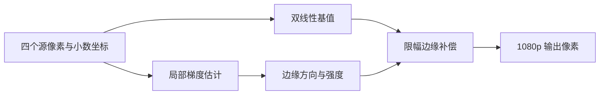

# FPGA 720p 到 1080p 超分辨率方案

_比较基准：`stage8_720p60hz_bilinear_uart_angle_correction_65byte`；独立验证工程：`stage12_720p_to_1080p30_bilinear_adaptive_sharpen_test`。目标为 1280×720 输入、1920×1080p30 输出。Stage12 RTL、全帧仿真和 PDS 时序均已通过；理想化 DDR 仿真约 32.87 fps，尚未进行实板帧率和视觉 A/B 验证。_

---

## 🎯 目标与基准

当前比较基准使用 1280×720 双线性插值、DDR 帧缓存、单应角度校正和 65 字节 UART 参数协议。Stage12 从较早的 Stage 5 identity DDR 项目复制，保留 720p 输入采集，只在副本中改成 1920×1080、30 Hz 输出；不接入 Brown 畸变、角度校正、Stage 11 图像增强或 UART。输入 MS7200 EDID 仍限制电脑输出 720p60；它与 FPGA 输出 HDMI 时序分开。

第一阶段选择**双线性插值加自适应锐化/边缘补偿**。重点是在复用现有四个邻点的前提下提升边缘观感，不增加每个输出像素的 DDR 邻点读取。该方法属于边缘保持型放大，不应宣称能恢复输入中从未采集到的真实细节。

后续保留两条研究方向：更强的传统边缘导向算法（DCCI/NEDI/EDI），以及神经网络超分或多帧融合。它们先记录为备选，不纳入第一阶段实现范围。

## 🔁 第一阶段数据通路

采样规划器和 Stage12 插值器复用 `p00/p10/p01/p11`、`fx/fy` 和四邻点有效掩码，不增加 DDR 邻点读取。[Stage12 自适应插值器](../../fpga/project/stage12_720p_to_1080p30_bilinear_adaptive_sharpen_test/source/rtl/correction/adaptive_bilinear_sharpener.sv) [采样规划器](../../fpga/project/stage12_720p_to_1080p30_bilinear_adaptive_sharpen_test/source/rtl/correction/bilinear_sample_planner.sv)

### 当前 RTL 算法

1. 对 R/G/B 通道分别计算原双线性结果和四邻点均值。
2. 若某通道四邻点 `max-min >= EDGE_THRESHOLD`（默认 12），输出 `bilinear + ((bilinear - mean) >>> 2)`；低对比区域保留双线性值。
3. 将补偿结果限制在该通道四邻点的最小值与最大值之间，RGBX 最低字节保持 0。
4. 采用四级弹性流水：邻点/权重采集、水平乘加、垂直乘法、末级求和和补偿；保持 ready/valid 元数据对齐。
5. 目的坐标以像素中心 3:2 映射到源坐标：`src=(dst+0.5)×2/3−0.5`，输出坐标首尾越界由现有边界复制采样处理。PDS 不支持此器件路径中的 RTL 常数除法，映射 RTL 改用精确 3 相位查表和乘常数求商。

阈值、补偿增益和限幅先作为 RTL 参数或常量，不扩展 UART 协议。这样可以先在同一位宽、同一输入图像和同一几何参数下比较原双线性与补偿模式。

### FPGA 约束与主要风险

- **读取带宽：**复用当前 2×2 四邻点，不增加 DDR 请求；算法不应引入额外邻域读取。
- **逻辑开销：**增加亮度差、绝对值、比较、方向选择和定点限幅，整体比 4×4 插值或 CNN 小，但具体 LUT、寄存器和时序变化必须以新构建为准。
- **流水线：**计算应拆入弹性流水级，并维持目标接收间隔为每周期一个有效像素；不能因补偿逻辑让下游反压显著增加。
- **时序：**首轮 Stage12 完整 PDS 布线的 DDR 处理时钟域 WNS 为 −2.368 ns（78 个 setup 端点失败），关键路径在垂直乘加。将垂直乘法和末级求和/补偿分开后，最终完整 PDS 报告为 `All Constraints Met`，DDR 时钟域 WNS **+0.403 ns**、TNS 0，并生成 `.sbit`。[Stage12 构建说明](../../fpga/project/stage12_720p_to_1080p30_bilinear_adaptive_sharpen_test/README.md) [详细结果](../results/stage12-super-resolution-feasibility.md)
- **吞吐：**1080p30 每帧像素数增加，算法吞吐、DDR 竞争和 HDMI 输出要在目标分辨率下共同验证；720p 实测不能直接证明 1080p30 可达。

## 🧪 第一阶段验证计划

1. 映射器和锐化器的定向 Vivado 仿真通过：映射测试覆盖首/中/尾坐标、元数据和反压；锐化测试覆盖高对比补偿与低对比保护。
2. 完整 Stage12 PDS 已通过，记录 LUT/寄存器/DRM 和 WNS/TNS 见[详细结果](../results/stage12-super-resolution-feasibility.md)。
3. 整帧仿真已覆盖 2,073,600 输出像素、16,200 个 128 像素突发、帧排空发布和输入/输出槽地址边界；理想 DDR 模型下约 32.87 fps。
4. 上板待办：下载配套位流，测显示器锁定、实际处理 fps/丢帧，并用相同输入对照 Stage 8 双线性与 Stage 12 边缘效果。

只有画质对照和 1080p30 实板数据都支持时，才把补偿版设为默认模式。

## 🧭 后续保留方向

### DCCI、NEDI 与其他强边缘导向方法

这类方法进一步利用边缘方向和局部统计来重建轮廓，适合斜线、细线和高对比边界的后续画质比较；DCCI、NEDI 和快速边缘导向方法各自采用不同的估计过程。[^1][^2][^3] 它们的具体运算和邻域大小依算法而异；较大窗口通常意味着更多行缓存、邻点读取、方向判断和乘加逻辑。

项目已有的 Catmull–Rom 4×4 邻域实验说明读取结构是关键风险：其读取器曾对每个输出像素串行执行四次 2×2 Tile Cache 查询，文档将该结构列为主要吞吐嫌疑点。[Stage 9 读取分析](./new-algorithm.md#当前最可能的吞吐瓶颈) 因此在评估 DCCI/NEDI 前，应先设计 4×4 窗口的行缓存或像素复用方案，再做画质和实测吞吐 A/B 比较。

该方向保持为**第二阶段传统算法候选**，不与第一阶段的 2×2 轻量方案混在一起实现。

### 神经网络超分与多帧融合

| 方向 | 可能收益 | 主要代价与风险 | 当前定位 |
| --- | --- | --- | --- |
| 轻量 CNN（如 ESPCN、FSRCNN） | 学习图像先验，可能生成单帧插值无法提供的纹理细节[^4][^5] | 需要匹配 1.5×放大比例的数据训练/模型、定点量化、卷积乘加阵列和特征缓存；可能生成看似锐利但不真实的细节 | 先在 PC 上评估画质和模型，再核对 FPGA 资源与时序 |
| 多帧超分 | 对齐带亚像素位移的多帧后融合观测信息，存在恢复真实高频细节的机会[^6] | 需要亚像素配准、跨帧缓存和运动/遮挡处理；动态目标、相机转动和视差可能造成重影 | 作为后续研究，不作为当前实时输出承诺 |

多帧方法的收益依赖输入帧之间存在可用的亚像素采样差异，并能可靠配准；如果相邻帧只是重复采样或场景运动无法补偿，多帧本身不会自动增加有效细节。神经网络方案还需检查模型输出是否会把噪声或压缩伪影误认为纹理。

## 📌 当前决策

- 当前实施候选：**双线性 + 自适应锐化/边缘补偿**，复用 2×2 邻点。
- 后续传统算法：**DCCI/NEDI/EDI 等强边缘导向方法**，先解决大邻域读取和窗口复用。
- 后续高复杂度方向：**轻量 CNN 超分**或**多帧融合超分**，先做离线画质/模型可行性评估。
- Stage 8 保持为比较基线；Stage12 是独立副本，未修改 Stage 5/8/10/11。
- 当前 RTL 测试通过不表示画质更好；布局布线时序、持续 1080p30 吞吐和上板画面仍是待验证项。

---

[^1]: Rouf, M. et al. (2016). “Fast edge-directed single-image super-resolution.” *Electronic Imaging*. https://doi.org/10.2352/ISSN.2470-1173.2016.15.IPAS-027
[^2]: Yu, S. et al. (2013). “Performance Evaluation of Edge-Directed Interpolation Methods for Images.” https://arxiv.org/abs/1303.6455
[^3]: Li, X. and Orchard, M. T. (2001). “New edge-directed interpolation.” *IEEE Transactions on Image Processing*, 10(10), 1521–1527. https://doi.org/10.1109/83.951537
[^4]: Dong, C. et al. (2016). “Accelerating the Super-Resolution Convolutional Neural Network.” *ECCV*. https://arxiv.org/abs/1608.00367
[^5]: Shi, W. et al. (2016). “Real-Time Single Image and Video Super-Resolution Using an Efficient Sub-Pixel Convolutional Neural Network.” *CVPR*. https://arxiv.org/abs/1609.05158
[^6]: Lafenetre, J. et al. (2023). “Implementing Handheld Burst Super-Resolution.” *Image Processing On Line*. https://doi.org/10.5201/ipol.2023.460

_最后更新：2026-10-29_
