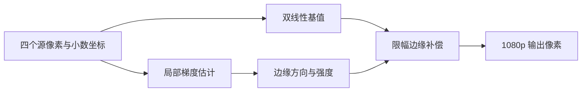

# FPGA 720p 到 1080p 超分辨率方案

_比较基准：`stage8_720p60hz_bilinear_uart_angle_correction_65byte`；独立验证工程：`stage12_720p_to_1080p30_bilinear_adaptive_sharpen_test`。目标为 1280×720 输入、1920×1080p30 输出。Stage12 RTL、全帧仿真和 PDS 时序均已通过；理想化 DDR 仿真约 32.87 fps，尚未进行实板帧率和视觉 A/B 验证。_

---

## 🎯 目标与基准

当前比较基准使用 1280×720 双线性插值、DDR 帧缓存、单应角度校正和 65 字节 UART 参数协议。Stage12 从较早的 Stage 5 identity DDR 项目复制，保留 720p 输入采集，只在副本中改成 1920×1080、30 Hz 输出；不接入 Brown 畸变、角度校正、Stage 11 图像增强或 UART。输入 MS7200 EDID 仍限制电脑输出 720p60；它与 FPGA 输出 HDMI 时序分开。

第一阶段选择**双线性插值加自适应锐化/边缘补偿**。重点是在复用现有四个邻点的前提下提升边缘观感，不增加每个输出像素的 DDR 邻点读取。该方法属于边缘保持型放大，不应宣称能恢复输入中从未采集到的真实细节。

后续保留两条研究方向：更强的传统边缘导向算法（DCCI/NEDI/EDI），以及神经网络超分或多帧融合。它们先记录为备选，不纳入第一阶段实现范围。

## 🔁 第一阶段数据通路

采样规划器和 Stage12 插值器复用 `p00/p10/p01/p11`、`fx/fy` 和四邻点有效掩码，不增加 DDR 邻点读取。[Stage12 自适应插值器](../../fpga/project/stage12_720p_to_1080p30_bilinear_adaptive_sharpen_test/source/rtl/correction/adaptive_bilinear_sharpener.sv) [采样规划器](../../fpga/project/stage12_720p_to_1080p30_bilinear_adaptive_sharpen_test/source/rtl/correction/bilinear_sample_planner.sv)

### 当前 RTL 算法

1. 对 R/G/B 通道分别计算原双线性结果和四邻点均值。
2. 若某通道四邻点 `max-min >= EDGE_THRESHOLD`（默认 12），输出 `bilinear + ((bilinear - mean) >>> 2)`；低对比区域保留双线性值。
3. 将补偿结果限制在该通道四邻点的最小值与最大值之间，RGBX 最低字节保持 0。
4. 采用四级弹性流水：邻点/权重采集、水平乘加、垂直乘法、末级求和和补偿；保持 ready/valid 元数据对齐。
5. 目的坐标以像素中心 3:2 映射到源坐标：`src=(dst+0.5)×2/3−0.5`，输出坐标首尾越界由现有边界复制采样处理。PDS 不支持此器件路径中的 RTL 常数除法，映射 RTL 改用精确 3 相位查表和乘常数求商。

阈值、补偿增益和限幅先作为 RTL 参数或常量，不扩展 UART 协议。这样可以先在同一位宽、同一输入图像和同一几何参数下比较原双线性与补偿模式。

### FPGA 约束与主要风险

- **读取带宽：**复用当前 2×2 四邻点，不增加 DDR 请求；算法不应引入额外邻域读取。
- **逻辑开销：**增加亮度差、绝对值、比较、方向选择和定点限幅，整体比 4×4 插值或 CNN 小，但具体 LUT、寄存器和时序变化必须以新构建为准。
- **流水线：**计算应拆入弹性流水级，并维持目标接收间隔为每周期一个有效像素；不能因补偿逻辑让下游反压显著增加。
- **时序：**首轮 Stage12 完整 PDS 布线的 DDR 处理时钟域 WNS 为 −2.368 ns（78 个 setup 端点失败），关键路径在垂直乘加。将垂直乘法和末级求和/补偿分开后，最终完整 PDS 报告为 `All Constraints Met`，DDR 时钟域 WNS **+0.403 ns**、TNS 0，并生成 `.sbit`。[Stage12 构建说明](../../fpga/project/stage12_720p_to_1080p30_bilinear_adaptive_sharpen_test/README.md) [详细结果](../results/stage12-super-resolution-feasibility.md)
- **吞吐：**1080p30 每帧像素数增加，算法吞吐、DDR 竞争和 HDMI 输出要在目标分辨率下共同验证；720p 实测不能直接证明 1080p30 可达。

## 🧪 第一阶段验证计划

1. 映射器和锐化器的定向 Vivado 仿真通过：映射测试覆盖首/中/尾坐标、元数据和反压；锐化测试覆盖高对比补偿与低对比保护。
2. 完整 Stage12 PDS 已通过，记录 LUT/寄存器/DRM 和 WNS/TNS 见[详细结果](../results/stage12-super-resolution-feasibility.md)。
3. 整帧仿真已覆盖 2,073,600 输出像素、16,200 个 128 像素突发、帧排空发布和输入/输出槽地址边界；理想 DDR 模型下约 32.87 fps。
4. 上板待办：下载配套位流，测显示器锁定、实际处理 fps/丢帧，并用相同输入对照 Stage 8 双线性与 Stage 12 边缘效果。

只有画质对照和 1080p30 实板数据都支持时，才把补偿版设为默认模式。

## 🧭 后续保留方向

### DCCI、NEDI 与其他强边缘导向方法

这类方法进一步利用边缘方向和局部统计来重建轮廓，适合斜线、细线和高对比边界的后续画质比较；DCCI、NEDI 和快速边缘导向方法各自采用不同的估计过程。[^1][^2][^3] 它们的具体运算和邻域大小依算法而异；较大窗口通常意味着更多行缓存、邻点读取、方向判断和乘加逻辑。

项目已有的 Catmull–Rom 4×4 邻域实验说明读取结构是关键风险：其读取器曾对每个输出像素串行执行四次 2×2 Tile Cache 查询，文档将该结构列为主要吞吐嫌疑点。[Stage 9 读取分析](./new-algorithm.md#当前最可能的吞吐瓶颈) 因此在评估 DCCI/NEDI 前，应先设计 4×4 窗口的行缓存或像素复用方案，再做画质和实测吞吐 A/B 比较。

该方向保持为**第二阶段传统算法候选**，不与第一阶段的 2×2 轻量方案混在一起实现。

### 神经网络超分与多帧融合

| 方向 | 可能收益 | 主要代价与风险 | 当前定位 |
| --- | --- | --- | --- |
| 轻量 CNN（如 ESPCN、FSRCNN） | 学习图像先验，可能生成单帧插值无法提供的纹理细节[^4][^5] | 需要匹配 1.5×放大比例的数据训练/模型、定点量化、卷积乘加阵列和特征缓存；可能生成看似锐利但不真实的细节 | 先在 PC 上评估画质和模型，再核对 FPGA 资源与时序 |
| 多帧超分 | 对齐带亚像素位移的多帧后融合观测信息，存在恢复真实高频细节的机会[^6] | 需要亚像素配准、跨帧缓存和运动/遮挡处理；动态目标、相机转动和视差可能造成重影 | 作为后续研究，不作为当前实时输出承诺 |

多帧方法的收益依赖输入帧之间存在可用的亚像素采样差异，并能可靠配准；如果相邻帧只是重复采样或场景运动无法补偿，多帧本身不会自动增加有效细节。神经网络方案还需检查模型输出是否会把噪声或压缩伪影误认为纹理。

## 📌 当前决策

- 当前实施候选已更新：**轻量 3:2 残差 CNN 超分**，用于运动视频整体清晰度；输入为 720p60，HDMI 输出保持 1080p60，每秒至少产生 30 张新的处理帧，其余扫描周期允许重复显示最近处理帧。
- 网络优先在低分辨率亮度域运行，预测叠加到双线性 3:2 基值上的有界残差；每个 2×2 输入块对应 3×3 输出相位。拟用 8 通道特征、两个 depthwise-separable 块和 9 相位输出头，8 位定点；RGB 色度先沿用双线性。
- 当前工程实测约 44.7 张新处理帧/秒，但加入 CNN 和畸变校正后的处理率尚未知。先完成软件训练/量化/连续视频 A/B，再在独立 Stage12 副本中实现行缓存卷积和相位重排；不覆盖已验证的 streaming line-buffer 工程。
- 评估至少包括 Y-PSNR/SSIM、斜边或细线分辨能力、连续帧清晰度波动、伪纹理、边缘振铃、PDS 资源及时序和板上处理帧率。模型输出需限制残差幅度，避免平坦区噪声被放大。
- 当前 Stage12 的双线性加自适应锐化保留为 FPGA 回退/基线；CNN 通过相同视频画质对比并实测达到至少 30 张新帧/秒后，才考虑作为默认方案。
- 后续传统算法：**DCCI/NEDI/EDI 等强边缘导向方法**，先解决大邻域读取和窗口复用。
- 后续研究方向：**多帧融合超分**，运动配准与重影抑制先离线评估，不纳入当前 FPGA 首版。
- Stage 8 保持为比较基线；Stage12 是独立副本，未修改 Stage 5/8/10/11。
- 当前 RTL 测试通过不表示画质更好；布局布线时序、持续 1080p30 吞吐和上板画面仍是待验证项。

---

[^1]: Rouf, M. et al. (2016). “Fast edge-directed single-image super-resolution.” *Electronic Imaging*. https://doi.org/10.2352/ISSN.2470-1173.2016.15.IPAS-027
[^2]: Yu, S. et al. (2013). “Performance Evaluation of Edge-Directed Interpolation Methods for Images.” https://arxiv.org/abs/1303.6455
[^3]: Li, X. and Orchard, M. T. (2001). “New edge-directed interpolation.” *IEEE Transactions on Image Processing*, 10(10), 1521–1527. https://doi.org/10.1109/83.951537
[^4]: Dong, C. et al. (2016). “Accelerating the Super-Resolution Convolutional Neural Network.” *ECCV*. https://arxiv.org/abs/1608.00367
[^5]: Shi, W. et al. (2016). “Real-Time Single Image and Video Super-Resolution Using an Efficient Sub-Pixel Convolutional Neural Network.” *CVPR*. https://arxiv.org/abs/1609.05158
[^6]: Lafenetre, J. et al. (2023). “Implementing Handheld Burst Super-Resolution.” *Image Processing On Line*. https://doi.org/10.5201/ipol.2023.460

## 🛠️ Stage12 streaming 行缓存黑屏排查（2026-10-30）

用户反馈最近烧录的 `stage12_1080p60_streaming_linebuffer_test` 出现 HDMI 有信号但黑屏、LED5/LED6/LED7 不亮。检查行缓存状态机和引用计数更新后，发现根因：3 位有符号 `ref_delta` 与 16 位无符号 `row_refs` 混合运算，负增量 `-1` 可能被零扩展，导致已完成的像素查询没有正确释放行槽。三行缓存填满后，顺序 DMA 可能一直等不到空闲槽，帧处理停止推进，符合黑屏和输出活动灯不亮的表现。

已修复为显式将 `ref_delta` 符号扩展到 16 位再更新引用计数，并在独立 Stage12 工程重新生成位流。PDS 完成调试核插入、布局布线和位流生成，报告 `All Constraints Met`：125 MHz DDR 域 WNS **+0.711 ns**，148.5 MHz HDMI 输出域 WNS **+1.207 ns**，TNS 为 0；资源为 24 DRM、9,906 LUT、9,967 FF。

- 修正版位流：[`.sbit`](../../fpga/project/stage12_1080p60_streaming_linebuffer_test/generate_bitstream/HDMI_IN_DDR3_HDMI_OUT_top.sbit)，SHA-256：`ED0C273E1DA8DF71958A64A8741278C77DFDA0C8DEC960F496EFB362420CBC33`。
- 配套调试文件：[`.fic`](../../fpga/project/stage12_1080p60_streaming_linebuffer_test/generate_bitstream/HDMI_IN_DDR3_HDMI_OUT_top.fic)，SHA-256：`A9A129747ED49C53C5EC4FABC43241C6D73E664649CE76698F392953B2E5DEDD`。
- 板上状态：用户已烧录修正版并确认画面恢复。Fabric Debugger 两次快照显示相关计数持续增长。

### 修复后实板帧率

Fabric Debugger 两次采样时间为 12:39:12 和 12:39:56，间隔约 44 秒。`input_published_count` 从 `0x0DB9`（3513）增至 `0x1816`（6166），增加 2653 帧，输入约 **60.3 fps**。`display_take_count` 从 `0x0A2D`（2605）增至 `0x11DD`（4573），增加 1968 帧，处理后被显示端接收的更新约 **44.7 fps**，超过 30 fps。

第二张快照的 `copy_last_frame_cycles=0x002AE981`（2,812,289 周期），按 125 MHz 计算为约 **22.50 ms/帧**，即约 **44.45 fps**，与两次计数差值估算相符。请求阻塞计数为 609 周期（约 0.022%），第一张为 683 周期。采样间隔来自控制台秒级时间戳，因此计数差的 fps 是近似值；单帧周期是交叉核验。该结果确认当前样机处理速率超过 30 fps，但低于 1080p60 显示扫描率，因此显示器仍会重复部分处理帧。后续应延长采样并在相同输入源下与 cache8/双线性基线比较画质和吞吐。

_最后更新：2026-10-30_

## 🧠 运动视频 CNN 超分实现进度（2026-10-30）

目标已调整为运动视频整体清晰度：720p60 输入、1080p60 HDMI 扫描，每秒至少 30 张新的超分处理帧。根据该目标，当前实施候选从双线性加锐化改为 3:2 轻量亮度残差 CNN；保留现有双线性加锐化作回退。采用每 2×2 个输入像素生成 3×3 输出相位的结构，网络输出有界残差并与双线性基值相加，先不把 Brown 畸变校正并入 Stage12 实验工程。

设计和任务分解见 [`运动视频超分设计`](../superpowers/specs/2026-10-30-motion-video-sr-design.md) 与 [`实施计划`](../superpowers/plans/2026-10-30-motion-video-sr.md)。软件原型目录为 [`host/super_resolution`](../../host/super_resolution/README.md)，已建立 3:2 相位 CNN、配对帧退化生成、合成运动图卡生成、训练入口、int8 权重导出和视频指标入口。当前开发环境为独立 `.venv-sr`（Python 3.13、PyTorch 2.15 CPU、OpenCV 5、NumPy 2.5），避免更改工程原有 Python 3.14 环境。另已创建独立 FPGA 候选 [`stage12_1080p60_cnn_sr_test`](../../fpga/project/stage12_1080p60_cnn_sr_test/README.md)，目前 RTL 仍为基线双线性加锐化，未接入 CNN。

早期 16 帧合成图卡实验只用于确认软件流程，因训练集与评估集相同，不作为模型效果证据。真实视频的留出评估和当前网络调整记录如下。已有 44.7 张新处理帧/秒的板测来自无 CNN、无 Brown 的 streaming line-buffer 版本，不能作为新设计的 30 fps 结论。

用户随后提供 `host/super_resolution/video/video_20261030_131922.mp4`（3840×2160、约 60.074 fps、1528 帧、25.44 秒）。已按场景时间段生成严格同源配对：0–15 秒训练 301 帧、15–21 秒验证 120 帧、21–25.4 秒留出测试 264 帧；4K 帧先缩为 1920×1080 参考，再施加轻度模糊/噪声并下采样到 1280×720。数据和模型保存在忽略目录 `host/super_resolution/.work/`；实验 int8 权重快照保存在 [`weights/bicubic_residual_int8_experimental.json`](../../host/super_resolution/weights/bicubic_residual_int8_experimental.json)。完整训练设置与结果见[报告](../results/stage12-cnn-sr-training.md)。

实验环境切换到 CUDA PyTorch 2.15.0+cu132，训练实际使用 RTX 5070 Laptop GPU。首个双线性基底 CNN 在留出测试段低于双三次，因此已改为双三次基底上的残差 CNN。验证选出的第 25 轮模型在 264 帧留出测试段得到：CNN **44.329 dB**、双三次 **43.805 dB**、Lanczos4 **43.796 dB**、双线性 **42.038 dB**；Y-PSNR 比双三次高约 0.52 dB，帧间误差从 1.338 降到 0.663。权重对称 int8 仿真只使 PSNR 降约 0.003 dB，但该仿真仍以浮点激活和偏置进行，不是 RTL 定点结果。现有训练/验证/测试片段来自同一段约 25 秒视频，不能代表跨场景泛化。下一关是整数激活/累加器位宽、流式 RTL、PDS 与板测；模型卷积估算约 383M MAC/帧（30 fps 约 11.5 GMAC/s），不是时序保证。已有 44.7 张新处理帧/秒的板测来自无 CNN、无 Brown 的 streaming line-buffer 版本，不能作为新设计的 30 fps 结论。

随后新增户外独立视频 `video_20261030_142255.mp4`（3840×2160、60.072 fps、663 帧、11.04 秒），内容含盆栽、庭院树叶和镜头移动，未用于训练。按同样退化生成 221 对测试帧，权重 int8 浮点模拟 CNN 达到 **40.111 dB**，双三次为 **39.651 dB**，Lanczos4 为 **39.766 dB**；CNN 帧间误差 **1.020**，双三次 **2.101**。这表明该拍摄方式能提供有用的独立场景评估素材。完整数据见[训练报告](../results/stage12-cnn-sr-training.md)。建议继续按该格式拍，并补室内细纹理、快速运动、低照度等场景；板上 RTL/时序/30 fps 尚未验证。

用户又新增 5 段 4K60 视频。已用 Rubik 低照度、草地/灌木、街道行人车辆和棋盘格片段继续训练；云层视频用作验证，庭院视频仍保持独立测试。多场景模型权重 int8 浮点模拟在庭院测试上得到 **39.924 dB**，双三次 **39.651 dB**，Lanczos4 **39.766 dB**；帧间误差 **1.041**，双三次 **2.101**。多场景训练、视频清单和边界见[训练报告](../results/stage12-cnn-sr-training.md)，权重快照见 [`bicubic_residual_multiscene_int8_experimental.json`](../../host/super_resolution/weights/bicubic_residual_multiscene_int8_experimental.json)。模型仍需整数激活、偏置/累加器实现，FPGA 综合、时序与板上 30 fps 还未验证。

## 2026-10-30：Stage11 功能与 1080p60 超分辨率集成构建

新增独立工程 `stage12_1080p60_stage11_super_resolution_test`，基于 Stage11 calibrated baseline，保留 65 字节 UART、帧边界单应/K3 参数、lighting LUT 和 cache8 读取；输出改为 1920×1080@60 Hz，在双线性采样处加入 Stage12 自适应锐化，并扩大输出帧池。3:2 像素中心坐标在单应变换前折算，避免 720p 中间帧 DDR 往返。后续板上检查发现首轮的齐次坐标缩放实现错误，首轮位流不能作为有效畸变矫正版使用，见下文修复记录。

首轮 PDS 2022.2-SP6.4 完整布线和位流生成通过，最终 `All Constraints Met`；125 MHz DDR 域 setup WNS +0.125 ns，148.5 MHz HDMI 输出域 +1.715 ns。工具时序通过并未发现映射器的坐标量纲错误；该首轮位流已在下文标记作废。

## 2026-10-30：Stage12 单应映射无效问题修复

复核 `stage12_1080p60_stage11_super_resolution_test` 时确认，首轮集成 RTL 虽然实例化了 Stage11 单应与 Brown K3 畸变链，但把 3:2 坐标变换后的齐次分子、分母统一放大了 6 倍；原有分母范围检查和倒数查找表仍按未缩放的 Q30 范围工作。因此单位单应的分母也会越界，映射坐标被标记为无效，解释了上板输出没有可见变化。首轮 `.sbit`（SHA-256 `B27C7A0ECCC8E753994E0C9A4B136ACC612BD1C14C888BACA03B8DCC2DA53C96`）作废，不应继续烧录。

修复后先用 3:2 mapper 产生像素中心对齐的 Q16.16 坐标，再进入 Stage11 单应与已标定 Brown K3 映射；并在宽乘法前寄存单应参数、坐标与元数据。流水吞吐仍为每周期一个像素，增加一拍延迟。Stage11 的 UART、帧边界单应/K3 更新、lighting LUT 与 cache8 均保留。单应/Brown 链、60 个参考向量、严格四邻点黑边、K3 参考和 3:2+单位单应仿真均通过。

修复版 PDS 2022.2-SP6.4 完整布线和位流生成通过，`All Constraints Met`：125 MHz DDR 域 setup WNS **+0.052 ns**，148.5 MHz HDMI 时钟域 **+1.764 ns**，TNS 均为 0。新配套文件在 `stage12_1080p60_stage11_super_resolution_test/generate_bitstream/`：`.sbit` SHA-256 `490DD940074C7141D63D47D9F9C20B34F679C860D38A7EC9BA2774B69381D8B4`；`.fic` SHA-256 `680DFAAFDB1FA79F243D339F80410A5A54E8A88BF9873F7EDE0392F460BBC24C`。生成时尚未完成上板验证；后续烧录与处理帧率测量见下节。

## 2026-10-30：Stage12 上板显示与处理帧率

用户已将修复版烧录 FPGA 并确认显示正常。该工程输出栅格配置为 **1920×1080、60 Hz**，像素时钟为 **148.5 MHz**；Fabric Debugger 截图显示处理和显示计数正常增长。截图中没有显示器 OSD 或 HDMI 接收端模式信息，因此 1080p60 的结论来自工程时序配置和用户确认画面显示，不能单凭这些调试器截图独立验证显示器实际锁定模式。

两次 Fabric Debugger `run` 约相隔 28 秒。`raw_input_vsync_count` 从 `0x19d5` 增至 `0x206d`（+1688，约 **60.3 fps**）；`copied_count` 和 `display_take_count` 均从 `0x0fae` 增至 `0x13af`（各 +1025，约 **36.6 fps**）。同期 `capture_dropped_count` 从 `0x0a24` 增至 `0x0cbb`（+663），`output_dropped_count` 保持 0。说明 FPGA 的 HDMI 扫描输出按 60 Hz 配置运行，但新处理画面约以 36.6 fps 更新；处理帧率超过 30 fps 目标，尚未达到每秒处理 60 帧。

帧周期计数器也支持该估算：`perf_frame_cycles=0x344f7d`（3,428,221 周期）和 `0x346534`（3,433,780 周期），以 125 MHz `core_clk` 换算分别约 **36.46 fps** 和 **36.40 fps**。两次读数与计数器增量估算一致。错误与不完整输出计数均为 0。

功能默认状态：单应矩阵上电为单位矩阵，UART 下发有效姿态参数后才产生对应角度/单应变换；标定 Brown K3 映射在像素数据链中运行；自适应锐化器持续工作，仅对超过阈值的边缘增强；lighting LUT 默认 profile 0 为恒等曲线，选择其他 UART profile 才应用相应曲线。

## 2026-10-30：运动视频超分首版 RTL 实验

在独立 `stage12_1080p60_cnn_sr_test` 工程中接入 3:2 相位选择的四抽头 Q7 RGB 插值器。系数来自五段训练视频的 720p/1080p 配对帧，并按 25% 学习系数、75% 双线性系数混合；九个相位的系数和均为 128，以保留平坦区域亮度。该硬件仍只读取 2×2 邻域，**不是已训练的 7×7 残差 CNN**。原 CNN 权重的整数激活、特征行缓存和相位输出头尚未接入 RTL。

采用独立庭院片段均匀抽样的 20 帧评估，该实验滤波器 Y-PSNR 为 **36.616 dB**，同一脚本中的双线性为 **36.550 dB**，双三次为 **39.153 dB**。这里的采样帧数和颜色/缩放实现与上文完整 CNN 测评不同，数值不可直接横向比较；只支持该脚本内的相对比较。增益很小，尚不能断言有可见的细节提升。系数和脚本分别在 `host/super_resolution/weights/phase_filter_q7_experimental.json`、`host/super_resolution/fit_phase_filter.py`。

ModelSim 定向仿真覆盖九个相位、元数据和反压，结果 PASS。整帧仿真覆盖 2,073,600 个输出像素、16,200 次输出写突发、720 行源读取，**2,349,194 个 125 MHz 周期/帧，理想 DDR 模型约 53 fps**，超过 30 fps 仿真门槛，但不代表实板帧率。整帧仿真还暴露初始行缓存会在 `source_frame_start` 前预取的问题；候选工程加了 `frame_armed` 门控并重跑通过。已验证的 streaming 工程未修改。

PDS 2022.2-SP6.4 完整构建通过，插入 Fabric DebugCore 并生成候选工程自己的位流，最终 `All Constraints Met`：125 MHz DDR 域 setup WNS **+0.605 ns**，输出相关时钟域 WNS **+2.133 ns**，TNS 均为 0。综合资源为 **8,762 LUT、7,877 寄存器、22 DRM**。配套文件：[`候选 .sbit`](../../fpga/project/stage12_1080p60_cnn_sr_test/generate_bitstream/HDMI_IN_DDR3_HDMI_OUT_top.sbit)，SHA-256 `19CD13CE3A0E158CBA212C937E40262F916C49B554925B53A4768D6EFC7FD3E0`；[`候选 .fic`](../../fpga/project/stage12_1080p60_cnn_sr_test/generate_bitstream/HDMI_IN_DDR3_HDMI_OUT_top.fic)，SHA-256 `2D45FB9810F8586BE6C49EEF013AE98527BA6F158833EFBE9A6A4659F9CBE266`。实板显示、运动视频画质和持续处理帧率尚未测量；这版的微小离线增益不足以替代计划中的 CNN。

## 2026-10-30：Stage12 真正 CNN 独立工程搭建

用户确认首版相位滤波位流已上板成功，要求另建真正使用训练权重的 CNN 测试工程，工程名以 `stage12_` 开头。详细实施计划见 [`Stage12 真正流式 CNN 超分辨率实施计划`](../superpowers/plans/2026-10-30-stage13-true-cnn-sr.md)。已创建隔离副本 `stage12_1080p60_true_cnn_sr_test`，去除旧综合/布局布线和模拟工作库；CNN 权重、整数参考和 RTL 尚未接入，因此当前目录还没有真正 CNN 位流。

模型未达标的复核与改进：修复评估脚本重复写入 CNN 行的错误后，原街道独立测试 CNN 仅 25.915 dB，双三次 25.871 dB，Lanczos4 26.166 dB。训练改为每帧四个纹理块、庭院纹理验证选模后，街道 CNN 达 26.711 dB、比当前自适应锐化高约 1.90 dB；权重 int8 浮点模拟为 26.710 dB。加入相邻帧损失的后续模型在街道达 26.792–26.852 dB，但云层视频的帧间误差仍高于双三次。具体实验与限制见[训练报告](../results/stage12-cnn-sr-training.md)。下一步先处理平坦场景时域稳定性，再完成整数激活/偏置和真正流式 CNN RTL；目前没有可交付的 CNN 位流。
