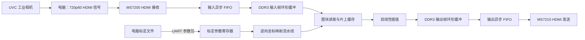

# 盘古 200Pro+ 720p60 畸变矫正实施计划

> 状态：阶段 1 HDMI 直通已上板；阶段 2 RGB565 缓存末行修正版已连续运行至少 30 分钟，无黑边、错位或闪屏。三帧槽 RGB565 版上板快速闪屏，RGBX8888 版目前显示正常，仍待颜色图和长时间验证；畸变矫正尚未完成。先完成基础功能，再进入动态角度等进阶功能。

## 1. 目标与边界

使用盘古 200Pro+（PG2L200H）实现 **工业相机 → 电脑 → HDMI 输入 → FPGA 畸变矫正 → HDMI 输出** 的实时闭环。输入和输出的目标视频制式均为 **1280×720 @ 60 Hz**。

基础功能完成的定义：

1. HDMI 输入、DDR3 缓存、HDMI 输出持续稳定工作，画面无撕裂、错行或明显丢帧。
2. 用工业相机的真实标定结果配置 `fx, fy, cx, cy, k1, k2, p1, p2`；FPGA 逐像素计算逆向映射并完成双线性插值。
3. 矫正结果能与同参数的 OpenCV 参考图比较，棋盘格或直线图卡可显示矫正效果。
4. 测出 FPGA HDMI 输入至 HDMI 输出的帧率、延迟、时序余量和资源占用，并形成可复现报告。

**帧率口径：**HDMI 链路为 60 Hz，不等于工业相机必然产生 60 张不同图像。首先确认 UVC 采集模式及实际帧时间戳；若相机只有 30 fps，应在报告中分别写明“HDMI 输出 60 Hz”和“不同相机帧 30 fps”。电脑端只能做采集、无缩放呈现、标定和参数传送；演示时不在电脑上预先完成畸变矫正。

赛题指南对基础任务要求视频采集与显示、二阶径向及切向畸变模型、图像插值；动态角度、自适应预处理属于高阶任务。本计划据此排序。指南位于父目录：`全国大学生嵌入式芯片与系统设计竞赛'2026FPGA赛道选题指南-紫光同创.pdf`，重点阅读 PDF 第 12–14 页。

## 2. 已有资料与工程起点

- 开发板手册（相对仓库根目录）：`../盘古200Pro+开发板配套资料/1_Demo_document/实验例程说明篇/MES2L676-200HP硬件使用手册_v1.2.pdf`。手册对应 PG2L200H，列出 HDMI 输入 MS7200、HDMI 输出 MS7210、两颗 DDR3、UART 和管脚信息。
- **优先使用的参考工程（相对仓库根目录）：**`../盘古200Pro+开发板配套资料/2_Demo/4_10_timing/4_10_HDMI_IN_DDR3_HDMI_OUT/HDMI_IN_DDR3_HDMI_OUT.pds`。其器件配置为 PG2L200H，已有 HDMI→DDR3→HDMI 通路；当前视频参数为 1080p，需要改成 720p60。
- `2_Demo/4_12_HDMI_IN_DDR3_HDMI_OUT` 的示例器件配置为 PG2L100H；可参考 RTL 思路，但不能直接把它的工程配置和 IP 当作 200Pro+ 目标工程。
- `2_Demo/2_10_hdmi_loop` 和 `2_Demo/2_9_ddr3_test` 均有 PG2L200H 版本，可分别用于定位 HDMI 或 DDR3 单独故障。
- OpenCV 文档：[相机标定](https://docs.opencv.org/4.13.0/dc/dbb/tutorial_py_calibration.html)、[逆向映射定义](https://docs.opencv.org/4.13.0/d9/d0c/group__calib3d.html)。软件参考图使用 `calibrateCamera`、`initUndistortRectifyMap` 和 `remap`。

厂商资料保留在父目录；仓库只放本项目源码、必要的工程配置、测试脚本和报告。需要纳入仓库的厂商文件先核对其再分发许可。

### 2.1 旧工程复用清单（先参考，不直接搬入）

旧工程位于仓库外的 `../../Pango_Micro_FPGA_Old/Distortion-correction/`。其 `rtl/algorithm/` 与 `rtl/platform/common/` 按板卡无关方式分层，适合作为后续移植起点；目前**不复制文件到新仓库**。进入阶段 4、5 时，按下表逐个移入必要模块及对应的软件模型、仿真向量，并记录来源版本和改动。

| 旧工程模块/资料 | 可利用的工作 | PG2L200H 接入时要核对 |
| --- | --- | --- |
| `rtl/algorithm/distortion/distortion_core_optimized.sv`、`coordinate_gen.sv`、`coordinate_split.sv` | 已有逆向坐标映射、行场标记传递及 Q18 定点实现；优先评估优化核心，避免重新设计整条乘法流水线 | 用真实相机参数检查量化范围、饱和和误差；该核心仅有 `k1/k2/p1/p2`，如标定必须用 `k3` 再扩展 |
| `rtl/algorithm/interpolation/bilinear_interp.sv`、`rtl/algorithm/distortion/distortion_image_pipeline.sv`、`rtl/platform/common/memory/coordinate_fifo.sv` | 四点 RGB888 插值、映射与取像素解耦、非停顿流水线的 FIFO 保护 | 包装模块默认 `USE_OPTIMIZED_CORE=0`、`USE_TILE_CACHE=0`，接入缓存方案时须显式启用；复核帧边界、复位和 FIFO 容量 |
| `rtl/platform/common/memory/{cached_pixel_fetch_engine,pixel_tile_cache,ddr_burst_reader,tile_cache_bank_ram}.sv` | 32×4 RGBX8888 Tile Cache、256 位突发读和四邻域并行取数，可替代从零设计图块搬运 | 旧 DDR 读接口的字节地址、突发长度、字节序和 Bank RAM 时序需通过新板适配；缓存组数/路数按 PG2L200H 资源与命中率重新选择 |
| `software/bitaccurate_distortion.py`、`software/cache_model.py`、`sim/tb_distortion_core_optimized.sv` 及相关图片/吞吐脚本 | 定点黄金向量、缓存行为和图片级比对的现成验证方法 | 旧脚本和测试条件基于旧工程目录及旧时钟，迁移后改成真实 720p60 参数再重新验证 |

旧 `rtl/board/pgl50h/`、`rtl/vendor/pgl50h/`、PDS 工程及约束属于 **MES50HP/PGL50H**，只参考帧写入、DDR 仲裁和读出控制思路；新工程板级层必须使用 PG2L200H 厂商例程及重新生成的 IP。旧板级 README 记录的是 **720p30 的采集一帧→处理一帧→循环显示**，不能据此宣称已实现 720p60 连续实时矫正。旧 1080p30 吞吐资料也只是缓存架构的参考数据，目标板仍需单独测量。

## 3. 基础功能架构



### 3.1 视频制式和存储

720p60 采用有效区域 `1280×720`、总时序 `1650×750`、像素时钟 **74.25 MHz**。水平前沿/同步/后沿分别为 `110/40/220` 像素，垂直前沿/同步/后沿分别为 `5/5/20` 行。输出 PLL、`sync_vg` 参数、`fram_buf` 的行列尺寸及帧地址空间必须一同修改。输入以 MS7200 的像素时钟为准，输出由板上 PLL 产生；DDR3 控制器有自己的时钟。各时钟域用异步 FIFO 和帧级握手连接，不直接跨域采样多位地址或帧号。

参考工程使用 RGB565 存储，适合先验证 HDMI/DDR3 通路。**正式矫正链路采用 RGB888 输入 → RGBX8888 DDR3 存储 → RGB888 HDMI 输出**：为对接旧缓存 RTL，每像素一个 32 位字，规定 `word[31:24]=R`、`word[23:16]=G`、`word[15:8]=B`、`word[7:0]=8'h00`，即 `{R,G,B,8'h00}`；旧 `cached_pixel_fetch_engine` 从 `[31:8]` 取 RGB888。`X` 只是填充字节，不参与插值；DDR 数据字中的像素顺序和字节序要用红、绿、蓝、白测试图实测核对。这样能保留输入的 8 位 RGB 精度，也便于按像素索引计算 DDR 地址。

RGB565 同样能整除 32 位 DDR 数据宽度，因此“能整除”不是升级的唯一理由。RGBX8888 的代价是存储量和视频数据流量均为 RGB565 的两倍：一帧 `1280×720×4 = 3,686,400` 字节；输入和输出各留三个帧槽约 **22.1 MB**。720p60 时，单条连续视频流约 **221.2 MB/s**；仅采集写、处理结果写、显示读三条流就约 **663.6 MB/s**，另需处理端读取源图。上述都是有效像素载荷，不含 DDR3 刷新、图块重复读取和仲裁开销，必须在板上测实际裕量。

DDR3 中分开管理输入帧和输出帧。只允许处理器读入已完整写入的输入帧，只允许显示端读入已完整写入的输出帧；帧槽在场同步边界交接。记录每帧的序号、完整标志、丢帧计数和欠读计数，便于证明 60 Hz 链路稳定。

### 3.2 坐标映射与插值

按**输出像素反查输入坐标**：对输出坐标 `(u,v)` 用输出相机矩阵归一化，再计算 `r²=x²+y²`、`r⁴=r²×r²`，得到源图坐标：

```text
xd = x × (1 + k1×r² + k2×r⁴) + 2×p1×x×y + p2×(r² + 2×x²)
yd = y × (1 + k1×r² + k2×r⁴) + p1×(r² + 2×y²) + 2×p2×x×y
us = fx×xd + cx
vs = fy×yd + cy
```

以上是基础阶段的二阶径向加切向模型。若真实相机标定显示 `k3` 不可忽略，应扩展模型并同步调整软件参考图，不能删改实测参数后仍声称等效于真实标定。优先核对旧优化核心的参数接口（`fx/fy/cx/cy` 为 Q19，倒数为 Q30，`k1/k2/p1/p2` 为 Q28）、内部 Q18 运算、Q19 源坐标及 Q16 插值小数，再用真实参数范围和定点模型确定是否需改位宽；不要另起一套不兼容的 Q 格式。

对 `(us,vs)` 周围四个像素做双线性插值。反向映射避免输出图像中的采样空洞；源坐标落在图像外时不能凭插值造出真实像素。基础版提供固定裁剪/缩放 ROI 和无效像素标记，在报告中记录视野损失。边界策略必须与 OpenCV 参考图一致。

### 3.3 DDR3 访问策略

720p60 有 **55,296,000 个有效输出像素/秒**。直接为每个像素发四次零散 DDR3 读取很可能使效率受行切换和命令开销限制。优先评估旧工程的 **32×4 RGBX8888 Tile Cache**：按需以 256 位 DDR 突发填充图块，片上四 Bank 并行提供四邻域像素；利用已有 `cached_pixel_fetch_engine` 和 `ddr_burst_reader`，不先重写一套 32×32 包围盒 DMA。缓存未命中时的停顿必须由坐标 FIFO 与帧调度吸收，不能静默丢像素。

缓存组数/路数、片上容量、DDR3 突发长度和处理时钟在综合及实测后确定。以 **每周期可接收一个输出像素**为流水线吞吐设计目标；还要统计完整帧周期数和缓存未命中率。720p60 是否稳定由完整系统测试判定。

## 4. 建议的仓库文件分工

以下路径是后续实现时的文件布局；创建工程前先保持参考工程可原样运行。

| 路径 | 职责 |
| --- | --- |
| `fpga/project/` | 面向 PG2L200H 的 PDS 工程与可再生 IP 配置 |
| `fpga/rtl/video/` | HDMI 像素流封装、720p60 时序和跨时钟 FIFO |
| `fpga/rtl/memory/` | DDR3 帧槽管理及从旧 `platform/common/memory/` 按需移植的突发读、图块缓存 |
| `fpga/rtl/correction/` | 从旧 `algorithm/` 按需移植的定点逆向映射、有效区域判断、双线性插值 |
| `fpga/rtl/control/` | 标定参数寄存器、UART 接收、帧边界生效 |
| `fpga/constraints/` | 200Pro+ 管脚、74.25 MHz 视频时钟及跨域约束 |
| `host/calibration/` | 棋盘格采集、标定参数导出、重投影误差分析 |
| `host/reference/` | OpenCV 基准矫正与逐像素比较 |
| `sim/` | 小尺寸图像、边界像素和定点运算仿真用例 |
| `docs/results/` | 实测帧率、延迟、精度、资源与时序报告 |

## 5. 基础功能实施顺序

### 阶段 1：固定真实输入模式与 HDMI 直通

- [ ] 记录相机型号、镜头、焦距/对焦状态、UVC 1280×720 模式的实际采集 fps；锁定会改变标定结果的设置。
- [ ] 电脑设置为 1280×720@60 Hz 输出，图像以 1:1 像素显示，关闭几何矫正、裁切与非预期缩放；检查 HDMI 接收端检测到的有效宽高与行场周期。
- [ ] 在 `2_10_hdmi_loop` 的 PG2L200H 工程中验证 MS7200→MS7210 直通、RGB 通道顺序和显示器兼容性。
- [ ] 用帧内运动计数画面确认 HDMI 刷新 60 Hz；另用 UVC 时间戳确认不同相机帧的实际速率。

**验收：**显示器稳定锁定 720p60；输入图无错色、裁切、缩放及随机闪烁。保存接线图、相机模式截图和 HDMI 时序记录。

### 阶段 2：HDMI→DDR3→HDMI 的 720p60 基线

- [ ] 从 `4_10_timing/4_10_HDMI_IN_DDR3_HDMI_OUT` 的 PG2L200H 工程另存新工程，不在厂商资料原件上直接改动。
- [ ] 把输出 PLL 从示例的 148.5 MHz 改为 74.25 MHz；将视频有效区、总时序和 `fram_buf` 尺寸统一改为 1280×720、1650×750，并复核 DDR3 帧地址步长。
- [ ] 先用示例原有的 RGB565 验证缓存通路；再把帧缓存像素宽度、DDR3 写读打包、地址步长、FIFO 和 HDMI 输出拆包统一改为 RGBX8888 `{R,G,B,8'h00}`，并用纯色及交替色图检查字节序。畸变核心只接入已通过 RGBX8888 验收的链路。
- [ ] 核对 `.fdc` 中 200Pro+ 管脚、输入 74.25 MHz 像素时钟、生成时钟和异步时钟域约束；不照搬与新时钟不符的 1080p 约束。
- [ ] 加帧槽序号与欠读/覆盖计数，通过 UART 或 LED 暴露关键状态。输入端、DDR3 端、输出端分别排查问题。

**验收：**RGBX8888 缓存通路持续运行至少 30 分钟，画面无撕裂、错行、错色；输入和输出分辨率均为 1280×720@60 Hz；DDR3 初始化、时序收敛及错误计数有记录。

### 阶段 3：真实相机标定与软件基准

- [ ] 在最终 UVC 模式下拍摄至少 20 张覆盖中心、边缘、不同倾角和距离的棋盘格图像，记录格子内角点数和实际格距。
- [ ] 用 OpenCV 求内参及畸变系数，保存原始图片、标定 JSON、各视图和整体重投影误差；用未参与标定的图卡检查直线度。
- [ ] 生成“畸变输入、OpenCV 矫正输出、有效区域掩码”三组参考图。基准处理按 8 位 RGB 通道和 RGBX8888 像素布局组织，匹配 FPGA 的 ROI、舍入及边界策略。
- [ ] 形成固定的 UART 参数格式：协议版本、宽高、内参、畸变系数、ROI、帧边界生效标志和 CRC；定义错误包拒收与参数范围检查。

**验收：**参数来自真实工业相机；软件参考图可稳定复现，原始标定数据可追溯。

### 阶段 4：畸变映射和插值 RTL

- [ ] 从旧工程按需移植 `distortion_core_optimized`、`coordinate_gen`、`coordinate_split` 和 `bilinear_interp`，先沿用已有 Q 格式、黄金向量及位精确 Python 模型，不改动算法公式；再接新板的视频输入输出接口。
- [ ] 用真实相机参数重新检查定点范围；仿真覆盖中心、四角、像素边界、负畸变系数、强畸变和 ROI 外像素，逐点与软件参考坐标比较。旧测试结果只算迁移线索，不代替新工程验证。
- [ ] 每级流水线传递像素坐标、有效标志和帧号；对乘法结果统一舍入与饱和，避免级间位宽不一致。
- [ ] 先让参考图从仿真输入进入矫正核心，得到可还原的输出图，再接入真实 DDR3 图块访问。

**验收：**有效区域内源坐标的目标误差不超过 **0.5 像素**，插值输出与同量化软件基准一致；该数值是本项目目标，不是赛题规定的阈值。

### 阶段 5：图块读取与整机集成

- [ ] 按需移植旧 `coordinate_fifo`、`cached_pixel_fetch_engine`、`pixel_tile_cache`、`ddr_burst_reader`；以 PG2L200H DDR3 例程新写接口适配器，再接输入帧槽、片上缓存、插值输出和输出帧槽。
- [ ] 在新工程中显式选用优化坐标核心与 Tile Cache，核对 RGBX8888 的 `[31:8]` RGB 通道、256 位数据拍内像素次序、字节地址单位及帧切换时的缓存失效。
- [ ] 使标定参数只在新帧开始时切换；读写状态机禁止显示正在写入的输出帧。
- [ ] 在板上依次检查固定测试格、静止棋盘格、运动棋盘格和一般场景；对比 FPGA 输出与同帧 OpenCV 输出。
- [ ] 若处理速度不足，先测缓存未命中、256 位突发等待、流水线停顿与 DDR3 仲裁占比，再调整缓存组数/路数、突发调度或处理时钟；结合完整帧周期预算决定是否需要新缓存方案。

**验收：**实际相机画面完成 FPGA 矫正并稳定输出 720p60；连续运动时无可见撕裂、错帧、花屏或参数混帧。

### 阶段 6：性能与参赛材料

- [ ] 用输入、处理、输出帧号和硬件计数器测 HDMI 输入到 HDMI 输出的延迟；另记录 UVC 采集到显示的总延迟，两个口径分开报告。
- [ ] 测有效帧率、持续运行丢帧数、DDR3 吞吐及 32 位像素链路的带宽裕量、LUT/寄存器/BRAM/DSP 使用量、最差时序余量。
- [ ] 用棋盘格/直线图卡量化直线拟合残差；有条件时用标准斜边图卡报告 MTF50/SFR，并与原图及 OpenCV 基准比较。
- [ ] 整理接线、标定过程、架构、模块接口、定点误差、资源时序、演示步骤及失败恢复流程。演示必须能现场更换图卡并重启恢复。

**验收：**有可复现的基础功能实物演示、源码和性能分析报告。延迟、清晰度及资源目标以实测数据陈述，不把理论带宽当成实测结果。

## 6. 基础功能完成后再做的进阶阶段

1. **动态角度：**上位机发送旋转角或平面单应矩阵；FPGA 在新帧开始时切换整组参数，逐像素执行变换。先做画面内旋转，再做倾斜平面图卡的透视矫正。将可用角度、裁剪比例和失效区域展示给评委。
2. **自动角度获取：**电脑从标定板特征或外部 IMU 获取姿态，只向 FPGA 发送角度/矩阵；电脑仍不处理演示视频的畸变像素。
3. **画质与性能优化：**按基础版报告中的瓶颈决定是否缩短帧缓冲延迟、改善插值质量、加入 Gamma 或直方图增强。

进阶阶段以基础功能稳定为进入条件。单应变换对平面目标或纯旋转相机适用；对有明显景深且相机平移的整个三维场景，不承诺用单张二维映射完全矫正。

## 7. 当前下一步

以 `stage2_ddr3_720p60_last_line` 为已通过 30 分钟验证的回退基线。RGB565 三槽版快速闪屏，暂不使用；RGBX8888 三槽版目前显示正常，仍需记录 LED4–7、纯色/交替色测试图及连续 30 分钟稳定性，步骤见 `docs/results/stage2-frame-handoff-rgbx.md`。阶段 3 的标定、参考图及定点导出工具已备好，用户尚未拍摄原始棋盘格照片；收到数据后计算真实参数，并评估 `k3` 是否要求扩展 FPGA 核心。阶段 4、5 再按复用清单移植旧算法源码与 Tile Cache。
