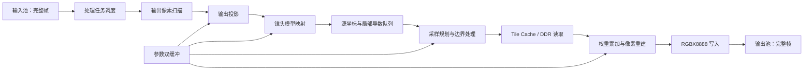

# 720p60 可扩展畸变矫正架构方案

日期：2026-10-21  
状态：设计方案；畸变矫正算法尚未按本文接入实物视频链路。

## 1. 目标与工程起点

基于盘古 200Pro+（PG2L200H）已有的 1280×720@60 Hz、RGBX8888、输入/输出三槽帧池视频链路，加入 FPGA 逐像素畸变矫正。当前镜头标称视角为 120°；架构应允许以后换为 150°、180°镜头，并允许替换插值方法。

本文以用户已完成视频流相关工作为工程前提。现有[主计划](720p60-distortion-correction.md)中的 Stage 3 进度描述较早，实际代码接入时应以当前已验收的视频工程和实测结果为准。保留当前可用位流作为回退版本，从其派生独立的算法工程。

基础版的成功条件：

1. 真实标定参数对应的 FPGA 源坐标与软件参考一致，图像矫正效果可比较。
2. 处理后的完整帧进入输出池；显示端不读取正在写入的帧。
3. 对运动画面测得持续处理帧率、处理延迟、DDR 等待、缓存未命中、丢帧、资源与时序；HDMI 60 Hz 刷新与每秒完成的不同处理帧数分开报告。
4. 后续更换镜头模型时保持帧池、DDR 仲裁和插值接口；更换插值时保持坐标映射接口。

## 2. 总体数据流

处理调度器在同一任务中取得一个完整的输入帧和一个空闲输出槽，锁定输入槽号、输出槽号、输入帧序号及参数版本。输出 921,600 个像素全部写入、写事务排空且没有协议错误后，才发布输出帧；失败时排空在途事务并中止输出槽。输入槽须等该帧所有已发读请求的返回数据排空、缓存不再引用该槽后释放。帧所有权和显示切换继续由当前双帧池管理逻辑负责。

坐标映射按**输出像素反查输入源坐标**。该方向与 OpenCV [`remap`](https://docs.opencv.org/4.13.0/da/d54/group__imgproc__transform.html) 的目标像素到源像素采样方式一致。

## 3. 固定的模块契约

接口采用 `valid/ready` 握手；在一次握手前，发送方保持载荷稳定。缓存未命中、DDR 仲裁和不同插值核均允许可变延迟。以输出像素序号关联请求和响应，首版按序处理及按序写回；以后若允许乱序返回，必须在写入前恢复原顺序。

| 边界 | 载荷与行为 | 可替换部分 |
| --- | --- | --- |
| 输出扫描 → 映射器 | 输出 `(u,v)`、像素序号、帧号、参数版本、帧首/行末标志 | 输出投影、镜头模型 |
| 映射器 → 采样规划器 | 源坐标 `sx/sy`、可选 `2×2` 局部雅可比矩阵 `J`、`J_valid`、几何有效标志及上述元数据 | Brown、鱼眼、坐标网格或其他映射实现 |
| 采样规划器 → 像素读取器 | 带像素序号的源像素采样请求；边界规则和本输出像素的采样结束标记 | Tile Cache、邻域调度、DDR 适配 |
| 像素读取器 → 重建核 | 对应采样点的 32 位 RGBX8888、有符号权重或权重索引、采样点有效状态、输出像素序号及结束标记 | 权重生成、累加、归一化与具体插值/滤波实现 |
| 重建核 → 写入器 | 32 位 RGBX8888、像素序号、像素有效标志、帧结束 | 最近邻、双线性、双三次、Lanczos、EWA 等 |

**像素公共格式：**沿用现有工程的 32 位 RGBX8888：`pixel[31:24]=R`、`pixel[23:16]=G`、`pixel[15:8]=B`、`pixel[7:0]=8'h00`。输入/输出帧池、DDR 像素、Tile Cache、像素读取响应及重建核外部接口均按 32 位传输。插值算术仅处理 R/G/B 三个 8 位通道，结果统一封装为 `{R,G,B,8'h00}`；低 8 位目前不是 Alpha。若将来需要 Alpha，应单独定义该通道的插值与边界规则。

**源坐标公共格式：**建议使用有符号 32 位 `Q16.16` 像素坐标，输入图像左上像素中心为 `(0,0)`，整数部分使用数学上的 `floor`，低 16 位表示非负小数部分。该格式是模块边界，不限制 Brown 或鱼眼模型内部使用更宽的角度、半径和乘法格式。映射溢出、几何不可达和无穷远方向应显式置无效标志，不能静默饱和后继续取样。

**局部导数扩展：**`J = ∂(sx,sy)/∂(u,v)` 描述相邻输出像素在源图上的位移，是 EWA 等方向相关抗混叠方法估计椭圆采样足迹的输入。现在先固定接口格式：四个元素 `∂sx/∂u`、`∂sx/∂v`、`∂sy/∂u`、`∂sy/∂v` 均用有符号 32 位 `Q16.16`，单位为源像素/输出像素，另带 `J_valid`。该范围约为 ±32768，足以覆盖由两个有效、图内的 720p 源坐标作相邻差分所得的分量；并不保证奇异点附近的解析导数都可表示。模型内部可用更宽位宽，接口转换时若溢出、非有限或导数不可用，必须清除 `J_valid`，不得静默截断。基础版可固定 `J_valid=0`，不要求旧 Brown 核立即计算导数；选择 EWA 等依赖导数的模式时，必须由映射器解析求导或专用差分级提供有效 `J`。真实标定和输出投影确定后仍需检查导数分布、椭圆足迹、采样点上限与资源/带宽，但不以标定作为确定该接口位宽的前置条件。四个 32 位元素合计增加 128 位元数据，首版不使用导数的实现可通过编译参数省略这部分队列存储，保持上述逻辑接口语义。

**坐标队列：**旧优化核心是固定流水线、不能在任意级直接反压。其输入准入必须预留所有在途结果的队列位置；模型切换、复位和帧中止时应冲刷队列并丢弃旧版本结果。帧号、像素序号和参数版本与坐标一起传递，不依赖固定延迟对齐。

**边界规则：**边界处理位于取样器，对邻域中的每个采样点分别执行。首版支持常量黑色和复制边缘；两种模式均应与软件参考使用相同规则。源坐标稍微越界但部分邻域仍在图内时，常量黑色模式应按权重混合有效像素与黑色，而非整像素直接变黑。另设几何无效掩码，用于输出投影无定义或源图完全不可达的区域。

## 4. 镜头模型与输出投影

镜头标称视角、真实成像投影和输出希望保留的视野是三个不同参数。模型由实拍标定和未参与标定的图像决定，不能只凭“120°/150°/180°”选择系数。

| 阶段 | 镜头模型候选 | 输出投影与注意点 |
| --- | --- | --- |
| 当前 120° | 先评估旧 `k1/k2/p1/p2` Brown 模型；若边缘拟合不达标，评估鱼眼模型 | 先做可控视野裁剪的透视输出；记录视野损失 |
| 后续 150° | 对比 Brown 与角度形式的鱼眼模型，重点检查边缘和映射单调性 | 透视输出仍可选择，但保留视野越大，边缘拉伸与无效区域越明显 |
| 后续 180° | 使用能处理接近 90°离轴光线的鱼眼映射；在光轴附近和视野边界验证数值稳定性 | 若需展示接近完整半球视野，提供等距或全景类输出；有限尺寸的单张透视平面无法正常容纳完整 180° |

输出投影负责把 `(u,v)` 变为相机方向或模型所需的无畸变坐标；镜头模型负责把该方向变为输入图像 `(sx,sy)`。参数中必须区分输入镜头标定矩阵 `K_in` 与输出虚拟相机矩阵或投影参数 `K_out/P_out`：输出裁剪、缩放或改变视角后，它们通常不同。旧 Brown 核心在归一化和还原源坐标时复用了同一组 `fx/fy/cx/cy`，因此移植时需拆成输出侧和输入侧两组参数，或将其多项式中段抽出接在独立的输出投影与输入投影之间；不能仅给旧核心增加一个模型选择位。鱼眼适配器按其自身角度与系数计算，参数字段和定点范围独立定义。OpenCV [fisheye 模型与校正映射接口](https://docs.opencv.org/4.13.0/db/d58/group__calib3d__fisheye.html)可用于软件对照；鱼眼系数不能直接写入 Brown 核心。

旧优化核心的归一化坐标、平方项和 `r²` 使用 `S20.Q18`，约在 2 处饱和。接入当前 120°配置之前，应扫描整个目标输出区域的最大中间值；若越界，扩大内部位宽或收窄输出视野，并同步更新位精确模型与时序预算。增加 `k3` 只能提高某类多项式拟合能力，不能替代投影模型选择。

**可选的映射网格：**若将来解析式鱼眼映射的乘法、`atan2` 或时序成本过高，可增加按网格存储源坐标、在 FPGA 内插值生成逐像素坐标的映射器。它仍遵守同一源坐标接口。网格间距必须根据边缘最大坐标误差实测选择；全帧坐标表会增加 DDR 带宽，不能在没有吞吐测量时作为默认方案。

## 5. 插值、抗混叠与像素获取

除了双三次，还有 Lanczos、区域重采样，以及用户提到的**椭圆加权平均（Elliptical Weighted Average，EWA）**。最近邻、双线性和双三次主要描述像素重建核；EWA 依据映射的局部变化方向和缩放比例，使用源图中的椭圆采样区域进行方向相关的过滤，对局部缩小时的混叠更有针对性。EWA 的椭圆由逆向映射的局部雅可比矩阵决定；这一关系见 [Heckbert 的图像映射与 EWA 研究](https://www2.eecs.berkeley.edu/Pubs/TechRpts/1989/5504.html)。

为容纳固定和可变大小的采样区域，把旧实现中绑定的四点取数与双线性运算拆成三层：

1. **采样规划器：**依据 `sx/sy`、插值模式及可选 `J`，产生一个输出像素所需的源像素位置与权重。最近邻/双线性可走一次返回 `1×1`/`2×2` 的快速路径；通用路径逐批产生采样点。
2. **像素读取器：**处理逐点边界规则、去重、Tile Cache 查询及 DDR 填充；其结果携带像素序号、权重和最后一个采样点标志。切换采样核不直接修改板级 DDR 地址协议。
3. **重建核：**按照该像素的采样点，对 R/G/B 三个通道分别做有符号累加、归一化、舍入与饱和，输出一个 32 位 RGBX8888 像素，低 8 位填零。双三次和 Lanczos 可能出现负权重；累加器宽度必须依据最大采样点数与权重范围确定。重建核不感知镜头系数和物理帧槽地址。

| 方法 | 每个输出像素的典型采样需求 | 建议实施阶段与限制 |
| --- | --- | --- |
| 最近邻 | 1 点 | 首版调试和像素序号核对；可在帧边界切换 |
| 双线性 | `2×2`，4 点 | 首版主路径；复用旧四邻域 Tile Cache 与双线性核 |
| 双三次 | `4×4`，16 点 | 后续评估画质与吞吐；可多周期收集或增加 Bank 并行度 |
| Lanczos-4 | `8×8`，64 点 | 高采样量的可选质量模式；应先评估截断、振铃、缓存和带宽成本。OpenCV 将 `INTER_LANCZOS4` 定义为 `8×8` 邻域，[见其插值文档](https://docs.opencv.org/4.13.0/da/d54/group__imgproc__transform.html) |
| 面积/多点抗混叠 | 随局部缩小比例变化 | 可先用有上限的多点采样或预滤波图层；OpenCV `remap` 不支持直接使用 `INTER_AREA`，需单独制作同算法的软件参考 |
| EWA | 椭圆内可变数量的采样点，需要有效 `J` | 长期升级项；椭圆权重查表、采样点上限与图像金字塔或其他预滤波方案须联合设计，不能假定旧 `2×2` 缓存足够 |

EWA 的采样区域可能远大于 `4×4`。如果直接限制采样点数量，必须在图像误差与抗混叠效果中记录该近似；更稳妥的高缩小倍率方案可能需要预滤波图层或图像金字塔，以及相应的帧存储和 DDR 带宽。基础版只固定**采样任务与逐点响应协议**，不预留一条昂贵的 64 点或可变点数并行数据总线。运行时只能选择当前位流实际编入的模式；不支持的模式或缺少有效 `J` 的 EWA 请求应明确拒绝。

软件对照应按算法分开：OpenCV `remap` 可用于最近邻、双线性、双三次和 Lanczos；EWA 与面积方案需要与硬件同权重、同边界、同预滤波规则的独立软件参考。对高阶核同时观察锐度、混叠、振铃及边缘有效区域，不能只用逐像素均方误差判定画质。

## 6. 现有代码迁移边界

旧工程位于仓库外的 `../../Pango_Micro_FPGA_Old/Distortion-correction/`。逐模块按需迁入当前仓库的 `fpga/rtl/correction/`、`fpga/rtl/memory/` 等目录，记录来源与修改；旧板卡 PDS、IP 和约束不迁入。

| 模块 | 用法与必要改造 |
| --- | --- |
| `rtl/algorithm/distortion/distortion_core_optimized.sv` | 以旧流水线为起点实现 `brown_mapper`；拆分 `K_out` 归一化与 `K_in` 源坐标投影，审查真实参数范围、饱和、舍入及帧级参数锁定 |
| `coordinate_gen.sv`、`coordinate_split.sv` | 作为输出像素扫描与坐标拆分的起点；统一公共 `Q16.16` 坐标及元数据 |
| `distortion_image_pipeline.sv`、`coordinate_fifo.sv` | 复用流水线准入和队列思路；将映射、取样与插值拆成独立边界。原包装默认 `USE_OPTIMIZED_CORE=0`、`USE_TILE_CACHE=0`，新工程必须显式指定实现 |
| `cached_pixel_fetch_engine.sv`、`pixel_tile_cache.sv`、`ddr_burst_reader.sv`、`tile_cache_bank_ram.sv` | 首版提供 `2×2` 快速路径；输出四点和元数据，解除与旧双线性核的直接绑定；对更大或可变足迹另加逐点/逐批采样调度，按 PG2L200H 资源重设缓存组数和路数 |
| `bilinear_interp.sv` | 包装为独立插值核；补齐队列与 `valid/ready` 适配。若旧核采用 24 位 RGB 端口，只在包装器内部取 32 位像素的 `[31:8]` 参与计算，按 R/G/B 各 8 位舍入及饱和，再封装为 `{R,G,B,8'h00}`；公共接口保持 32 位 RGBX8888 |
| `software/bitaccurate_distortion.py`、`software/cache_model.py` 及相关仿真 | 迁移为定点参考与缓存行为参考；重新生成 720p60、真实参数和边界用例 |

当前工程的 `frame_pool_address.v` 和 DDR 仲裁器采用 **32 位字地址**；旧 Tile Cache 读取路径使用**字节地址**。仅在板级缓存适配器中做地址单位转换，并检查帧槽基址、256 位数据拍内的 8 个 RGBX8888 像素顺序、字节序及突发对齐。帧切换时按输入槽和帧序号失效缓存，防止命中上一帧的同地址像素。当前 Pango DDR IP 的读返回不能随意反压，发读命令前仍须为完整突发预留接收空间。

## 7. 参数管理与故障处理

定义带协议版本、模型 ID、插值 ID、输入/输出尺寸、`K_in`、`K_out/P_out`、ROI、边界模式、模型专用参数和 CRC 的参数包。接收端检查范围与当前位流能力，完整写入备用参数组；仅在新处理帧开始时原子切换，并将参数版本写入该帧的诊断元数据。参数包错误时继续使用上一组已验证参数。

保留原样复制处理器作为独立模式，用于回退和带宽对照。发生映射溢出、队列溢出、缓存协议故障、处理超时或输出写错误时，记录错误及帧号，中止当前输出帧，显示端继续使用上一完整帧；不能发布半帧。

## 8. 性能预算

720p60 每帧为 921,600 个有效像素，帧周期约 16.67 ms，有效输出速率为 55.296 Mpixel/s。若算法时钟为 125 MHz，平均预算约 **2.26 时钟/输出像素**，其中包括缓存未命中和等待。是否达到目标以完整帧处理周期和持续实测为准。

RGBX8888 单条 720p60 视频流有效载荷约 221.184 MB/s。采集写、结果写、显示读三条整帧流合计约 **663.552 MB/s**。若源图读取平均相当于每个输出像素再取一次，则四项合计约 **884.736 MB/s**；实际源图 DDR 读取量取决于映射、缓存复用和重复填充，可能低于或高于这一参考值，DDR 刷新与仲裁还会降低可用吞吐。现有复制路径接近 60 fps 的读数不能直接证明新算法有足够余量。至少记录：处理帧数、每帧周期最大值、输入/输出丢帧、缓存命中及未命中、DDR 等待、FIFO 水位、读写协议错误和输出欠读。

## 9. 实施顺序与阶段验收

1. **接口及软件参考：**确定像素中心、坐标舍入、负坐标拆分、边界模式、RGB 顺序、独立的输入/输出内参与输出投影、参数格式；生成浮点参考、位精确参考、源坐标图及有效区域掩码。首个代码里程碑只建立公共映射接口、单位映射器和对应的软件坐标参考，使后续 Brown 与鱼眼均有可替换的接入点。
2. **单位映射闭环：**新处理器经过坐标队列、邻域读取、插值和输出帧池，输出图与同帧输入一致；验证首末像素、首末行、帧号及缓存失效。
3. **120°真实参数：**实拍标定并比较 Brown 与鱼眼模型在未参与标定图上的中心、边缘误差和直线残差；选择达标模型，记录输出保留视野及无效区域。用定点参考检查整帧源坐标和 RGB 输出。
4. **720p60整机：**从静态棋盘格、直线图、运动格到一般场景上板；记录持续运行的处理帧率、最坏帧周期、错误计数、资源和时序。若不足，先据缓存未命中、DDR 等待和流水线停顿数据定位瓶颈，再改缓存或时钟。
5. **150°/180°与其他采样核：**每次换镜头重新标定并选择模型及输出投影；按双三次、Lanczos、EWA 的顺序评估新增采样量、局部导数、抗混叠效果、缓存与持续处理帧率。单独保存每种配置的软件参数、位流版本和结果。

本方案的长期稳定边界是：**源坐标与可选局部导数、可变数量的采样任务、帧级参数版本和完整帧发布契约**。镜头模型与采样核可以分别演进；缓存组织、DDR 带宽、内部位宽和时序仍须随实际模型与采样核重新测量。
