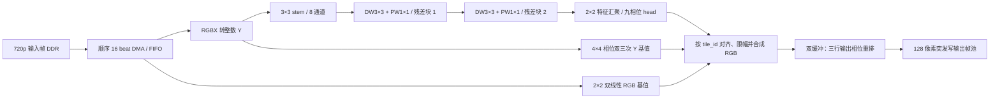

# Stage12 真正流式 CNN 超分辨率实施计划

> 本计划是供用户审阅的实施蓝图。项目建立、RTL 修改和位流构建在计划确认后进行；既有 Stage12 位流及其工程作为回退基线。

**目标：**在盘古 200Pro+（PG2L200H）上实现真正使用已训练卷积权重的 720p→1080p 单帧超分，1080p60 HDMI 扫描，每秒至少产生 30 张新的 CNN 处理帧；运动视频画质明显优于现有 2×2 相位滤波器。

**独立工程：**`fpga/project/stage12_1080p60_true_cnn_sr_test/`。从已上板成功的 `stage12_1080p60_cnn_sr_test` 提取源 RTL、IP、约束、PDS 配置、调试模板和仿真脚本，不复制旧 `.sbit/.fic`、综合/布局布线结果，也不修改原工程。

**依据：**现有多场景 8 通道 PyTorch 模型是 3×3 stem、两个 3×3 depthwise + 1×1 pointwise 残差块、2×2 特征汇聚和九相位输出头。当前 `bicubic_residual_multiscene_int8_experimental.json` 只量化权重，偏置和激活仍是浮点，不能直接进 RTL。完整 CNN 在独立庭院视频上比双三次高约 0.27 dB；首版 2×2 相位滤波器在 20 帧抽样上仅比双线性高约 0.07 dB。两个评估的抽样/颜色路径不同，正式门槛需用同一部署评估脚本重测。

## 1. 硬件架构与选择

可选方案如下：

| 方案 | 优点 | 问题 | 决定 |
| --- | --- | --- | --- |
| 每层特征图写入 DDR，再读回下一层 | RTL 控制较直观 | 多次整帧往返增加 DDR 带宽和延迟，与 30 fps 目标冲突 | 不采用 |
| 低分辨率域逐层行缓存、源帧只读一次 | 保持顺序 DMA；卷积、双三次基值和输出写入可重叠 | 需要准确处理层间反压、边界、特征对齐和输出相位重排 | **采用** |
| 多帧运动补偿超分 | 有机会恢复跨帧真实亚像素信息 | 运动估计、遮挡和重影使资源与验证风险显著增加 | 留作后续独立研究 |

RGBX 输入为 1280×720、8 位/色；HDMI 输出保持 1920×1080@60 Hz。前端使用整数亮度 `Y=(77R+150G+29B+128)>>8`。为避免整套 YCrCb 色度往返，先用现有 2×2 RGB 双线性值作为色彩基底，再将 `ΔY=双三次 Y−双线性 Y+CNN 残差` 等量加到 R/G/B，逐通道饱和到 0–255，输出低字节固定为 0。Python 部署参考必须采用完全相同的颜色、边界、舍入和限幅规则；如果它相对当前浮点参考明显掉质，先调整训练/数值设计再冻结硬件。

三层 3×3 卷积使单个 LR 特征具有 7×7 感受野；九相位 head 还汇聚相邻 2×2 特征，所以一个输出 tile 的输入联合范围最大约 **8×8 LR 像素**。这要求逐层行缓存，不能沿用 Stage12 每个输出只返回 2×2 RGB 的查询接口。源流按 raster 顺序读一遍；stem 和两个 depthwise 层各保存上两行，phase head 保存相邻特征行；基值支路保存足够的 Y/RGB 行。每组 2×2 LR 输入产生 3×3 HR tile，写入两组交替使用的三行 RGBX 缓冲，再按完整 1920 像素行顺序输出。帧号、tile 序号、行边界和 `valid/ready` 随数据传递，连接点核对序号；帧启动清理行标签和缓冲所有权。

## 2. 定点与可复现模型

1. 冻结训练/验证/测试清单和模型哈希。从现有五段训练视频中移出街道视频，以其余四段重新训练；云层视频用于验证，庭院与街道视频只在最终测试使用。相邻帧不能跨训练/测试集合。
2. 为每层校准激活范围：输入 Y 为 unsigned 8 位；卷积权重为 signed 8 位、按输出通道缩放；特征激活为 signed 8 位；偏置和 MAC 累加器为 signed 32 位。残差跳接先在扩展位宽中对齐尺度并相加，再 ReLU/限幅。每层采用写入 manifest 的整数乘数与右移位数做 requant，舍入规则在 Python 和 RTL 中固定一致。
3. 九相位 head 输出带符号亮度残差，并限制在 ±24。双三次基值用三种横向/纵向相位的固定系数、4×4 边界复制窗口和定点运算实现；其单相位系数和、舍入、输出裁剪规则由 Python bit-exact reference 固定。
4. 新建完整部署包：权重、int32 偏置、每层输入/输出尺度、requant 乘数/移位、激活限幅、双三次相位表、颜色公式和 SHA-256。现有权重 JSON 只能作为训练来源，不能冒充 FPGA 定点包。导出脚本同时生成 RTL ROM/`mem` 文件与可用于 ModelSim 的 golden vectors。
5. 在 RTL 开工前，用部署参考重测完整庭院片段和退训后的街道片段；若定点比浮点模型下降超过 0.15 dB Y-PSNR，先做量化感知微调或修改定点尺度。所有后续 RTL 像素比较以这一版整数参考为准。

## 3. 吞吐与资源预算

当前 8 通道模型约 **416 MAC/LR 像素**、约 **3.83 亿 MAC/帧**；30 fps 约需 **115 亿 MAC/s**。125 MHz 时，单帧上限为 **4,166,666 个周期**。以平均每 3 周期接收 1 个 LR 像素为初版调度目标，纯计算下限为 **2,764,800 周期/帧**；三行输出缓冲每组需要写 640 个 tile、读 5,760 个 HR 像素，双缓冲使读写重叠。剩余约 140 万周期要覆盖行首填充、DDR 仲裁、帧排空和反压；这只是设计预算，不是已验证帧率。

按逐层独立流水粗算，stem 需要约 24 条 8 位乘加 lane；两个 depthwise 层各约 24 条、两个 pointwise 层各约 22 条；九相位 head 约 24 条，合计约 **140 条理论并行 MAC lane**。初始实现预留约 160–200 个 APM 的上限，必要时调整调度和并行度。PG2L200H 本地 PDS 报告资源总量为 740 APM、415 DRM、159,800 LUT；当前已上板的 Stage12 候选使用 14 APM、22 DRM、8,762 LUT。APM 是算术资源、DRM 是片上存储资源，不能互换计数。逐层行缓存、基值窗口和双缓冲输出的逻辑存储需求约 1 Mbit 量级，实际 DRM 数由存储体端口、位宽与 PDS 映射决定。

孤立 CNN 工程的初版资源审查线：不超过 **220 APM、120 DRM、40,000 LUT**，125 MHz/148.5 MHz 时钟全部 `All Constraints Met`，主要处理域 WNS ≥ +0.2 ns。该线是为后续畸变校正保留空间的工程门槛，不是板卡可用资源的保证；若超限，先减少并行空转、压缩特征缓冲或重调度，不默默降低画质。畸变校正与 CNN 的联合版本在孤立 CNN 通过后作为单独阶段测量；现有“畸变约用 20% 资源”不能直接推算两者叠加的时序与 DDR 吞吐。

## 4. 任务拆分与文件边界

### 任务 A：建立独立可回退工程

- 新建 `fpga/project/stage12_1080p60_true_cnn_sr_test/`，复制 Stage12 已上板候选的源码、IP、引脚/时钟约束、PDS 源列表、调试模板、构建和仿真脚本；保持 Stage12 原文件和已有 `.sbit/.fic` 不变。
- 在新工程 `README.md` 写明源工程、输入/输出格式、工程版本、尚未接入 CNN 时的状态；PDS 首次编译先验证副本可独立构建。新增源帧启动门控及引用计数修复必须保留。
- 验收：新工程复制后产生与 Stage12 同功能的独立构建报告；构建产物路径在新工程中，不引用旧 bitstream。

### 任务 B：冻结整数部署参考与画质门槛

- 修改 `host/super_resolution/fixed_point_reference.py` 为真正逐层整数推理；新增 `deploy_manifest.py` 和 `export_rtl_weights.py`，输出 manifest、ROM 文件和 golden vectors；修正 `README.md` 中“未训练”和“每张量缩放”等过时描述。
- 完整评估使用固定帧清单、相同色彩路径和同一指标脚本。记录当前相位滤波器、双三次、浮点 CNN、部署整数 CNN 的逐帧 Y-PSNR、SSIM、时间误差和 A/B 截图。
- 画质目标：两段独立测试片段上，整数 CNN 比当前相位滤波器至少高 **1.5 dB Y-PSNR**；两片段平均比双三次至少高 **0.2 dB**，任一片段不低于双三次超过 0.1 dB；运动纹理无明显新增闪烁/伪纹理。若不满足，先重训或量化感知微调；10 通道版本只在重新核算 MAC 与资源后考虑。

### 任务 C：建立像素流和窗口

- 新建 `source/rtl/sr/sr_source_dma.sv`：顺序 16-beat DDR 读取、RGBX 像素解包、帧序号和行列标记、输入 FIFO/反压。
- 新建 `sr_luma_frontend.sv`、`sr_window3x3.sv`、`sr_feature_linebuffer.sv`：亮度和 3×3 层输入窗口，行边界复制，不跨帧使用旧特征。各模块接口约定 `valid/ready`、`frame_id`、`x/y` 或 `tile_id`，不能仅靠固定延迟对齐。
- 验收：ModelSim 覆盖首末像素、行切换、突发延迟、随机反压、连续两帧；源 DDR 地址不越界且每帧恰好读 720 行。

### 任务 D：实现三层特征卷积和残差块

- 新建 `sr_stem3x3.sv`、`sr_depthwise3x3.sv`、`sr_pointwise1x1.sv`、`sr_requant_relu.sv`；实例化 8 通道 stem 和两个 depthwise/pointwise 残差块。物理 MAC lane 数按任务 B 的量化配置和 3 周期/像素调度生成，不依赖运行时可变权重加载。
- 每层先用小尺寸 golden tensor 对比 Python 整数参考，逐项覆盖 int32 偏置、乘加符号、舍入、饱和、ReLU、skip 尺度对齐及停顿恢复。
- 验收：每层 bit-exact；随机反压前后的输出序列逐元素相同。

### 任务 E：九相位 head、双三次基值和颜色合成

- 新建 `sr_phase_head_3x2.sv`、`sr_bicubic_y_3x2.sv`、`sr_bilinear_rgb_3x2.sv`、`sr_tile_join.sv`、`sr_phase_reorder.sv`。
- 九相位顺序固定为输出 tile 的 row-major 3×3；`tile_id`/`frame_id` 在三条支路汇合时必须一致。两个三行输出 bank 交替填充/读取，读完才释放；帧尾输出像素 ID 为 2,073,599。
- 验收：边界、平坦区、单像素脉冲、棋盘格、渐变及真实视频抽样与 Python 部署参考匹配；所有输出 RGBX 低字节为 0，整帧输出恰好 2,073,600 像素。

### 任务 F：接入帧池并做整帧压力仿真

- 新建 `frame_cnn_transform_engine.sv`，在新工程 `fram_buf.v` 接入，保留现有输入/输出槽租约、DDR 仲裁和 1080p60 HDMI 扫描。增加 `cnn_frame_complete_count`、`cnn_last_frame_cycles`、行缓存溢出/对齐错误计数到 Fabric Debugger `.fic`。
- 运行完整一帧和连续两帧仿真，检查 7,200 个输入 16-beat 突发、16,200 个输出 128 像素突发、帧序、写入排空及随机 DDR 延迟。目标在带保守 DDR 停顿模型时仍 ≤ 4,166,666 周期/帧；理想模型只作调试下界。
- 验收：无丢/重像素、无行缓存死锁、帧间不串扰；RTL 与 Python 整数参考的图像差异为 0 或仅限事先定义的双三次系数量化容差。

### 任务 G：PDS、上板和画质 A/B

- 更新新工程 `.pds` 源列表、构建脚本与调试模板，完整跑 PDS 2022.2-SP6.4；保存综合/布局布线资源、各时钟 WNS/TNS、`.sbit/.fic` SHA-256 和对应模型 manifest SHA-256。任何时序失败或资源超线都要回到调度或缓存结构，不把失败位流提供上板。
- 上板用相同的 720p60 动态输入，在至少三段各 60 秒窗口读取输入发布、CNN 完成、显示取新帧计数；要求 CNN 完成和显示取新帧均 ≥ 30 fps，HDMI 输出仍 1080p60，无黑屏/周期性停顿。按同一运动视频与现有 Stage12 位流 A/B 检查棋盘、树叶、文字、低照度和快速运动。
- 记录结果到 `docs/results/stage13-true-cnn-sr.md` 并更新 `docs/chat/super-resolution.md`。若画质门槛或板上帧率失败，保留可上板的 Stage12 工程，并明确报告失败项及下一步瓶颈，不将候选称为完成。

## 5. 交付物与阶段顺序

按 **A→B→C→D→E→F→G** 顺序推进。B 的真实整数画质通过后冻结权重和定点格式；C–E 每层有可复现的 golden vector；F 证明整帧功能和周期预算；G 才提供真正 CNN 的 `.sbit/.fic`。独立工程 `README.md`、部署 manifest、逐层仿真日志、PDS 报告和板测计数共同组成可审查交付物。下一阶段再基于已验收的 CNN 工程与约 20% 资源的畸变矫正合并，单独验证联合时序、DDR 竞争和画质。
